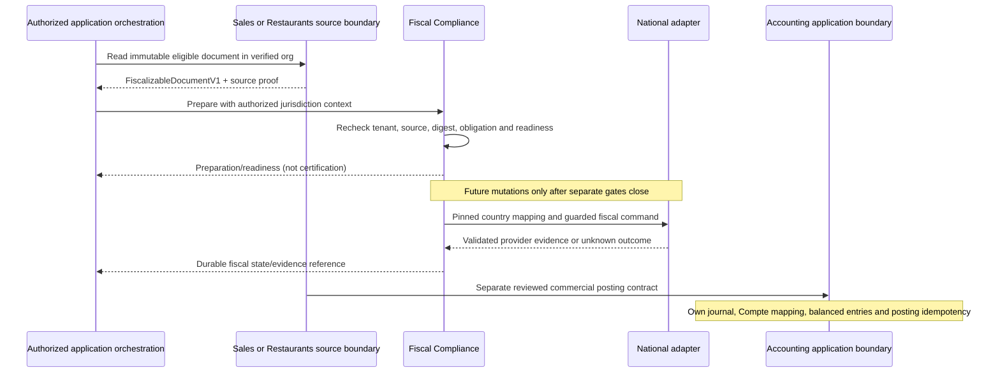

# S4C-1 — FiscalizableDocument V1 design

2026-11-04. Status: **ACCEPTED — ARCHITECTURE BASELINE**. **IMPLEMENTATION BLOCKERS OPEN**. Documentation only; no runtime implementation is authorized.

Classification: `ERP_DOMAIN`; owner: Fiscal Compliance, a shared business capability consumed by products. This document proposes a source-document boundary, not a new service or product. It does not close the existing S4C-1 connector gates. S4C-0B2 remains accepted at commit `7be59201b15252d5cdaa00997bc24b874930583f`.

## 1. Current evidence and compatibility

| Existing component                                                                | Current behavior                                                                                                                                      | Consequence for V1                                                                                                                  |
| --------------------------------------------------------------------------------- | ----------------------------------------------------------------------------------------------------------------------------------------------------- | ----------------------------------------------------------------------------------------------------------------------------------- |
| `packages/shared/src/sales/sales-fiscalizable-document.ts`                        | SALES-owned protocol 1; issued invoice/credit, org/id/version/digest, commercial number, buyer snapshot, decimal quantity/HT price, minor-unit totals | Preserve this contract and its digest. Adapt through the SALES application boundary; do not rename it in place.                     |
| `packages/backend/lambda/domains/sales/references/sales-fiscal-source-service.ts` | Reads only SALES-owned repositories, rejects non-ISSUED sources, freezes ordered facts and hashes them                                                | Reuse the boundary; Fiscal never reads SALES repositories.                                                                          |
| `packages/backend/lambda/domains/fiscal-compliance/core/fiscal-service.ts`        | Directly consumes the SALES contract; local preparation/revision, immutable history, no remote mutations                                              | Future replacement needs an explicit producer boundary, not a cross-domain repository import.                                       |
| `packages/shared/src/restaurants/invoices.ts`, `receipts.ts`, `credit-notes.ts`   | Canonical Invoice aliases legacy receipt; FINAL publication and digest chain prove availability; paginated parts; immutable VALIDATED credits         | Assemble and verify every part through a Restaurants-owned application service. A payment or partial page is insufficient evidence. |
| `packages/backend/docs/restaurants-commercial-documents.md`                       | Order, Payment, Invoice, CreditNote and Refund are distinct; proposed integration events are conceptual                                               | Invoice/credit facts are fiscalization sources; settlement facts do not create another source.                                      |
| Fiscal provider adapter                                                           | Benin TEST status read only, accepted in S4C-0B2                                                                                                      | No invoice mapping, submission or finalization follows from connectivity.                                                           |
| Fiscal KeyFactory and authorization                                               | Keys include org/BJ/provider/environment/type/id, but no source domain; all ten fiscal routes require SALES plus fiscal permission                    | Domain-aware identity and cross-product authorization are future prerequisites. No key or permission changes are authorized here.   |

This proposal is additive. Existing S4B snapshots, commands, provider spelling `BENIN_E_MECEF`, protocol-1 digests, commercial routes and document identities remain authoritative. No backfill, source rehash or migration is performed. The historical S4C validation plan's production/credential/mutation gates remain open.

## 2. Contract scope and ownership

`FiscalizableDocumentV1` carries immutable commercial evidence eligible for fiscal preparation. It is not proof of legal eligibility, certification, payment or accounting posting. Fiscal Compliance owns the exchange contract; the originating domain owns the commercial facts and their correctness. A future frontend-safe schema must be separately reviewed; this proposal describes backend-to-backend data only.

Generic fields describe facts: source, parties, commercial type, date, currency, prices, discounts, taxes and totals. Jurisdiction selection, taxpayer regime, obligation/exemption evidence, national document codes, provider tax groups, operator declarations, provider payment codes, credentials and final fiscal numbering belong to a separate versioned fiscal preparation. National adapters own wire DTOs, numeric representability, request mapping and provider evidence.

No token, secret alias, provider UID, QR, national security code, account number, PK/SK/GSI or arbitrary extension payload belongs to this contract.

## 3. Proposed TypeScript examples (documentation only)

Every nested value is immutable by contract. TypeScript `readonly` is illustrative; future validators and durable snapshots must enforce this at runtime.

```ts
type Decimal = string; // canonical unsigned base-10 decimal
type Minor = string; // canonical unsigned integer, smallest currency unit
type Sha256 = string; // 64 lowercase hex characters
type Domain = "SALES" | "RESTAURANTS"; // extend only by reviewed contract change

interface SourceIdentityV1 {
  readonly domain: Domain;
  readonly documentType: "INVOICE" | "CREDIT_NOTE";
  readonly documentId: string;
}

interface PartyIdentifierV1 {
  readonly scheme: string; // reviewed identifier scheme, or UNCLASSIFIED
  readonly issuingCountry?: string; // ISO 3166-1 alpha-2
  readonly value: string;
}

interface PartySnapshotV1 {
  readonly name?: string;
  readonly country?: string;
  readonly address?: {
    readonly lines: readonly string[];
    readonly city?: string;
    readonly postalCode?: string;
  };
  readonly identifiers: readonly PartyIdentifierV1[];
}

interface CommercialTaxV1 {
  readonly taxId: string; // document-local component identity
  readonly kind: "VAT" | "OTHER";
  readonly label: string;
  readonly ratePercent?: Decimal;
  readonly basisMinor: Minor;
  readonly amountMinor: Minor;
  readonly effect: "ADDED_TO_NET"; // V1 supported arithmetic only
}

interface FiscalizableLineV1 {
  readonly lineId: string;
  readonly sourceCoordinates: readonly {
    readonly sourceLineId: string;
    readonly orderId?: string;
    readonly itemId?: string;
    readonly partNumber?: number;
    readonly position?: number;
  }[]; // nonempty, resolved against verified immutable source evidence
  readonly lineKind: "ITEM" | "SERVICE_CHARGE";
  readonly fiscalTreatmentEvidence: {
    readonly reference: string;
    readonly version: string;
  }; // restricted evidence reference, not a provider group or exemption claim
  readonly zeroPriceJustification?: string;
  readonly position: number;
  readonly description: string;
  readonly unit?: string;
  readonly quantity: Decimal;
  readonly unitPrice: Decimal; // major currency units, before discounts
  readonly priceBasis: "EXCLUDING_TAX" | "INCLUDING_TAX";
  readonly discount: {
    readonly basis: "EXCLUDING_TAX" | "INCLUDING_TAX";
    readonly amountMinor: Minor; // allocated authoritative amount
    readonly ratePercent?: Decimal; // explanatory, never a second deduction
  };
  readonly netMinor: Minor; // after discount, excluding added taxes
  readonly taxes: readonly CommercialTaxV1[];
  readonly totalMinor: Minor;
  readonly originalLineId?: string; // required for a credit line
}

interface FiscalizableDocumentBaseV1 {
  readonly schemaVersion: 1;
  readonly orgId: string;
  readonly source: SourceIdentityV1;
  readonly sourceRevision: string; // opaque stable source version/proof reference
  readonly sourceProof: {
    readonly algorithm: string; // versioned producer digest/manifest algorithm
    readonly digest: Sha256;
  };
  readonly projectionVersion: string; // producer mapping version, pinned
  readonly projectionRevision: number; // explicit immutable projection revision
  readonly projectionEvidenceDigest: Sha256; // source-coordinate/exclusion/allocation evidence
  readonly canonicalizationProfile: "LIASS-FISCAL-C14N-1";
  readonly snapshotDigest: Sha256; // shared canonicalization below
  readonly commercialNumber?: string; // absent means absent, never invented
  readonly issuedAt: string; // UTC RFC3339 instant
  readonly issueDate: string; // validated calendar YYYY-MM-DD
  readonly issueTimezone: string; // validated IANA business timezone
  readonly issuanceEvidence: {
    readonly event:
      | "SALES_ISSUED"
      | "RESTAURANT_INVOICE_FINAL"
      | "CREDIT_VALIDATED";
    readonly reference: string;
    readonly digest: Sha256;
    readonly timezoneSourceReference: string;
  };
  readonly currency: { readonly code: string; readonly minorUnitScale: number };
  readonly seller: PartySnapshotV1 & { readonly name: string };
  readonly sellerProvenance: {
    readonly identityReference: string;
    readonly identityVersion: string;
    readonly identityDigest: Sha256;
    readonly capturedAt: string;
    readonly issuanceEventReference: string;
  };
  readonly buyer: {
    readonly kind: "IDENTIFIED" | "UNIDENTIFIED";
    readonly party?: PartySnapshotV1;
  };
  readonly calculationPolicy: {
    readonly id: string;
    readonly version: string;
    readonly definitionDigest: Sha256;
    readonly rounding: "HALF_UP" | "HALF_EVEN" | "EXACT";
    readonly scope: "LINE" | "DOCUMENT_ALLOCATED_TO_LINES";
  };
  readonly lines: readonly FiscalizableLineV1[];
  readonly totals: {
    readonly netMinor: Minor;
    readonly taxMinor: Minor;
    readonly totalMinor: Minor;
  };
}

type FiscalizableDocumentV1 =
  | (FiscalizableDocumentBaseV1 & {
      readonly kind: "INVOICE";
      readonly original?: never;
    })
  | (FiscalizableDocumentBaseV1 & {
      readonly kind: "CREDIT_NOTE";
      readonly original: {
        readonly source: SourceIdentityV1;
        readonly sourceProof: {
          readonly algorithm: string;
          readonly digest: Sha256;
        };
      };
      readonly reason: string;
    });
```

`source.documentType` must equal `kind`; original source must be an INVOICE in the same tenant/domain and currency. Credits use positive magnitudes and explicit type; no negative-price shortcut. A credit identifies original lines and cannot exceed remaining commercial quantity/amount; the producer enforces cumulative credits atomically. Fiscal Compliance independently checks fiscal original eligibility in the selected jurisdiction/provider/environment. A Refund is not a CreditNote.

## 4. Field responsibility and validation

| Fields                                   | Fact owner / producer                                               | Fiscal Compliance responsibility                                                                                                                      |
| ---------------------------------------- | ------------------------------------------------------------------- | ----------------------------------------------------------------------------------------------------------------------------------------------------- |
| org, source, revision, proof             | Verified source-domain application boundary                         | Compare org to trusted caller context; verify source identity, eligibility and proof; never trust request tenant selection                            |
| seller                                   | Frozen seller identity available to producer at issuance            | Resolve versioned jurisdiction profile separately; verify same legal seller; missing/disagreeing data blocks preparation rather than rewriting source |
| buyer                                    | Frozen invoice customer; UNIDENTIFIED explicitly represents absence | Do not infer taxpayer identity from a generic identifier or claim UNIDENTIFIED is legally permitted everywhere                                        |
| dates, number, currency                  | Producer commercial issuance                                        | Validate date/time policy and currency registry; no new number or currency conversion                                                                 |
| lines, discounts, tax components, totals | Producer calculation policy and immutable evidence                  | Structural validation, exact arithmetic checks, mapping eligibility; no repricing from live catalog/menu                                              |
| snapshot digest                          | Producer canonical projection; receiver recomputes                  | Conflict detection, immutable evidence pinning; digest is not authorization or signature                                                              |
| obligation and national mapping          | Fiscal Compliance jurisdiction policy and national adapter          | Legal evidence and technical readiness remain separate; absence of token/adapter never establishes exemption                                          |

Seller name is mandatory as a contract completeness choice, not a claim of universal statutory fields. Country, address and identifiers are optional structurally but can be mandatory under the applicable legal profile. Missing seller information in existing sources is a real producer gap: no automatic substitution of Outlet name or Organization display name as verified legal name. Seller-profile supplementation must remain a separately pinned fiscal preparation with provenance; it must not alter source evidence.

IDENTIFIED requires a nonempty name; UNIDENTIFIED forbids `party`. Identifier scheme/value presence does not mean externally verified. Existing SALES taxIdentifier maps only to UNCLASSIFIED until evidence supports a typed scheme. No IFU regex, compulsory buyer IFU or national tax rate is introduced.

### Seller and issuance provenance

For new documents, the producer freezes seller identity in the same commercial publication decision that establishes SALES `ISSUED`, Restaurants Invoice `FINAL`, or a credit's `ISSUED`/`VALIDATED` result. Order acceptance, payment and service closure are not substitute capture events. Snapshot legal name, country, available registered address and typed registration/tax identifiers, plus identity reference/version/digest and capture event/time. Snapshot optional fields as actually known; later additions require separate evidence, not an in-place update. Outlet/shop names are presentation facts and cannot replace the legal seller.

The authoritative source must be a reviewed, verified legal-identity record for the effective organization, exposed through its owning application boundary. Current Organization display name and Restaurants names are not that evidence; this authoritative issuance-time facility is a future prerequisite, not an existing implementation claim. Jurisdiction profiles may supplement national declarations with their own pinned provenance, but cannot silently change the commercial seller.

`issuedAt` comes from the durable publication event. `issueDate` is the commercial date recorded by that event; `issueTimezone` comes from the versioned business timezone configuration used at issuance. A backdated business date is preserved and distinguished from publication time; validate its policy rather than require equality with today's date. No browser, deployment-stage or current Outlet timezone substitution is allowed. A credit has its own issuance provenance and retains the original document evidence.

Historical sources lacking reproducible seller/timezone evidence return an explicit projection-ineligible result outside `FiscalizableDocumentV1`, with safe missing-evidence reasons. Preserve source bytes/digest and existing commercial access. Do not synthesize an issuance-time seller from today's data. A reviewed historical attestation, if legally allowed, is separately dated evidence and cannot be mislabeled as the original snapshot; acceptance of such evidence requires an explicit later contract/legal decision. Issued seller corrections require the applicable linked corrective-document workflow; provider pending cancellation does not edit the commercial invoice.

## 5. Decimal, financial and boundedness rules

Proposed V1 limits are technical constraints subject to representative source-fixture review, not fiscal law: 1–1,000 lines; 350 KiB serialized UTF-8 envelope maximum, plus the existing stricter marshalled-item budget if persisted; ids 1–200 characters; descriptions 1–2,000; party names 1–160; identifiers 1–100; address at most three lines of 300 characters; at most 16 identifiers per party and eight tax components per line. Reject unsupported oversized sources explicitly; never truncate or split a fiscal invoice to fit transport/storage. Restaurants pagination must be exhausted before assembly, with bounded work and no partial snapshot success.

All amounts use strings; never floating-point money or epsilon comparisons. Minor strings use `0|[1-9][0-9]*`, at most 80 digits. Decimal strings have at most 18 integer digits and six fractional digits for quantity/unit price, four for rates; no exponent, sign, whitespace, leading zeros or trailing fractional zeros. Quantity is strictly positive; free lines may have zero price. Currency scale is validated against a pinned currency registry, not caller-selected precision. Existing safe-integer Restaurants amounts convert exactly to integer strings; reject unsafe Number values before conversion.

The source policy remains authoritative. SALES currently rounds quantity × HT price HALF_UP to currency scale per line, then tax HALF_UP on rounded net; it supports quantity/price six decimals and rate four. This policy is not a DGI rounding rule. Restaurants tax/price inclusion must be evidenced before mapping; no HT extraction or tax-rate guessing from paid totals.

For each line: `totalMinor = netMinor + sum(taxes.amountMinor)`. Header net, tax and total are exact sums of the respective line values; header total equals header net plus tax. The registered calculation-policy version defines how quantity, price basis, discounts and components produce these amounts, including inclusive-price decomposition and deterministic residual allocation. A generic validator must not blindly compute net as quantity × tax-inclusive price. Missing/unrecognized policy or unexplained residual is ineligible; it is never silently rounded away.

Document discounts must be allocated by the source's pinned policy into line discounts before projection; no duplicate header discount. Zero discount is explicit only when proven. V1 excludes withholding, non-additive tax effects, surcharges without an evidenced component model and negative lines. Unsupported cases remain commercially valid but cannot be projected as fully supported V1 facts. National adapter limits (e.g. int64/double, currency or TTC representability) are additional checks and never weaken these invariants.

### Explicit V1 technical eligibility

| Supported only with verified source and treatment evidence | V1 representation                                                                                                                  |
| ---------------------------------------------------------- | ---------------------------------------------------------------------------------------------------------------------------------- |
| Positive commercial invoice lines                          | Positive quantity, nonnegative price, proven inclusion/decomposition and exact totals                                              |
| Line-level discounts                                       | Authoritative amount in stated price basis; optional rate is explanatory                                                           |
| Partial settlement                                         | Independent settlement evidence; invoice amount and identity unchanged                                                             |
| Service charges                                            | `lineKind=SERVICE_CHARGE`, evidenced immutable commercial line with its own tax treatment; no synthetic unexplained balancing line |
| Separate credits                                           | Positive magnitudes, original source/proof and original-line links, cumulative commercial caps                                     |
| Zero-price items                                           | Explicit justification and known fiscal treatment; zero price alone establishes no exemption                                       |

Unknown tax treatment, withholding, unallocated document-level adjustments, arbitrary negative lines and unreproducible seller identity are unsupported. Missing service-charge tax evidence is unsupported too. An empty `taxes` array is permitted only with positive evidence that no additive tax belongs in the source calculation, not because `taxMinor=0` is stored. The treatment evidence reference proves the documented commercial classification; Fiscal Compliance separately determines whether that classification is legally sufficient in the selected jurisdiction.

Technical eligibility never implies jurisdiction-specific legal eligibility. A representable invoice may still be blocked by taxpayer regime, national document type, approval scope, currency, timing or mandatory information. Unsupported transactions are rejected for fiscal projection explicitly, without modifying their commercial validity or assuming exemption.

Payment balances, tendered cash, change, paid amount and refund totals are excluded from the immutable economic envelope. Later national payment declarations use separately frozen, versioned settlement evidence; they are not copied from whichever payment triggered a UI action.

## 6. Immutability, revision and deterministic idempotency

The source identity tuple is `(orgId, domain, documentType, documentId)`. SourceRevision identifies evidence, not permission for a second fiscal effect. SALES supplies its immutable issued version and protocol-1 digest; Restaurants supplies verified FINAL manifest identity/digest, not an invented mutable version. Preserve the original digest algorithm and byte semantics alongside the new projection digest.

Proposed `snapshotDigest`: digest of the envelope excluding only `snapshotDigest`, using the normative wrapper and profile in §6.1 with kind `snapshot`. `LIASS-FISCAL-C14N-1` now specifies RFC 8785 JCS, including UTF-16 object-property ordering, rather than the earlier proposed code-point ordering. No runtime implementation or persisted fingerprint used that earlier proposal. Existing SALES source digests remain unchanged. The normative rules below supersede the earlier illustrative fingerprint-layer descriptions wherever more precise.

### Provider-independent identity hierarchy

Each identity is SHA-256 of its explicitly tagged canonical tuple under `LIASS-FISCAL-C14N-1`; retain the tuple for equality/provenance checks. These are logical identities, not new database keys.

| Identity                                                | Tuple inputs after its versioned tag                                        | Semantics                                                                                                         |
| ------------------------------------------------------- | --------------------------------------------------------------------------- | ----------------------------------------------------------------------------------------------------------------- |
| BusinessDocumentIdentity (`business-document-v1`)       | orgId, source domain, document type, source ID                              | Commercial document, independent of payment, revision and provider                                                |
| FiscalEffectIdentity (`fiscal-effect-v1`)               | BusinessDocumentIdentity, jurisdiction, obligationDefinitionId, environment | One legally defined obligation for that document; no provider/connection/credential                               |
| ProviderAttemptIdentity (`provider-attempt-v1`)         | FiscalEffectIdentity, provider, durable attemptId                           | One controlled attempt; attemptId is persisted before send and retained on retries                                |
| OperationIdentity (`operation-v1`)                      | ProviderAttemptIdentity, action, commandIntentDigest                        | One action and its exact intent; include expected fiscal version and preparation fingerprint in intent            |
| ProviderTransactionIdentity (`provider-transaction-v1`) | orgId, provider, environment, connectionId, returned UID                    | Tenant-qualified provider transaction; connection ownership and atomic effect/attempt association required (§6.3) |

Jurisdiction, obligation definition and environment are authorized fiscal context, never AWS stage. Obligation definitions are version-governed legal concepts, not user-supplied arbitrary labels; renaming/versioning one must alias the same obligation unless reviewed law proves a distinct one. Multiple legitimate obligations require explicitly distinct definitions and documented applicability. Changing provider cannot create a new obligation or release the FiscalEffectIdentity guard. Unknown outcomes prohibit blind retries, new attempts and provider switching. Switching requires proven disposition of every prior attempt and no prior successful satisfaction of the same obligation; retain the same effect guard and audit the decision. An operator cannot override ambiguity by selecting another provider.

Source/projection/preparation revisions, token rotation and connections never mint another fiscal effect. New operation/attempt identities do not grant permission to execute; the effect state machine remains authoritative. The existing provider UID cannot be assumed globally unique or equivalent to commercial identity.

The hash above is a proposed business identity, not an approved KeyFactory format or provider idempotency key. Existing keys lack domain: additive mapping and migration review are mandatory before accepting Restaurants, even if UUID collision appears unlikely. Existing SALES effects must resolve to the same legacy evidence, never a second aggregate under a new key.

### Historical SALES compatibility gate

Future domain resolution must treat existing org/BJ/BENIN_E_MECEF/environment/type/id fiscal records as SALES, with an explicitly reviewed legacy obligation binding. Do not invent a legal obligation id from a token or tax rate. Until that binding is reviewed, new mutation is blocked. Resolve the existing legacy aggregate/history first for SALES and return its historical command result unchanged; do not create a parallel domain-qualified aggregate. Before dual-version writers are allowed, use one atomic authoritative guard/alias strategy or fence old writers during controlled cutover. Read-before-write alone is not a concurrency guarantee. Legacy/new conflict is fail-closed, never last-write-wins or a fresh certification.

Restaurants identities must not resolve an existing SALES record merely because ids match. Future migration design must specify authoritative physical resolution, concurrent create/replay, rollback and retention of old command results; review it against current KeyFactory without altering any existing format in this task. Cross-product adoption remains blocked until that compatibility design is accepted.

Published snapshots are append-only. Before any remote attempt, an explicit reviewed preparation revision may freeze new fiscal configuration while preserving the same commercial source. Same source identity/revision with different commercial digest is an integrity conflict. A producer mapping correction may create a reviewed new projection before send, retaining prior evidence; it cannot reopen source economics. After a send or unknown outcome, freeze source, projection, request, configuration and credential version references. Correct issued economics through a linked new commercial credit/corrective document under reviewed jurisdiction rules, never edit a certified snapshot. Rendering retry uses stored evidence and cannot re-fiscalize.

### Fingerprints, correction and replay protocol

Calculation policies are immutable definitions identified by id/version/definitionDigest. Definitions specify price inclusion, discount basis/order, tax bases/compounding, rounding stages/direction, currency-scale registry version and residual allocation order. Never edit a definition in place; an algorithm correction requires a new definition and explicit projection/preparation review. Neither source calculation nor DGI rounding may be silently substituted for the other.

| Layer         | Fingerprint/revision rule                                                                                                                                                          |
| ------------- | ---------------------------------------------------------------------------------------------------------------------------------------------------------------------------------- |
| Source proof  | Producer algorithm + original digest + immutable revision; source economics cannot change under this identity                                                                      |
| Projection    | projectionVersion + positive projectionRevision + snapshotDigest; records the mapping and source coordinates without rehashing legacy proof                                        |
| Preparation   | Positive revision + fingerprint of effect, snapshotDigest, legal/configuration/reference/mapping versions and secret-version reference (never secret); stored outside the envelope |
| Action intent | Fingerprint of attempt, action, expected fiscal version, preparation fingerprint and exact sanitized request digest; durable command replay binds this intent                      |

Exact same command identity and fingerprint returns its original authoritative result even after later revisions. Same command identity with changed fingerprint conflicts. A pre-send projection fix or configuration change uses an explicit new revision command with expected version, retains old evidence/results and revalidates source/legality; it stays under the same effect. Changing issued economics, seller or issuance evidence is not a projection fix. Once sending may have occurred, no projection/preparation replacement, new attempt or provider switch is allowed until authoritative disposition. Proven no-effect recovery may authorize a new audited attempt under the same effect; success can never be replaced by another attempt. Changed preparation alone never authorizes another fiscal effect.

### Deterministic fingerprint and replay examples

The following are synthetic specification vectors, not executable tests or evidence of legal applicability. Hash algorithm is SHA-256, input bytes are UTF-8 without newline, output is lowercase hex. Object inputs `{"b":"2","a":"1"}` and `{"a":"1","b":"2"}` canonicalize identically:

```text
canonical: {"a":"1","b":"2"}
sha256: 21f76dfbfe6dfe21f762080ef484112cf2952974cef30741fd1931e1c6d92112

canonical: ["business-document-v1","org-example","SALES","INVOICE","invoice-example"]
sha256: ab8cff840ee8fdf935791a44959860c4acc91298ec69c16a315cb5433878d495
```

Effect-vector construction uses the preceding business hash, jurisdiction `BJ`, synthetic obligation id `obligation-example-v1` and TEST. This obligation id is a placeholder, not an approved Benin legal definition. The exact tuple and hash are recorded below.

```text
canonical: ["fiscal-effect-v1","ab8cff840ee8fdf935791a44959860c4acc91298ec69c16a315cb5433878d495","BJ","obligation-example-v1","TEST"]
sha256: 17bf46e17ca660cc0d83ce91eafd8404b9c9edb28f98e95e91ff141c8732c0a9
```

| Example change                                                             | Expected identity/replay result                                                                             |
| -------------------------------------------------------------------------- | ----------------------------------------------------------------------------------------------------------- |
| Same object members in another input order                                 | Same canonical bytes and snapshot fingerprint                                                               |
| Same source + same command intent resent                                   | Original durable result; no new send, even if a later revision exists                                       |
| Same command identity, changed preparation fingerprint or expected version | Intent conflict; no new operation                                                                           |
| Explicit pre-send preparation revision 1 → 2 using a new revision command  | New preparation fingerprint and historical result; same BusinessDocumentIdentity and FiscalEffectIdentity   |
| SALES → RESTAURANTS with same local source id                              | Different business/effect identities; no legacy SALES lookup alias for Restaurants                          |
| Provider A → B under same obligation                                       | Same effect identity, different attempt identity; blocked while prior outcome unknown or already successful |
| Tax/discount amount changes under same source proof/revision               | Integrity failure, not a retry or projection correction                                                     |
| Canonical decimal input `1.0`, duplicate JSON keys or unknown field        | Reject before fingerprinting; producer must emit valid canonical values                                     |

Before a runtime implementation is accepted, extend these vectors to full envelopes with UTF-8/control escaping, coordinate ordering, inclusive-price/discount rounding and immutable policy-definition hashes. This revision calculates documentation examples only; it does not claim runtime canonicalizer conformance.

### 6.1 Normative fingerprint specifications

This section is normative for the proposed design. Serialization basis is [RFC 8785 JCS](https://www.rfc-editor.org/rfc/rfc8785), §§3.1–3.2.4. Profile identifier is `LIASS-FISCAL-C14N-1`, version `1`. JCS sorts object properties by unsigned UTF-16 code units, not Unicode code points, and does not sort arrays. The earlier small vectors above are primitive/identity serialization examples; all five evidence fingerprints below use the domain-separated wrapper specified here.

For every fingerprint, hash exactly UTF-8 JCS bytes of `{profile:"LIASS-FISCAL-C14N-1",version:1,kind:K,payload:P}`. Output is SHA-256 as 64 lowercase hex characters. No prefix outside JSON, BOM or terminal newline. The kind is the exact literal from the type name below: `source-proof`, `projection-evidence`, `calculation-definition`, `preparation`, `action-intent`. Snapshot uses kind `snapshot` and P is the normalized §3 envelope excluding only snapshotDigest. All nested fingerprints are the digest outputs, never mutable references substituted after hashing. Identity tagged tuples in §6 use JCS directly, retaining their domain-separated tag.

Common input rules (apply to every P and every nested member):

- Closed objects: all declared fields required except `?`; unknown fields, duplicate JSON member names, undefined values, sparse arrays, null and invalid Unicode are rejected. Optional absence means absent; it is never replaced with null, empty string, zero or a default. Null is not supported by these structures. Empty arrays are permitted only where specified. Duplicate domain ids/coordinates are errors, not deduplicated.
- No coercion. Numbers are nonnegative safe integers only; positive revisions/part numbers start at 1, positions at 0. Negative zero, non-finite values, unsafe integers, fractions and numeric strings in integer fields are rejected. Decimal/Minor are strings following §5 exactly; reject `1.0`, `01`, exponents and locale separators rather than silently convert. Producers may normalize legacy decimals before constructing a new projection, retaining original proof. Canonical input is never silently repaired by the receiver.
- Text is preserved exactly, with no trimming, case folding, Unicode normalization or locale-dependent comparison. Identifiers are nonempty bounded strings per §5; H means lowercase SHA-256 hex; U means lowercase canonical UUIDv4 (`xxxxxxxx-xxxx-4xxx-[89ab]xxx-xxxxxxxxxxxx`). Environment is TEST or PRODUCTION, selected explicitly. Domain is SALES or RESTAURANTS; type is INVOICE or CREDIT_NOTE. Algorithm/version identifiers must resolve to approved immutable definitions; unknown definitions fail closed.
- Timestamp T is exactly `YYYY-MM-DDTHH:mm:ss.SSSZ`, valid Gregorian UTC, years 0001–9999, no leap seconds or timezone offsets. Existing instants may be converted without loss before projection; non-millisecond-exact instants are unsupported, not truncated. Date-only fields remain validated YYYY-MM-DD, and issueTimezone is a validated IANA identifier pinned with issuance evidence. Timestamp strings are not JCS dates and are never reparsed/reformatted during hashing.
- All object keys follow JCS recursively. Address lines preserve order. Envelope lines sort numerically by unique position; identifiers sort lexicographically on `(scheme, issuingCountry-or-empty, value)` using unsigned UTF-16 string comparison; taxes sort by taxId using that same comparison. Sorting applies only to these declared set-like arrays. Equal sort keys with distinct records are rejected; no implementation-specific stable-sort fallback.

The following closed TypeScript shapes are documentation schemas, not runtime declarations. `S` is bounded nonempty string; `I` nonnegative safe integer; `R` positive safe integer; `H`, `U`, `T`, Decimal and Minor follow the rules above. All structure values below are immutable.

```ts
type SourceProofPayloadV1 = {
  orgId: S;
  source: {
    domain: Domain;
    documentType: "INVOICE" | "CREDIT_NOTE";
    documentId: S;
  };
  sourceRevision: S;
  proofAlgorithm: S;
  proofDigest: H;
};

// Fixed coordinate tuple: optional values use tagged presence, never null.
// [sourceLineId, orderIdPresent, orderIdValue, itemIdPresent, itemIdValue,
//  partPresent, partValue, positionPresent, positionValue]
// Presence is boolean; absent string slots MUST be "", absent integer slots 0.
// Present strings MUST be nonempty; present part >=1, position >=0.
type CoordinateV1 = [
  S,
  boolean,
  string,
  boolean,
  string,
  boolean,
  I,
  boolean,
  I,
];

type ProjectionEvidencePayloadV1 = {
  sourceProofFingerprint: H;
  projectionVersion: S;
  projectionRevision: R;
  included: {
    lineId: S;
    coordinates: CoordinateV1[];
    allocatedQuantity: Decimal;
    allocatedTotalMinor: Minor;
  }[];
  excluded: {
    coordinate: CoordinateV1;
    reason: "CANCELLED_ZERO" | "NON_ECONOMIC";
    contributionMinor: "0";
  }[];
};

type CalculationDefinitionPayloadV1 = {
  policyId: S;
  policyVersion: S;
  definitionFormat: "LIASS-CALCULATION-SPEC-UTF8-1";
  definitionBytesDigest: H;
  currencyRegistryDigest: H;
};

type PreparationPayloadV1 = {
  fiscalEffectIdentity: H;
  preparationRevision: R;
  snapshotDigest: H;
  sourceProofFingerprint: H;
  projectionEvidenceFingerprint: H;
  calculationDefinitionFingerprint: H;
  legalDecisionDigest: H;
  sellerProfileDigest: H;
  providerReferenceDigest: H;
  mappingDefinitionDigest: H;
  provider: S;
  environment: "TEST" | "PRODUCTION";
  connectionId: S;
  connectionVersion: R;
  credentialVersionReference: S;
};

type ActionIntentPayloadV1 = {
  providerAttemptIdentity: H;
  action: "SUBMIT" | "CONFIRM" | "CANCEL";
  expectedFiscalVersion: R;
  preparationFingerprint: H;
  requestBytesDigest: H;
  providerTransactionIdentity?: H;
};
```

Projection ordering: included records sort by lineId (unsigned UTF-16); coordinates sort lexicographically by the fixed tuple, strings by UTF-16, booleans false before true, integers numerically. Excluded records sort by coordinate. Included is nonempty; each coordinates array is nonempty; excluded may be empty. Allocations of a source coordinate to multiple lines must have distinct lineIds and prove disjoint quantities/amounts reconciled to original evidence; duplicate coordinate within a line or any included/excluded overlap is rejected. Coordinate objects in §3 map to these tuples with explicit presence rules. `projectionEvidenceDigest` equals this fingerprint. Source proof's original digest is retained unchanged; its fingerprint binds identity/revision/algorithm and is not a replacement source digest.

Calculation definition content is an immutable, content-addressed specification artifact: valid UTF-8, no BOM, LF endings, no CR, exactly one final LF; all other bytes preserved. SHA-256 of those exact bytes is definitionBytesDigest. Its required contents are the complete policy described in §6 (inclusion, discounts/order, tax bases/compounding, formula steps, rounding stages/direction, residual allocation and currency registry). The artifact must be approved before use, not interpreted as arbitrary executable code. Missing or incomplete artifacts block projection; policy approval is D03. `calculationPolicy.definitionDigest` equals the calculation-definition fingerprint, not its raw artifact hash. Two definitions with the same id/version but different bytes/registry are an integrity conflict.

Preparation references are mandatory even for a verified no-additional-national-input case: pin an explicitly approved empty reference artifact, never invent a default zero hash. All digests resolve immutable, versioned artifacts in the same authorized context; legalDecisionDigest binds obligation definition/version, jurisdiction and applicability evidence. Connection/provider/environment must agree with the effect context and verified tenant connection. CredentialVersionReference is an opaque backend-only version reference, never token/secret material; no value enters the shared source envelope. Creation/update times, actor, retries, leases, transport errors, current status and observation timestamps are excluded. The preparation fingerprint excludes itself and all attempt/command ids.

Action requestBytesDigest is SHA-256 of exact immutable provider request body bytes without authentication/transport headers; no body hashes the empty byte sequence. Monetary/body serialization is the adapter's separately approved lossless contract, not ordinary Number conversion or reserialization. CONFIRM/CANCEL require providerTransactionIdentity; SUBMIT forbids it. The action and transaction bind method/operation/UID via the pinned adapter definition; no arbitrary URL is fingerprint input. Action intent excludes callerCommandId, OperationIdentity, its own digest and mutable processing metadata. OperationIdentity is derived only after intent hashing, so there is no circularity.

Source/projection/calculation structures contain no timestamps; preparation/action also exclude mutable timestamps. All timestamps in snapshot/issuance evidence use T. Seller capture metadata is immutable publication provenance, not a processing time. Only the listed fields belong to each payload; identifiers/fingerprints never include themselves. Unsupported type, unavailable evidence, unknown profile/kind/version, invalid decimal/time, ambiguous allocation or unresolved original source yields explicit failure before any digest or effect reservation. A failed validation cannot be converted into readiness.

### 6.2 Durable commands, operations and attempt reservation

`callerCommandId` is U, generated by the caller before its first submission and reused unchanged on retry. Its uniqueness scope is `(orgId, callerCommandId)` across fiscal actions, domains and effects. It is independent of content-derived OperationIdentity. A synchronous caller must preserve it across transport retries; a trusted asynchronous producer durably records it with its originating command before dispatch.

Fiscal Compliance atomically makes the command durable with its immutable binding `{orgId, callerCommandId, fiscalEffectIdentity, action, preparationFingerprint, expectedFiscalVersion, requestBytesDigest, providerTransactionIdentity?, attemptId, commandIntentDigest, operationIdentity}` and the effect transition/attempt reservation, before any provider send. Action intent from §6.1 is constructed after selecting/reserving the attempt; the binding and reservation commit together. For replay, look up the durable command before allocating an attempt; recompute intent with its recorded attempt, not a new one. Existing historical command results keep their original id, hashing semantics and bytes; this design applies only after reviewed compatibility resolution.

Same command and same binding/intent returns its stored authoritative result, including historical results after later revisions; pending/unknown returns that safe state without automatically sending again. Same command with any different effect, action, expected version, preparation, request or transaction conflicts; actor still needs authorization, and matching bytes do not grant it. A different command for the same obligation does not create a new effect or new send: the effect guard returns already-satisfied/in-flight/unknown conflict, or permits an explicitly legal next transition. No last-write-wins or command-id regeneration to bypass uncertainty.

`attemptId` is U allocated only by Fiscal Compliance. Reservation atomically checks the authoritative FiscalEffectIdentity guard, expected version, accepted preparation and absence of any unresolved or successful prior attempt, and binds the selected provider/connection/environment. Only one reservation can win concurrent creation. Its identity is never reassigned or reused after reservation, even if abandoned before send; subsequent authorized attempts get a fresh id. An interrupted reservation remains a durable attempt; it is not reclaimed because a lease expires. Internal resumption of the same attempt after proven no-send requires explicit policy and action-state conditions, never ordinary command replay.

New attempt/provider switch requires authenticated authority, proven final no-effect disposition for every prior attempt, no successful satisfaction, reviewed legal applicability and current pinned readiness. Unknown/possible-send outcome blocks all such reservations. Proven disposition and the new reservation must be coordinated against the same effect version. ProviderAttemptIdentity uses effect/provider/attemptId; connection remains pinned immutable attempt context. Attempt id, effect id, provider UID and caller command id are not interchangeable.

Examples: two commands concurrently reserve SUBMIT for one effect; one binding/reservation wins, the other observes in-flight conflict without send. Crash after reservation before send returns pending on replay until proven no-send recovery. Crash after possible send before UID storage returns unknown and prohibits new attempt/provider switch. A proven cancelled/no-effect attempt may permit a fresh reviewed attempt, while replaying its old command still returns the old cancellation result. A later preparation revision does not change the recorded historical response or enable replay to send again.

### 6.3 Tenant-qualified provider transaction ownership

ProviderTransactionIdentity is SHA-256 of JCS tuple `["provider-transaction-v1",orgId,provider,environment,connectionId,providerUid]`, UTF-8, lowercase hex. ProviderUid is the bounded nonempty provider string preserved verbatim; no case folding, trimming or numeric conversion. Validate it under the pinned provider schema. The connection must be retrieved through the authorized Fiscal Compliance boundary and proven to belong to orgId/provider/environment; caller-provided connection metadata is insufficient. A provider's guarantee of UID scope must be documented; if ambiguity remains, no automatic association is allowed.

Association is a conditional atomic invariant: attach this transaction identity and its full tuple to exactly one originating FiscalEffectIdentity and ProviderAttemptIdentity, with expected attempt state, source ownership and response/recovery provenance checked together. Identical tuple and same effect/attempt is idempotent. A conflicting effect/attempt claim is an integrity conflict, never reassignment, overwrite or second success. Any provider rule requiring broader UID uniqueness adds a validation constraint; it cannot weaken the tenant-qualified binding. No PK/SK allocation is specified here.

Reconciliation starts from an authorized tenant effect/attempt or full verified tenant connection tuple. Never look up a bare UID globally, infer tenant from a provider body, or claim ownership from matching totals/time alone. Unknown UID or multiple candidate matches stays RECONCILIATION_REQUIRED; disclose no other tenant's existence. Read-only provider evidence may inform an authorized operator, but association requires authoritative attribution. Connection rotation cannot manufacture a new owner for the same historical transaction. Conflicting or ambiguous identifiers block success, further mutation and provider switching until the D11 recovery procedure establishes disposition.

### 6.4 Complete fingerprint vectors

All objects below are complete hash inputs, including domain-separation wrappers. Repeated `a` digests and version references are synthetic fixture values, not secrets, approved policies or legal evidence. They test serialization/hashing only; operational validation must additionally resolve every artifact. For each pair, normalize/validate first and apply JCS: the exact canonical line has no trailing newline. This is documentation data, not runtime implementation.

#### source-proof V1

Full input:

```json
{
  "profile": "LIASS-FISCAL-C14N-1",
  "version": 1,
  "kind": "source-proof",
  "payload": {
    "orgId": "org-example",
    "source": {
      "domain": "SALES",
      "documentType": "INVOICE",
      "documentId": "invoice-example"
    },
    "sourceRevision": "1",
    "proofAlgorithm": "sales-protocol-1",
    "proofDigest": "aaaaaaaaaaaaaaaaaaaaaaaaaaaaaaaaaaaaaaaaaaaaaaaaaaaaaaaaaaaaaaaa"
  }
}
```

```text
canonical: {"kind":"source-proof","payload":{"orgId":"org-example","proofAlgorithm":"sales-protocol-1","proofDigest":"aaaaaaaaaaaaaaaaaaaaaaaaaaaaaaaaaaaaaaaaaaaaaaaaaaaaaaaaaaaaaaaa","source":{"documentId":"invoice-example","documentType":"INVOICE","domain":"SALES"},"sourceRevision":"1"},"profile":"LIASS-FISCAL-C14N-1","version":1}
sha256: ef50da7a6f4df7afbc0b3a210a1d75261daf45de39c84aea197c5872c9595ef1
```

#### projection-evidence V1

Full input:

```json
{
  "profile": "LIASS-FISCAL-C14N-1",
  "version": 1,
  "kind": "projection-evidence",
  "payload": {
    "sourceProofFingerprint": "aaaaaaaaaaaaaaaaaaaaaaaaaaaaaaaaaaaaaaaaaaaaaaaaaaaaaaaaaaaaaaaa",
    "projectionVersion": "sales-map-1",
    "projectionRevision": 1,
    "included": [
      {
        "lineId": "line-1",
        "coordinates": [["line-1", false, "", false, "", false, 0, true, 0]],
        "allocatedQuantity": "2",
        "allocatedTotalMinor": "1180"
      }
    ],
    "excluded": []
  }
}
```

```text
canonical: {"kind":"projection-evidence","payload":{"excluded":[],"included":[{"allocatedQuantity":"2","allocatedTotalMinor":"1180","coordinates":[["line-1",false,"",false,"",false,0,true,0]],"lineId":"line-1"}],"projectionRevision":1,"projectionVersion":"sales-map-1","sourceProofFingerprint":"aaaaaaaaaaaaaaaaaaaaaaaaaaaaaaaaaaaaaaaaaaaaaaaaaaaaaaaaaaaaaaaa"},"profile":"LIASS-FISCAL-C14N-1","version":1}
sha256: d720fcd751b3826b1807310d2fc2fc8342f89e157f7b4a88176b423246a39e6c
```

#### calculation-definition V1

Full input:

```json
{
  "profile": "LIASS-FISCAL-C14N-1",
  "version": 1,
  "kind": "calculation-definition",
  "payload": {
    "policyId": "example-policy",
    "policyVersion": "1",
    "definitionFormat": "LIASS-CALCULATION-SPEC-UTF8-1",
    "definitionBytesDigest": "aaaaaaaaaaaaaaaaaaaaaaaaaaaaaaaaaaaaaaaaaaaaaaaaaaaaaaaaaaaaaaaa",
    "currencyRegistryDigest": "aaaaaaaaaaaaaaaaaaaaaaaaaaaaaaaaaaaaaaaaaaaaaaaaaaaaaaaaaaaaaaaa"
  }
}
```

```text
canonical: {"kind":"calculation-definition","payload":{"currencyRegistryDigest":"aaaaaaaaaaaaaaaaaaaaaaaaaaaaaaaaaaaaaaaaaaaaaaaaaaaaaaaaaaaaaaaa","definitionBytesDigest":"aaaaaaaaaaaaaaaaaaaaaaaaaaaaaaaaaaaaaaaaaaaaaaaaaaaaaaaaaaaaaaaa","definitionFormat":"LIASS-CALCULATION-SPEC-UTF8-1","policyId":"example-policy","policyVersion":"1"},"profile":"LIASS-FISCAL-C14N-1","version":1}
sha256: f1877bcb38a1a7ab3dd491cd0050a3f49d1d0a967f6299acc55a6928a6027a35
```

#### preparation V1

Full input:

```json
{
  "profile": "LIASS-FISCAL-C14N-1",
  "version": 1,
  "kind": "preparation",
  "payload": {
    "fiscalEffectIdentity": "aaaaaaaaaaaaaaaaaaaaaaaaaaaaaaaaaaaaaaaaaaaaaaaaaaaaaaaaaaaaaaaa",
    "preparationRevision": 1,
    "snapshotDigest": "aaaaaaaaaaaaaaaaaaaaaaaaaaaaaaaaaaaaaaaaaaaaaaaaaaaaaaaaaaaaaaaa",
    "sourceProofFingerprint": "aaaaaaaaaaaaaaaaaaaaaaaaaaaaaaaaaaaaaaaaaaaaaaaaaaaaaaaaaaaaaaaa",
    "projectionEvidenceFingerprint": "aaaaaaaaaaaaaaaaaaaaaaaaaaaaaaaaaaaaaaaaaaaaaaaaaaaaaaaaaaaaaaaa",
    "calculationDefinitionFingerprint": "aaaaaaaaaaaaaaaaaaaaaaaaaaaaaaaaaaaaaaaaaaaaaaaaaaaaaaaaaaaaaaaa",
    "legalDecisionDigest": "aaaaaaaaaaaaaaaaaaaaaaaaaaaaaaaaaaaaaaaaaaaaaaaaaaaaaaaaaaaaaaaa",
    "sellerProfileDigest": "aaaaaaaaaaaaaaaaaaaaaaaaaaaaaaaaaaaaaaaaaaaaaaaaaaaaaaaaaaaaaaaa",
    "providerReferenceDigest": "aaaaaaaaaaaaaaaaaaaaaaaaaaaaaaaaaaaaaaaaaaaaaaaaaaaaaaaaaaaaaaaa",
    "mappingDefinitionDigest": "aaaaaaaaaaaaaaaaaaaaaaaaaaaaaaaaaaaaaaaaaaaaaaaaaaaaaaaaaaaaaaaa",
    "provider": "BENIN_E_MECEF",
    "environment": "TEST",
    "connectionId": "connection-example",
    "connectionVersion": 1,
    "credentialVersionReference": "synthetic-version-1"
  }
}
```

```text
canonical: {"kind":"preparation","payload":{"calculationDefinitionFingerprint":"aaaaaaaaaaaaaaaaaaaaaaaaaaaaaaaaaaaaaaaaaaaaaaaaaaaaaaaaaaaaaaaa","connectionId":"connection-example","connectionVersion":1,"credentialVersionReference":"synthetic-version-1","environment":"TEST","fiscalEffectIdentity":"aaaaaaaaaaaaaaaaaaaaaaaaaaaaaaaaaaaaaaaaaaaaaaaaaaaaaaaaaaaaaaaa","legalDecisionDigest":"aaaaaaaaaaaaaaaaaaaaaaaaaaaaaaaaaaaaaaaaaaaaaaaaaaaaaaaaaaaaaaaa","mappingDefinitionDigest":"aaaaaaaaaaaaaaaaaaaaaaaaaaaaaaaaaaaaaaaaaaaaaaaaaaaaaaaaaaaaaaaa","preparationRevision":1,"projectionEvidenceFingerprint":"aaaaaaaaaaaaaaaaaaaaaaaaaaaaaaaaaaaaaaaaaaaaaaaaaaaaaaaaaaaaaaaa","provider":"BENIN_E_MECEF","providerReferenceDigest":"aaaaaaaaaaaaaaaaaaaaaaaaaaaaaaaaaaaaaaaaaaaaaaaaaaaaaaaaaaaaaaaa","sellerProfileDigest":"aaaaaaaaaaaaaaaaaaaaaaaaaaaaaaaaaaaaaaaaaaaaaaaaaaaaaaaaaaaaaaaa","snapshotDigest":"aaaaaaaaaaaaaaaaaaaaaaaaaaaaaaaaaaaaaaaaaaaaaaaaaaaaaaaaaaaaaaaa","sourceProofFingerprint":"aaaaaaaaaaaaaaaaaaaaaaaaaaaaaaaaaaaaaaaaaaaaaaaaaaaaaaaaaaaaaaaa"},"profile":"LIASS-FISCAL-C14N-1","version":1}
sha256: 4269c78d2951510de291d8c3a782f071a28e3d8a05b66319b86ef48c140345d3
```

#### action-intent V1

Full input:

```json
{
  "profile": "LIASS-FISCAL-C14N-1",
  "version": 1,
  "kind": "action-intent",
  "payload": {
    "providerAttemptIdentity": "aaaaaaaaaaaaaaaaaaaaaaaaaaaaaaaaaaaaaaaaaaaaaaaaaaaaaaaaaaaaaaaa",
    "action": "SUBMIT",
    "expectedFiscalVersion": 1,
    "preparationFingerprint": "aaaaaaaaaaaaaaaaaaaaaaaaaaaaaaaaaaaaaaaaaaaaaaaaaaaaaaaaaaaaaaaa",
    "requestBytesDigest": "aaaaaaaaaaaaaaaaaaaaaaaaaaaaaaaaaaaaaaaaaaaaaaaaaaaaaaaaaaaaaaaa"
  }
}
```

```text
canonical: {"kind":"action-intent","payload":{"action":"SUBMIT","expectedFiscalVersion":1,"preparationFingerprint":"aaaaaaaaaaaaaaaaaaaaaaaaaaaaaaaaaaaaaaaaaaaaaaaaaaaaaaaaaaaaaaaa","providerAttemptIdentity":"aaaaaaaaaaaaaaaaaaaaaaaaaaaaaaaaaaaaaaaaaaaaaaaaaaaaaaaaaaaaaaaa","requestBytesDigest":"aaaaaaaaaaaaaaaaaaaaaaaaaaaaaaaaaaaaaaaaaaaaaaaaaaaaaaaaaaaaaaaa"},"profile":"LIASS-FISCAL-C14N-1","version":1}
sha256: 28fe2db4b5232a8c6f78407e1af92efeccd1affa70b0a74e0de9814ab31f1704
```

Positive replay: V1 action-intent with the same tenant/callerCommandId and recorded attempt returns the identical historical result. Reordering any object's input members yields the same canonical representation/digest. Negative conflict: reuse that callerCommandId with preparationFingerprint changed from 64 `a` to 64 `b`; recomputed intent differs and must conflict, without send. A different command carrying the same preparation still encounters the same effect guard. Null for an optional providerTransactionIdentity, duplicate coordinate, or missing required definition field fails validation before hashing. CONFIRM without a transaction is invalid. No fixture establishes permission to send.

#### Negative intent-conflict vector

Reuse the same tenant and callerCommandId from the preceding SUBMIT replay with this changed input: it has a different valid fingerprint, so command binding MUST conflict before any provider send.

Full input:

```json
{
  "profile": "LIASS-FISCAL-C14N-1",
  "version": 1,
  "kind": "action-intent",
  "payload": {
    "providerAttemptIdentity": "aaaaaaaaaaaaaaaaaaaaaaaaaaaaaaaaaaaaaaaaaaaaaaaaaaaaaaaaaaaaaaaa",
    "action": "SUBMIT",
    "expectedFiscalVersion": 1,
    "preparationFingerprint": "bbbbbbbbbbbbbbbbbbbbbbbbbbbbbbbbbbbbbbbbbbbbbbbbbbbbbbbbbbbbbbbb",
    "requestBytesDigest": "aaaaaaaaaaaaaaaaaaaaaaaaaaaaaaaaaaaaaaaaaaaaaaaaaaaaaaaaaaaaaaaa"
  }
}
```

```text
canonical: {"kind":"action-intent","payload":{"action":"SUBMIT","expectedFiscalVersion":1,"preparationFingerprint":"bbbbbbbbbbbbbbbbbbbbbbbbbbbbbbbbbbbbbbbbbbbbbbbbbbbbbbbbbbbbbbbb","providerAttemptIdentity":"aaaaaaaaaaaaaaaaaaaaaaaaaaaaaaaaaaaaaaaaaaaaaaaaaaaaaaaaaaaaaaaa","requestBytesDigest":"aaaaaaaaaaaaaaaaaaaaaaaaaaaaaaaaaaaaaaaaaaaaaaaaaaaaaaaaaaaaaaaa"},"profile":"LIASS-FISCAL-C14N-1","version":1}
sha256: 183c79a79d9c8e11c818b2734e02a46581cb779732591729ab43c0aad4dde9f8
```

## 7. Domain integration and accounting boundary

SALES adapts its existing issued-document DTO inside a SALES-owned application service. Preserve line ids/order, original links, HT values, currency and source proof. Discounts unsupported by existing SALES are zero only because the current issued model has none; no future discount is inferred. Seller facts and timezone provenance must be resolved explicitly. No provider package import is needed.

Restaurants adapts only a fully verified FINAL Invoice or VALIDATED CreditNote through its own service. Preserve invoiceId aliases and original digest, assemble all manifest parts, map stable line identities from source coordinates, and omit cancelled/non-economic rows with an explicitly tested projection policy. Sum eligible source values back to the final commercial amount. Current schemas do not establish a complete generic tax decomposition or verified seller/buyer snapshot: production of V1 remains blocked where evidence is insufficient. A successful payment, Order, Bill or BUILDING publication cannot substitute for Invoice. Partial payments reuse the final invoice identity; any future true split invoice must have its own immutable source identity and non-overlapping documented allocations. No UI action mints fiscal identity.

### SALES projection matrix

| Source case                              | Projection and evidence                                                                                                               | Eligibility/boundary                                                                                        |
| ---------------------------------------- | ------------------------------------------------------------------------------------------------------------------------------------- | ----------------------------------------------------------------------------------------------------------- |
| Normal ISSUED line                       | Existing id/position → lineId/position/sourceLineId; quantity, HT price and exact minor amounts preserved; `priceBasis=EXCLUDING_TAX` | Retain protocol-1 proof; taxRate alone does not identify national tax group or exemption                    |
| Discounts                                | Current issued model has none: explicit zero discount; future evidenced line discount maps amount/basis                               | Cannot introduce a discount while projecting; unallocated document adjustments rejected                     |
| Cancelled/draft/non-fiscalizable content | DRAFT document rejected by existing source service; only issued economic lines projected                                              | No deletion of an issued line to make tax totals fit; unsupported content blocks the whole projection       |
| Free item                                | Preserve positive quantity/zero price and source coordinate                                                                           | Requires explicit business justification and known treatment; missing evidence blocks                       |
| Service charge                           | Only a source-issued evidenced charge line maps to SERVICE_CHARGE                                                                     | Current source lacks explicit charge-kind evidence; do not classify by label or synthesize a balancing line |
| Credit                                   | Existing originalInvoiceId/proof and original-line ids; positive credited values, reason, its own issuance event                      | Original reference is commercial; Fiscal resolves original fiscal evidence separately                       |
| Partial payment                          | No economic-envelope change; e.g. total 1180, payment 400 leaves balance 780                                                          | Payment must not generate another invoice or rehash source facts                                            |
| Refund/outstanding balance               | Excluded; use settlement/receivable application boundary                                                                              | Refund is not a credit; no accounting or fiscal result inferred from balance                                |
| Unsupported case                         | Safe eligibility failure with source reference                                                                                        | Never silently omit withholding, unknown treatment or unreproducible seller                                 |

### Restaurants projection matrix

| Source case                | Projection and evidence                                                                                                                                      | Eligibility/boundary                                                                                                              |
| -------------------------- | ------------------------------------------------------------------------------------------------------------------------------------------------------------ | --------------------------------------------------------------------------------------------------------------------------------- |
| Normal Invoice FINAL line  | Verify full manifest/part chain; preserve orderId/itemId/part number/position as sourceCoordinates; stable lineId derived by producer from those coordinates | Accepted Order or Payment is not the Invoice. `netAmountMinor` is surviving commercial total, not automatically tax-exclusive net |
| Discounts                  | Current AcceptedSaleSnapshot fixes discountMinor to zero; preserve proven zero; future explicit frozen line discount maps amount/basis                       | Never allocate an adjustment without a registered deterministic source policy                                                     |
| Cancelled lines            | Retain source evidence and excluded-coordinate/reason mapping in producer projection evidence; omit only if verified net contribution is zero                | Cancelled line with nonzero contribution is an integrity error; no mutation of accepted cancellation/abandonment behavior         |
| Non-fiscalizable rows      | Preparation/status/notes and settlement parts are not economic lines                                                                                         | If an actual economic charge is unsupported, block the entire projection rather than discard it                                   |
| Free item                  | Preserve source coordinate and zero-price economic line                                                                                                      | Requires explicit justification and known fiscal treatment; do not drop solely because amount is zero                             |
| Service charge             | Frozen commercial charge line with quantity/price and evidenced tax basis; lineKind SERVICE_CHARGE                                                           | Current accepted-sale schema has no distinct service-charge kind; future source evidence needed, not a name heuristic             |
| Credit VALIDATED           | Its own id/proof/time, finalBillId→original invoiceId, sourceReceiptDigest preserved, sourcePartNumber/sourcePosition→original-line coordinates              | Keep currency and commercial cumulative caps; verify original FINAL evidence; not a negative invoice line                         |
| Partial payments           | All payment allocations refer to the same commercial Invoice identity once FINAL exists                                                                      | Before FINAL, status is document unavailable; no fiscal document minted per payment                                               |
| Refund/outstanding balance | Separate Refund/Payment evidence; no change to original source digest or totals                                                                              | `dueMinor`, `paidMinor`, credited amount and cash refund each retain their own meaning                                            |
| Unsupported case           | Reject missing seller/timezone/treatment, withholding or unallocated adjustments                                                                             | Stored taxMinor=0 is not tax exemption and does not prove EXCLUDING_TAX or INCLUDING_TAX                                          |

For every supported line, sourceCoordinates must be nonempty and unique across projected lines unless a reviewed allocation explicitly partitions one source line without overlapping amounts/quantities. Such allocations and excluded-coordinate/reason records belong in immutable projection evidence bound by `projectionEvidenceDigest` into the envelope digest; never alter the producer's original source proof. Arbitrary aggregation or splitting is unsupported. Exclusion evidence must reconcile all source economic rows. Source proof validation remains mandatory independently of envelope validation.

Synthetic arithmetic examples (not tax rates or legal treatment for any jurisdiction): an evidenced SALES line with quantity 2, HT unit price 5 and currency scale 2 has net 1000; an evidenced commercial tax amount 180 gives total 1180. An evidenced future Restaurants inclusive-price line with total 1180 and a verified policy/decomposition of net 1000 plus tax 180 maps to the same totals without calling 1180 tax-exclusive. A service charge with evidenced net 200 and tax 36 adds a separate total 236, producing document net 1200, tax 216, total 1416. A payment of 400 leaves 1016 outstanding; neither changes invoice total or triggers a second fiscal effect. A later credit for a documented share is a new linked document, while any cash refund is its independent settlement. These numbers cannot be produced from current zero-tax Restaurants placeholders without the additional treatment evidence.

Reconciliation has four separate checks: eligible commercial-line sum equals the immutable Invoice total; settlement allocations/credits explain the current receivable balance under the owning domain's rules; approved national mapping matches every applicable fiscal total exactly; Accounting validates balanced postings under its own posting contract. No equality of Order total, paid amount, fiscal taxable base and Accounting journal total is presumed.



The arrows describe a future application boundary, not implemented events, endpoints or queues. Fiscal Compliance may validate source provenance through the producer boundary; client-supplied JSON alone is insufficient. Business issuance, fiscal certification, payment confirmation, document rendering and service closure are separate lifecycles. Accounting owns SYSCOHADA posting, fiscal-year rules, Compte mappings, debit/credit balance and audit; this envelope contains no posting instructions. Accounting and fiscalization may observe the same source without duplicating postings on fiscal retry. Posting timing and prerequisites need a dedicated reviewed workflow; no rule that payment or certification automatically posts is introduced.

## 8. Authorization, sensitive data and access patterns

The inspected V2 model is `packages/shared/src/shared/product-access.ts`: independent `ACCOUNTING`, `SALES` and `RESTAURANTS` ProductCodes with ACTIVE/INACTIVE org access. `ProductAccessService.requireActiveProductAccess` requires the requested product's own ACTIVE record; it provides no cross-product grant. `prepare-certification.ts` currently fixes `productCode: SALES` and `FISCAL_COMPLIANCE_WRITE`. The centralized permission projection grants fiscal permissions to direct COMPANY OWNER, not automatically to Restaurants product roles. This is current SALES integration behavior and an inconsistency with future shared Restaurants consumption, not evidence that Restaurants must activate SALES.

Proposed decision sequence, with verified actor/membership/effective org established by Platform Core before tenant reads:

1. Resolve the actual source through the registered producer boundary; verify its domain, type, id, tenant and immutable eligibility. Client-declared domain is only a lookup hint; no probing of unauthorized documents is allowed.
2. Derive the applicable entitlement from the reviewed source-domain registry: current SALES source → SALES; current Restaurants source → RESTAURANTS. Unknown/new domains fail closed until reviewed. No workspaceType or ACCOUNTING fallback.
3. Verify the source product's active entitlement and action-specific source access, including Restaurants Outlet/resource scope. The producer authorizes before returning source data; the Fiscal boundary verifies the same provenance.
4. Verify the distinct fiscal action permission and action/state constraints. Source visibility, payment capture or an active product alone never authorizes fiscal issuance.
5. For trusted asynchronous work, retain original tenant/domain/source/action, verified initiator or explicit service delegation, authorization-policy version and correlation with the immutable intent. Recheck current entitlement/access where required before a new external effect; no service-role bypass or replay into another tenant. Revoked issuance authority blocks new effects; safe reconciliation of existing unknown effects follows a separately authorized operational policy.

| Fiscal action                        | Proposed independent authorization decision                                                                                                                                             |
| ------------------------------------ | --------------------------------------------------------------------------------------------------------------------------------------------------------------------------------------- |
| Issuance (submit/confirm)            | Source product ACTIVE + authorized source command scope + explicit fiscal issuance capability + legal/readiness/state gates                                                             |
| Status inspection                    | Authorized source visibility + fiscal read capability; sanitized status only. Historical access after entitlement revocation needs an explicit policy, never an implicit issuance grant |
| Configuration                        | Org-scoped fiscal configuration capability; scope selected under a reviewed shared-capability entitlement policy; never grants source access or issuance                                |
| Reconciliation/cancellation recovery | Explicit restricted recovery capability, effect ownership and state/evidence checks; no general cashier right or automatic resubmit                                                     |

These are capability semantics, not new permission constants. Existing READ/WRITE definitions and ProductAccess remain unchanged; future grants/action separation require explicit approval. General org configuration and recovery of historical effects cannot be authorized by selecting whichever product is easiest to access. The shared-policy decision remains a product acceptance gate.

Envelope org must match trusted context; original invoice, linked credit and fiscal evidence must match it too. Source identity and digests are not authorization capabilities. No unrelated SALES privilege is granted to a Restaurants-only actor.

Keep customer/seller snapshots in restricted backend storage and authorized detail DTOs. Collect only required facts: contacts and free-text service notes are excluded here. Protect transport/storage using existing controls; specify retention, deletion exceptions and audit access before persistence rollout. Logs contain bounded correlation/source handles and safe error codes, never party fields, source bodies, payment references, QR, credentials or unfiltered provider errors. Digests can correlate private data and deserve restricted treatment. A public status projection should expose lifecycle and safe evidence references rather than this complete envelope.

Access patterns considered: authorized keyed source read; bounded multipart assembly for Restaurants; deterministic source fiscal lookup; original certification lookup; durable command replay; append-only preparation/attempt history and conditional transitions. Existing strongly consistent Get, scoped Query and transactional history are precedents. There is no new list/search need, so no cache, scan, projection, GSI, table or worker infrastructure is proposed. Cross-domain persistence reads/writes remain forbidden. Domain-aware physical identity, byte budgets and any recovery lookup must be reviewed against actual KeyFactory before implementation; this document allocates none.

## 9. Future workflow requirements and recovery gates

| Event                                        | Required future behavior                                                                                                                                                                                        |
| -------------------------------------------- | --------------------------------------------------------------------------------------------------------------------------------------------------------------------------------------------------------------- |
| Prepare                                      | Resolve obligation and source evidence; pin seller/profile, source, mapping, references, connection/environment and secret-version references separately; missing adapter means unsupported/unknown, not exempt |
| Submit                                       | Persist action intent and serialize connection/source effects before send; immediate durable UID/result evidence; compare every applicable provider total exactly before confirmation                           |
| Known pre-send failure                       | Keep immutable intent; retry only when no-send is proven and credential/context remains valid                                                                                                                   |
| Send timeout or crash without UID            | RECONCILIATION_REQUIRED; no blind POST; payload/time similarity is insufficient ownership proof                                                                                                                 |
| Confirm response lost                        | Preserve known UID/intent; recover authoritative final fact and complete security elements; never create a replacement invoice                                                                                  |
| Cancel response lost                         | Block confirm/resubmit until proven cancellation/no effect; absent pending entry is insufficient                                                                                                                |
| Lease expiry, 401/403 or credential rotation | Cannot erase unknown effects or release source uniqueness; rotation requires same-context continuity and reviewed policy                                                                                        |
| Provider rejection/expiry                    | Mark terminal only with proven semantics and safe no-effect evidence; preserve attempt history                                                                                                                  |
| Render/reprint failure                       | Retry artifact generation from final evidence only; no provider mutation                                                                                                                                        |

S4C's audited e-MECeF contract advertises no native invoice idempotency/correlation mechanism or guaranteed final-security recovery endpoint. Local uniqueness cannot guarantee exactly-once remote effects. An accepted DGI/operator recovery path is required wherever automation cannot prove disposition. Read retries may later use bounded backoff; no automatic mutation retry is authorized.

## 10. Open decisions and next slices

### Accountable decision register

This register governs every unresolved topic summarized below. Roles are accountable assignments for review, not assertions of approvals already obtained. Every row is **OPEN**; no implementation may infer permission from silence, an unavailable approver or a later milestone. Milestones are approval checkpoints, not invented delivery dates: M1 contract/design acceptance; M2 producer projection approval before producer runtime; M3 authorization/persistence approval before handlers or durable writers; M4 country mutation entry (existing S4C-2/3 gates); M5 production enablement (S4E). Unaffected offline contract work may be separately authorized only after M1; no next task starts automatically.

| ID  | Required decision                                                          | Accountable owner role       | Approver role                                       | Blocked component                                          | Safe default                                                                       | Resolution milestone                                              | Required evidence                                                                                     | Status                                                                 |
| --- | -------------------------------------------------------------------------- | ---------------------------- | --------------------------------------------------- | ---------------------------------------------------------- | ---------------------------------------------------------------------------------- | ----------------------------------------------------------------- | ----------------------------------------------------------------------------------------------------- | ---------------------------------------------------------------------- |
| D01 | Seller legal-identity authority, capture atomicity and historical evidence | Platform identity owner      | Platform architect + Product Owner                  | Seller producer/capture and legacy projection              | Ineligible if unreproducible; preserve source                                      | M2 before capture implementation                                  | Versioned authority contract, publication protocol, legacy cases                                      | OPEN                                                                   |
| D02 | Issue timezone/configuration authority and precision                       | Source-domain owner          | Platform architect + Product Owner                  | Issuance projection                                        | No current/browser timezone fallback                                               | M2 before producer implementation                                 | Frozen timezone version, millisecond precision and backdating cases                                   | OPEN                                                                   |
| D03 | Calculation definitions, registry and reproducibility                      | Commercial calculation owner | Fiscal Compliance architect + Product Owner         | Calculation/projection adapter                             | Unknown policy or artifact rejected                                                | M2 before calculator mapping                                      | Immutable definitions, registry digest and rounding/allocation vectors                                | OPEN                                                                   |
| D04 | SALES source projection completeness                                       | Sales domain owner           | Fiscal Compliance architect                         | SALES V1 producer                                          | Keep legacy read contract; missing evidence ineligible                             | M2 before SALES adapter                                           | Issued invoice/credit/discount/service-charge and proof fixtures                                      | OPEN                                                                   |
| D05 | Restaurants source evidence and complete publication mapping               | Restaurants domain owner     | Fiscal Compliance architect + Product Owner         | Restaurants V1 producer                                    | No tax inference; no partial manifest accepted                                     | M2 before Restaurants adapter                                     | Full FINAL chains, coordinates, cancellations, credits, free items and charges                        | OPEN                                                                   |
| D06 | Supported/unsupported V1 scope and limits                                  | Fiscal Compliance owner      | Product Owner + platform architect                  | Shared contract implementation                             | Unsupported/ambiguous cases explicitly rejected                                    | M1 before runtime schema work                                     | Signed-off §§5/7 matrix, payload/cardinality examples                                                 | OPEN — PO scope approved 2026-11-04; limits/evidence/architect pending |
| D07 | Multi-product fiscal grants and configuration scope                        | Platform authorization owner | Security reviewer + Product Owner                   | Fiscal handlers/delegated dispatch                         | Existing grants unchanged; no SALES bypass                                         | M3 before authorization implementation                            | Source-product/action/role decision matrix and denial cases                                           | OPEN                                                                   |
| D08 | Revocation, historical access and safe recovery delegation                 | Fiscal operations owner      | Security reviewer + Product Owner                   | Async execution/reconciliation                             | Block new effects; no implicit service-role bypass                                 | M3 before worker/recovery implementation                          | Revocation and delegated-action policy with safe read scenarios                                       | OPEN                                                                   |
| D09 | Legacy SALES obligation binding, authoritative resolution and cutover      | Fiscal persistence owner     | Platform architect                                  | Domain-qualified durable writers                           | Legacy results retained; no parallel aggregate; unresolved binding blocks mutation | M3 before persistence implementation                              | Atomic guard or fenced-writer plan, races, rollback and replay fixtures                               | OPEN                                                                   |
| D10 | National applicability, obligation definitions and exemption evidence      | Country compliance owner     | Qualified legal/compliance reviewer + Product Owner | Country eligibility and mutations                          | UNKNOWN/unsupported; never infer exemption                                         | M4 before country mutation enablement                             | Current jurisdiction/regime/transaction evidence and obligation aliases                               | OPEN                                                                   |
| D11 | Provider terminal outcomes and mutation recovery                           | Fiscal integration owner     | Fiscal operations owner + platform architect        | Submit/confirm/cancel/retry and switching                  | RECONCILIATION_REQUIRED; no blind resend                                           | M4 before mutation implementation/enabling                        | Authorized TEST evidence, DGI clarification where needed, operator runbook                            | OPEN                                                                   |
| D12 | Fiscal numbering, national types and issuance/correction timing            | Country compliance owner     | Legal/compliance reviewer + Product Owner           | National numbering/type mapping and delivery orchestration | No invented number/type or legal timing rule                                       | M4 before mapping implementation                                  | Commercial/fiscal distinction, original/credit and legal timing evidence                              | OPEN                                                                   |
| D13 | Production credential provisioning/rotation/revocation                     | Platform security owner      | Security reviewer + infrastructure owner            | Production credential resolver                             | TEST injection only; production disabled                                           | M5 before production provisioning implementation                  | Tenant/env/version ownership, least privilege, SSM Standard cost evaluation; paid resources justified | OPEN                                                                   |
| D14 | Accounting posting and artifact workflow                                   | Accounting integration owner | Accounting domain owner + Product Owner             | Posting and normalized rendering                           | No fiscal retry posts or republishes accounting                                    | Before corresponding integration implementation, no later than M5 | Posting idempotency, timing, private artifact and fiscal evidence contracts                           | OPEN                                                                   |
| D15 | Retention, deletion exceptions and sensitive evidence access               | Data governance owner        | Legal/privacy reviewer + security reviewer          | New evidence persistence rollout                           | Minimize data; no raw credential/provider dump or invented retention period        | M3 before new evidence storage rollout                            | Retention/access/audit and deletion policy                                                            | OPEN                                                                   |
| D16 | Full profile/identity vectors and contract acceptance                      | Fiscal Compliance architect  | Platform architect + Product Owner                  | Shared validators/fingerprint runtime                      | Reject unknown profiles; no self-selected hashing rules                            | M1 before runtime implementation                                  | §6.1–6.4 review, UTF-16/escaping/full-envelope vectors and command races                              | OPEN                                                                   |
| D17 | Production software approval, national artifact and rollout                | Fiscal Compliance owner      | Country compliance reviewer + Product Owner         | Production activation                                      | Disabled independently of TEST success                                             | M5 before production enablement                                   | Approval/version scope, verified artifacts, capacity and operations evidence                          | OPEN                                                                   |

The following topic summary is subordinate to D01–D17; it grants no alternative approval path.

### D06 Product Owner scope approval — 2026-11-04

**D06 status: OPEN — Product Owner transaction-scope approval recorded; remaining requirements not closed.** Approval authority: Product Owner, supplied explicitly in the task instruction on 2026-11-04. This records approval of technical transaction categories, not national legal eligibility or runtime authorization.

| Product Owner classification                     | Approved scope                                                                                                                                                                                     |
| ------------------------------------------------ | -------------------------------------------------------------------------------------------------------------------------------------------------------------------------------------------------- |
| SUPPORTED, subject to complete verified evidence | Invoices with positive commercial lines; line-level discounts; partial settlements modeled separately from invoice totals                                                                          |
| CONDITIONALLY SUPPORTED                          | Credit documents linked to an original invoice; service charges represented by explicit evidenced commercial lines; zero-price/free items with documented justification and known fiscal treatment |
| UNSUPPORTED IN V1                                | Unknown tax treatment; withholding; unallocated document-level adjustments; arbitrary negative lines                                                                                               |

Consistency review: these categories agree with §5 technical eligibility and both §7 producer matrices. Conditional support preserves original-document and line references, cumulative credit caps, charge provenance, justification and known tax treatment; it does not establish that current producers already supply the evidence. Seller/timezone reproducibility, exact arithmetic, publication proof and all other eligibility checks remain mandatory. Partial settlement does not change invoice totals or identity. No unknown treatment is inferred as exemption.

D06 also requires approval of **scope and limits** by **Product Owner + platform architect**, supported by signed-off §§5/7 matrices and payload/cardinality examples. The approval supplied here does not explicitly approve the proposed §5 bounds (including 1–1,000 lines, 350 KiB envelope and field/precision/component limits), supply representative payload/cardinality evidence, or close the platform-architect approval requirement. Those decisions remain required at M1. The D06 register row therefore remains OPEN; approval of transaction categories is not approval of all D06 requirements.

D16 and every other decision remain OPEN. National applicability remains the separate D10 gate; national types/numbering/timing remain D12. Shared runtime implementation stays blocked until D06 and D16 are both formally closed.

| Decision                        | Required evidence / recommended next step                                                                                                                                                                                                                                              |
| ------------------------------- | -------------------------------------------------------------------------------------------------------------------------------------------------------------------------------------------------------------------------------------------------------------------------------------- |
| Contract approval               | Review producer mappings, limits and golden vectors; then separately authorize additive shared schema and pure contract tests                                                                                                                                                          |
| Seller/buyer completeness       | Identify authoritative issuance-time identity sources and provenance; resolve Restaurants gaps without mutating historical documents                                                                                                                                                   |
| Restaurant economic facts       | Verify price inclusion, tax/discount decomposition, cancellation projection and multipart bounds with representative frozen invoices/credits; block unsupported mappings                                                                                                               |
| Commercial calculation registry | Approve versioned SALES and Restaurants policies, inclusive/exclusive formulas and allocation vectors; do not impose one country's fiscal rounding globally                                                                                                                            |
| Legal applicability             | Resolve jurisdiction, taxpayer regime, transaction scope, exemptions/alternatives and evidence independently of provider readiness/token presence; current retained sources are incomplete for current national eligibility                                                            |
| National document types         | Map commercial INVOICE/CREDIT_NOTE to jurisdiction-specific types only with evidence; Benin FV/EV/FA/EA and A–F remain adapter preparation concerns                                                                                                                                    |
| Fiscal numbering/timing         | Distinguish commercial number, immutable source id and returned fiscal number; validate legal issuance/delivery timing, split/correction numbering and missing legacy commercial numbers                                                                                               |
| Source identity migration       | Design domain-aware lookup preserving existing SALES source uniqueness/history and no duplicated fiscal effect; review actual KeyFactory before any additive allocation                                                                                                                |
| Cross-product access            | Review shared capability authorization for Restaurants and SALES without assuming one product entitlement implies another                                                                                                                                                              |
| Credential provisioning         | TEST stays explicitly injected; define future verified org/provider/env/version resolution, rotation/revocation and least privilege. Evaluate SSM Standard where IAM/KMS is sufficient; paid secret/KMS resources need justification. No provisioning decision/resource is implemented |
| Mutation and recovery           | Close applicable S4C-2/3 mapping, currency, totals, terminal and ambiguity gates before enabling writes; TEST status acceptance closes none of these                                                                                                                                   |
| Accounting and artifacts        | Separate posting contract, idempotency, timing, private fiscal rendering, retention and audit decisions; no accounting account/rate/retention rule inferred here                                                                                                                       |

Recommended order: review this contract → prove both source projections offline → design compatible identity/authorization evolution → implement reviewed shared validators and producer adapters in a separate task → close provider mutation/recovery gates → later review fiscal rendering and Accounting integration. No next slice starts automatically.

## 11. Revised S4C-1 acceptance checklist

### Final architecture acceptance record

2026-11-04: final targeted architecture gate decision **ACCEPTED WITH IMPLEMENTATION BLOCKERS**. This records acceptance of the architectural invariants, not approval of source evidence, runtime implementation or operational enablement.

| Targeted acceptance check      | Outcome |
| ------------------------------ | ------- |
| Deterministic fingerprints     | PASS    |
| Command and attempt identities | PASS    |
| Provider transaction ownership | PASS    |
| Accountable decision register  | PASS    |

The review independently reconstructed six complete input objects, compared their canonical UTF-8 bytes and verified their SHA-256 digests with Node and OpenSSL. The supplied ASCII-key vectors matched; broader UTF-16, escaping and full-envelope conformance evidence remains part of D16. All 17 decisions D01–D17 remain OPEN, with their owners, approvers, safe defaults, evidence and milestones unchanged.

**M1 implementation gate:** Product Owner approval of D06 transaction categories was recorded on 2026-11-04 in §10. D06 remains OPEN pending explicit limits approval, representative payload/cardinality evidence and platform-architect approval through the recorded roles. D16 remains OPEN for complete canonicalization conformance evidence and contract approval. No shared runtime implementation is authorized until both decisions are formally closed. This architecture acceptance closes neither decision. Separate M2–M5, legal, security, privacy, mutation-recovery and production gates remain in force.

### A. Invariants required for design acceptance

- Provider-independent obligation guard and all five identity levels must be unambiguous (§6).
- The five closed fingerprint structures, RFC 8785 profile, coordinate ordering and replay/conflict examples must be accepted (§§6.1,6.4).
- Caller command identity must be independent of intent; effect/attempt reservation and tenant transaction ownership must be specified (§§6.2–6.3).
- Seller/timezone/currency/calculation evidence, both producer matrices, same-tenant authorization and legacy non-duplication rules must remain fail-closed (§§4–8).
- Every deferred decision must have owner, approver, blocked component, safe default, milestone and evidence (§10); all remain OPEN until explicitly resolved.

### B. Open implementation blockers allowed after design acceptance

D01–D09 and D14–D16 may remain open only where their affected component is not implemented and their stated safe default is enforced. M1 decisions D06/D16 must resolve before any shared runtime implementation. M2/M3 decisions resolve before their respective producer, authorization or persistence implementation, not merely before production deployment. A design acceptance does not approve current source evidence or replace these decisions.

### C. Separate legal and production gates

D10/D12 legal decisions, D11 mutation recovery and D13/D17 production provisioning/enablement remain independent gates. No contract acceptance, successful fingerprint, TEST read or available credential satisfies them. D15 privacy/retention must also precede new evidence rollout. No implementation may turn an OPEN decision into an implicit exemption, grant, fallback provider or retry permission.

The five architecture findings are addressed in the accepted architectural baseline. The following unchecked implementation and approval decisions remain OPEN:

- [x] Provider-independent effect guard and explicit five-level identity hierarchy (§6).
- [x] Seller/issuance capture, legal identity provenance and historical-incomplete handling (§4).
- [x] Both producer matrices, service charges, zero-price treatment and reconciliation boundaries (§§5,7).
- [x] Source-derived product entitlement and separate fiscal action decisions (§8).
- [x] Named canonicalization, immutable policy definitions, explicit revisions/conflicts and fingerprint examples (§6).
- [x] Product Owner approval of supported, conditional and unsupported transaction categories recorded on 2026-11-04 (§10).
- [ ] Complete D06 closure: limits approval, representative payload/cardinality evidence and platform-architect approval; existing source eligibility checks preserved.
- [ ] Acceptance of seller/timezone authoritative source, capture protocol and historical treatment; no fabricated snapshots.
- [ ] Approval of cross-product grants, configuration/recovery scope, revocation and delegated asynchronous authority policy.
- [ ] Acceptance of legacy SALES obligation binding, one authoritative aggregate/guard, concurrent-writer fencing and rollback plan before persistence work.
- [ ] Review source mappings and synthetic examples, including credits, partial settlement, service charges and cancelled lines; source-coordinate traceability proven in a future implementation task.
- [ ] Approve full-envelope canonicalization/policy/fingerprint and replay vectors before runtime conformance work.
- [ ] Separate legal approval of jurisdiction/regime/obligation definitions, issuance timing, national types/numbering and corrections.
- [ ] Keep provider mutation/reconciliation, production credentials, software approval, artifact/retention and production rollout gates closed until independently satisfied.

Architecture baseline accepted with implementation blockers. Next milestone: formally close M1 decisions D06 and D16 before separately authorizing shared runtime work. Design acceptance does not authorize mutation implementation, production access or changes to entitlements/keys.

## 12. References and validation scope

Authorities: repository `AGENTS.md`, `SPEC.md`; [Fiscal foundation](fiscal-compliance-foundation.md); [Restaurants vocabulary](restaurants-commercial-documents.md); [S4A](../../../docs/sales/benin-emecef-compliance-spec.md) §§13–16; [S4C plan](../../../docs/sales/benin-emecef-s4c-validation-plan.md) §§5–10 and acceptance Appendix C. Source paths inspected are listed in §1, plus the SALES calculator, FiscalRepository, fiscal shared DTOs and KeyFactory.

Skills consulted: platform architecture; DynamoDB access-pattern template, single-table conventions and modeling principles; OHADA domain mapping, SYSCOHADA orientation and retained commercial-law Article 59 excerpt. These references inform ownership/auditability and do not establish current national fiscal obligations. No account mapping, legal rule or statutory retention period is created.

Documentation-only validation: review interface completeness, arithmetic/identity rules, Mermaid sequence and local source links; Prettier and whitespace checks on this new file. No runtime schemas, tests, builds, infrastructure synthesis, provider calls, secrets or production access are needed for this design. Technical documentation checks do not constitute Product Owner design approval.
