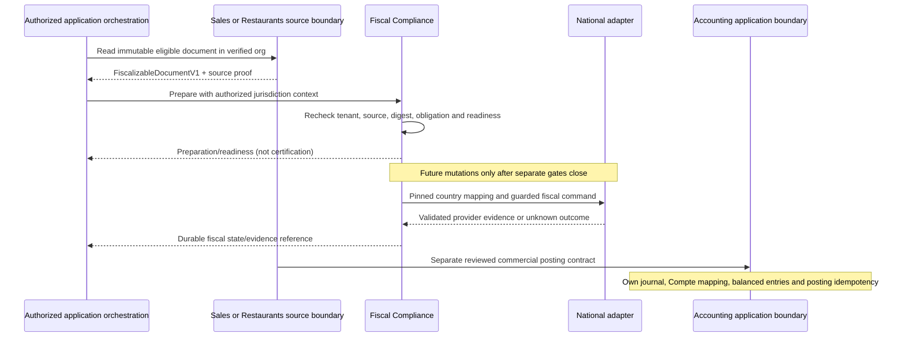

# S4C-1 — FiscalizableDocument V1 design

2026-11-04. Status: **ACCEPTED — ARCHITECTURE BASELINE**. **IMPLEMENTATION BLOCKERS OPEN**. Documentation only; no runtime implementation is authorized.

Classification: `ERP_DOMAIN`; owner: Fiscal Compliance, a shared business capability consumed by products. This document proposes a source-document boundary, not a new service or product. It does not close the existing S4C-1 connector gates. S4C-0B2 remains accepted at commit `7be59201b15252d5cdaa00997bc24b874930583f`.

## 1. Current evidence and compatibility

| Existing component                                                                | Current behavior                                                                                                                                      | Consequence for V1                                                                                                                  |
| --------------------------------------------------------------------------------- | ----------------------------------------------------------------------------------------------------------------------------------------------------- | ----------------------------------------------------------------------------------------------------------------------------------- |
| `packages/shared/src/sales/sales-fiscalizable-document.ts`                        | SALES-owned protocol 1; issued invoice/credit, org/id/version/digest, commercial number, buyer snapshot, decimal quantity/HT price, minor-unit totals | Preserve this contract and its digest. Adapt through the SALES application boundary; do not rename it in place.                     |
| `packages/backend/lambda/domains/sales/references/sales-fiscal-source-service.ts` | Reads only SALES-owned repositories, rejects non-ISSUED sources, freezes ordered facts and hashes them                                                | Reuse the boundary; Fiscal never reads SALES repositories.                                                                          |
| `packages/backend/lambda/domains/fiscal-compliance/core/fiscal-service.ts`        | Directly consumes the SALES contract; local preparation/revision, immutable history, no remote mutations                                              | Future replacement needs an explicit producer boundary, not a cross-domain repository import.                                       |
| `packages/shared/src/restaurants/invoices.ts`, `receipts.ts`, `credit-notes.ts`   | Canonical Invoice aliases legacy receipt; FINAL publication and digest chain prove availability; paginated parts; immutable VALIDATED credits         | Assemble and verify every part through a Restaurants-owned application service. A payment or partial page is insufficient evidence. |
| `packages/backend/docs/restaurants-commercial-documents.md`                       | Order, Payment, Invoice, CreditNote and Refund are distinct; proposed integration events are conceptual                                               | Invoice/credit facts are fiscalization sources; settlement facts do not create another source.                                      |
| Fiscal provider adapter                                                           | Benin TEST status read only, accepted in S4C-0B2                                                                                                      | No invoice mapping, submission or finalization follows from connectivity.                                                           |
| Fiscal KeyFactory and authorization                                               | Keys include org/BJ/provider/environment/type/id, but no source domain; all ten fiscal routes require SALES plus fiscal permission                    | Domain-aware identity and cross-product authorization are future prerequisites. No key or permission changes are authorized here.   |

This proposal is additive. Existing S4B snapshots, commands, provider spelling `BENIN_E_MECEF`, protocol-1 digests, commercial routes and document identities remain authoritative. No backfill, source rehash or migration is performed. The historical S4C validation plan's production/credential/mutation gates remain open.

## 2. Contract scope and ownership

`FiscalizableDocumentV1` carries immutable commercial evidence eligible for fiscal preparation. It is not proof of legal eligibility, certification, payment or accounting posting. Fiscal Compliance owns the exchange contract; the originating domain owns the commercial facts and their correctness. A future frontend-safe schema must be separately reviewed; this proposal describes backend-to-backend data only.

Generic fields describe facts: source, parties, commercial type, date, currency, prices, discounts, taxes and totals. Jurisdiction selection, taxpayer regime, obligation/exemption evidence, national document codes, provider tax groups, operator declarations, provider payment codes, credentials and final fiscal numbering belong to a separate versioned fiscal preparation. National adapters own wire DTOs, numeric representability, request mapping and provider evidence.

No token, secret alias, provider UID, QR, national security code, account number, PK/SK/GSI or arbitrary extension payload belongs to this contract.

## 3. Proposed TypeScript examples (documentation only)

Every nested value is immutable by contract. TypeScript `readonly` is illustrative; future validators and durable snapshots must enforce this at runtime.

```ts
type Decimal = string; // canonical unsigned base-10 decimal
type Minor = string; // canonical unsigned integer, smallest currency unit
type Sha256 = string; // 64 lowercase hex characters
type Domain = "SALES" | "RESTAURANTS"; // extend only by reviewed contract change

interface SourceIdentityV1 {
  readonly domain: Domain;
  readonly documentType: "INVOICE" | "CREDIT_NOTE";
  readonly documentId: string;
}

interface PartyIdentifierV1 {
  readonly scheme: string; // reviewed identifier scheme, or UNCLASSIFIED
  readonly issuingCountry?: string; // ISO 3166-1 alpha-2
  readonly value: string;
}

interface PartySnapshotV1 {
  readonly name?: string;
  readonly country?: string;
  readonly address?: {
    readonly lines: readonly string[];
    readonly city?: string;
    readonly postalCode?: string;
  };
  readonly identifiers: readonly PartyIdentifierV1[];
}

interface CommercialTaxV1 {
  readonly taxId: string; // document-local component identity
  readonly kind: "VAT" | "OTHER";
  readonly label: string;
  readonly ratePercent?: Decimal;
  readonly basisMinor: Minor;
  readonly amountMinor: Minor;
  readonly effect: "ADDED_TO_NET"; // V1 supported arithmetic only
}

interface FiscalizableLineV1 {
  readonly lineId: string;
  readonly sourceCoordinates: readonly {
    readonly sourceLineId: string;
    readonly orderId?: string;
    readonly itemId?: string;
    readonly partNumber?: number;
    readonly position?: number;
  }[]; // nonempty, resolved against verified immutable source evidence
  readonly lineKind: "ITEM" | "SERVICE_CHARGE";
  readonly fiscalTreatmentEvidence: {
    readonly reference: string;
    readonly version: string;
  }; // restricted evidence reference, not a provider group or exemption claim
  readonly zeroPriceJustification?: string;
  readonly position: number;
  readonly description: string;
  readonly unit?: string;
  readonly quantity: Decimal;
  readonly unitPrice: Decimal; // major currency units, before discounts
  readonly priceBasis: "EXCLUDING_TAX" | "INCLUDING_TAX";
  readonly discount: {
    readonly basis: "EXCLUDING_TAX" | "INCLUDING_TAX";
    readonly amountMinor: Minor; // allocated authoritative amount
    readonly ratePercent?: Decimal; // explanatory, never a second deduction
  };
  readonly netMinor: Minor; // after discount, excluding added taxes
  readonly taxes: readonly CommercialTaxV1[];
  readonly totalMinor: Minor;
  readonly originalLineId?: string; // required for a credit line
}

interface FiscalizableDocumentBaseV1 {
  readonly schemaVersion: 1;
  readonly orgId: string;
  readonly source: SourceIdentityV1;
  readonly sourceRevision: string; // opaque stable source version/proof reference
  readonly sourceProof: {
    readonly algorithm: string; // versioned producer digest/manifest algorithm
    readonly digest: Sha256;
  };
  readonly projectionVersion: string; // producer mapping version, pinned
  readonly projectionRevision: number; // explicit immutable projection revision
  readonly projectionEvidenceDigest: Sha256; // source-coordinate/exclusion/allocation evidence
  readonly canonicalizationProfile: "LIASS-FISCAL-C14N-1";
  readonly snapshotDigest: Sha256; // shared canonicalization below
  readonly commercialNumber?: string; // absent means absent, never invented
  readonly issuedAt: string; // UTC RFC3339 instant
  readonly issueDate: string; // validated calendar YYYY-MM-DD
  readonly issueTimezone: string; // validated IANA business timezone
  readonly issuanceEvidence: {
    readonly event:
      | "SALES_ISSUED"
      | "RESTAURANT_INVOICE_FINAL"
      | "CREDIT_VALIDATED";
    readonly reference: string;
    readonly digest: Sha256;
    readonly timezoneSourceReference: string;
  };
  readonly currency: { readonly code: string; readonly minorUnitScale: number };
  readonly seller: PartySnapshotV1 & { readonly name: string };
  readonly sellerProvenance: {
    readonly identityReference: string;
    readonly identityVersion: string;
    readonly identityDigest: Sha256;
    readonly capturedAt: string;
    readonly issuanceEventReference: string;
  };
  readonly buyer: {
    readonly kind: "IDENTIFIED" | "UNIDENTIFIED";
    readonly party?: PartySnapshotV1;
  };
  readonly calculationPolicy: {
    readonly id: string;
    readonly version: string;
    readonly definitionDigest: Sha256;
    readonly rounding: "HALF_UP" | "HALF_EVEN" | "EXACT";
    readonly scope: "LINE" | "DOCUMENT_ALLOCATED_TO_LINES";
  };
  readonly lines: readonly FiscalizableLineV1[];
  readonly totals: {
    readonly netMinor: Minor;
    readonly taxMinor: Minor;
    readonly totalMinor: Minor;
  };
}

type FiscalizableDocumentV1 =
  | (FiscalizableDocumentBaseV1 & {
      readonly kind: "INVOICE";
      readonly original?: never;
    })
  | (FiscalizableDocumentBaseV1 & {
      readonly kind: "CREDIT_NOTE";
      readonly original: {
        readonly source: SourceIdentityV1;
        readonly sourceProof: {
          readonly algorithm: string;
          readonly digest: Sha256;
        };
      };
      readonly reason: string;
    });
```

`source.documentType` must equal `kind`; original source must be an INVOICE in the same tenant/domain and currency. Credits use positive magnitudes and explicit type; no negative-price shortcut. A credit identifies original lines and cannot exceed remaining commercial quantity/amount; the producer enforces cumulative credits atomically. Fiscal Compliance independently checks fiscal original eligibility in the selected jurisdiction/provider/environment. A Refund is not a CreditNote.

## 4. Field responsibility and validation

| Fields                                   | Fact owner / producer                                               | Fiscal Compliance responsibility                                                                                                                      |
| ---------------------------------------- | ------------------------------------------------------------------- | ----------------------------------------------------------------------------------------------------------------------------------------------------- |
| org, source, revision, proof             | Verified source-domain application boundary                         | Compare org to trusted caller context; verify source identity, eligibility and proof; never trust request tenant selection                            |
| seller                                   | Frozen seller identity available to producer at issuance            | Resolve versioned jurisdiction profile separately; verify same legal seller; missing/disagreeing data blocks preparation rather than rewriting source |
| buyer                                    | Frozen invoice customer; UNIDENTIFIED explicitly represents absence | Do not infer taxpayer identity from a generic identifier or claim UNIDENTIFIED is legally permitted everywhere                                        |
| dates, number, currency                  | Producer commercial issuance                                        | Validate date/time policy and currency registry; no new number or currency conversion                                                                 |
| lines, discounts, tax components, totals | Producer calculation policy and immutable evidence                  | Structural validation, exact arithmetic checks, mapping eligibility; no repricing from live catalog/menu                                              |
| snapshot digest                          | Producer canonical projection; receiver recomputes                  | Conflict detection, immutable evidence pinning; digest is not authorization or signature                                                              |
| obligation and national mapping          | Fiscal Compliance jurisdiction policy and national adapter          | Legal evidence and technical readiness remain separate; absence of token/adapter never establishes exemption                                          |

Seller name is mandatory as a contract completeness choice, not a claim of universal statutory fields. Country, address and identifiers are optional structurally but can be mandatory under the applicable legal profile. Missing seller information in existing sources is a real producer gap: no automatic substitution of Outlet name or Organization display name as verified legal name. Seller-profile supplementation must remain a separately pinned fiscal preparation with provenance; it must not alter source evidence.

IDENTIFIED requires a nonempty name; UNIDENTIFIED forbids `party`. Identifier scheme/value presence does not mean externally verified. Existing SALES taxIdentifier maps only to UNCLASSIFIED until evidence supports a typed scheme. No IFU regex, compulsory buyer IFU or national tax rate is introduced.

### Seller and issuance provenance

For new documents, the producer freezes seller identity in the same commercial publication decision that establishes SALES `ISSUED`, Restaurants Invoice `FINAL`, or a credit's `ISSUED`/`VALIDATED` result. Order acceptance, payment and service closure are not substitute capture events. Snapshot legal name, country, available registered address and typed registration/tax identifiers, plus identity reference/version/digest and capture event/time. Snapshot optional fields as actually known; later additions require separate evidence, not an in-place update. Outlet/shop names are presentation facts and cannot replace the legal seller.

The authoritative source must be a reviewed, verified legal-identity record for the effective organization, exposed through its owning application boundary. Current Organization display name and Restaurants names are not that evidence; this authoritative issuance-time facility is a future prerequisite, not an existing implementation claim. Jurisdiction profiles may supplement national declarations with their own pinned provenance, but cannot silently change the commercial seller.

`issuedAt` comes from the durable publication event. `issueDate` is the commercial date recorded by that event; `issueTimezone` comes from the versioned business timezone configuration used at issuance. A backdated business date is preserved and distinguished from publication time; validate its policy rather than require equality with today's date. No browser, deployment-stage or current Outlet timezone substitution is allowed. A credit has its own issuance provenance and retains the original document evidence.

Historical sources lacking reproducible seller/timezone evidence return an explicit projection-ineligible result outside `FiscalizableDocumentV1`, with safe missing-evidence reasons. Preserve source bytes/digest and existing commercial access. Do not synthesize an issuance-time seller from today's data. A reviewed historical attestation, if legally allowed, is separately dated evidence and cannot be mislabeled as the original snapshot; acceptance of such evidence requires an explicit later contract/legal decision. Issued seller corrections require the applicable linked corrective-document workflow; provider pending cancellation does not edit the commercial invoice.

## 5. Decimal, financial and boundedness rules

Proposed V1 limits are technical constraints subject to representative source-fixture review, not fiscal law: 1–1,000 lines; 350 KiB serialized UTF-8 envelope maximum, plus the existing stricter marshalled-item budget if persisted; ids 1–200 characters; descriptions 1–2,000; party names 1–160; identifiers 1–100; address at most three lines of 300 characters; at most 16 identifiers per party and eight tax components per line. Reject unsupported oversized sources explicitly; never truncate or split a fiscal invoice to fit transport/storage. Restaurants pagination must be exhausted before assembly, with bounded work and no partial snapshot success.

All amounts use strings; never floating-point money or epsilon comparisons. Minor strings use `0|[1-9][0-9]*`, at most 80 digits. Decimal strings have at most 18 integer digits and six fractional digits for quantity/unit price, four for rates; no exponent, sign, whitespace, leading zeros or trailing fractional zeros. Quantity is strictly positive; free lines may have zero price. Currency scale is validated against a pinned currency registry, not caller-selected precision. Existing safe-integer Restaurants amounts convert exactly to integer strings; reject unsafe Number values before conversion.

The source policy remains authoritative. SALES currently rounds quantity × HT price HALF_UP to currency scale per line, then tax HALF_UP on rounded net; it supports quantity/price six decimals and rate four. This policy is not a DGI rounding rule. Restaurants tax/price inclusion must be evidenced before mapping; no HT extraction or tax-rate guessing from paid totals.

For each line: `totalMinor = netMinor + sum(taxes.amountMinor)`. Header net, tax and total are exact sums of the respective line values; header total equals header net plus tax. The registered calculation-policy version defines how quantity, price basis, discounts and components produce these amounts, including inclusive-price decomposition and deterministic residual allocation. A generic validator must not blindly compute net as quantity × tax-inclusive price. Missing/unrecognized policy or unexplained residual is ineligible; it is never silently rounded away.

Document discounts must be allocated by the source's pinned policy into line discounts before projection; no duplicate header discount. Zero discount is explicit only when proven. V1 excludes withholding, non-additive tax effects, surcharges without an evidenced component model and negative lines. Unsupported cases remain commercially valid but cannot be projected as fully supported V1 facts. National adapter limits (e.g. int64/double, currency or TTC representability) are additional checks and never weaken these invariants.

### Explicit V1 technical eligibility

| Supported only with verified source and treatment evidence | V1 representation                                                                                                                  |
| ---------------------------------------------------------- | ---------------------------------------------------------------------------------------------------------------------------------- |
| Positive commercial invoice lines                          | Positive quantity, nonnegative price, proven inclusion/decomposition and exact totals                                              |
| Line-level discounts                                       | Authoritative amount in stated price basis; optional rate is explanatory                                                           |
| Partial settlement                                         | Independent settlement evidence; invoice amount and identity unchanged                                                             |
| Service charges                                            | `lineKind=SERVICE_CHARGE`, evidenced immutable commercial line with its own tax treatment; no synthetic unexplained balancing line |
| Separate credits                                           | Positive magnitudes, original source/proof and original-line links, cumulative commercial caps                                     |
| Zero-price items                                           | Explicit justification and known fiscal treatment; zero price alone establishes no exemption                                       |

Unknown tax treatment, withholding, unallocated document-level adjustments, arbitrary negative lines and unreproducible seller identity are unsupported. Missing service-charge tax evidence is unsupported too. An empty `taxes` array is permitted only with positive evidence that no additive tax belongs in the source calculation, not because `taxMinor=0` is stored. The treatment evidence reference proves the documented commercial classification; Fiscal Compliance separately determines whether that classification is legally sufficient in the selected jurisdiction.

Technical eligibility never implies jurisdiction-specific legal eligibility. A representable invoice may still be blocked by taxpayer regime, national document type, approval scope, currency, timing or mandatory information. Unsupported transactions are rejected for fiscal projection explicitly, without modifying their commercial validity or assuming exemption.

Payment balances, tendered cash, change, paid amount and refund totals are excluded from the immutable economic envelope. Later national payment declarations use separately frozen, versioned settlement evidence; they are not copied from whichever payment triggered a UI action.

### D06 technical limits proposal — 2026-11-04

This subsection completes the bounded proposal for architecture review; it does not record approval. It refines §5 where more specific. Existing limits below were verified by reading the named source definitions at baseline `804c2f19a33d8c44b16b791e03d92eda1104a688`; synthetic measurements below are isolated documentation calculations, not runtime schema tests, production samples or proof of provider acceptance.

| Area                        | Existing enforced constraint / evidence                                                                                                        | Proposed FiscalizableDocument V1 bound                                                                                                                                                                                                                                      | Compatibility / approval implication                                                                                                                                                                                                                                                              |
| --------------------------- | ---------------------------------------------------------------------------------------------------------------------------------------------- | --------------------------------------------------------------------------------------------------------------------------------------------------------------------------------------------------------------------------------------------------------------------------- | ------------------------------------------------------------------------------------------------------------------------------------------------------------------------------------------------------------------------------------------------------------------------------------------------- |
| Commercial lines            | SALES fiscalizable-document.ts: 1–100 for invoice/credit; existing fiscal preparation lines max 100                                            | 1–1,000 including service charges and free lines; unique positions 0–999 (gaps allowed)                                                                                                                                                                                     | 1,000 is a proposed cross-domain ceiling, not derived from provider or current fiscal capacity. Current SALES and preparation remain capped at 100; documents above that cannot use the current preparation path. Explicit architecture approval required                                         |
| Restaurants source assembly | receipts.ts: 1–16 commercial lines per part; read page at most 8 parts; summary counts are safe integers, not a 1,000-line aggregate guarantee | At most 2,000 commercial source rows examined, 1,000 economic rows included, 2,000 total source-coordinate references including exclusions; at most 2,048 total manifest parts and 8 MiB cumulative raw UTF-8 part bytes, checked cumulatively                              | New bounded eligibility policy, not a modification of publication limits. Reject larger FINAL documents without truncation; verify all parts including settlement parts before projection                                                                                                         |
| Source coordinates          | Restaurants source orderId/itemId UUIDs, sourcePosition 0–15; Sales id/position                                                                | Exactly one coordinate per projected line in V1; sourceLineId required; orderId/itemId/partNumber/position optional only as a complete producer-defined locator. Part 1–2,048; position 0–999, Restaurants source position remains 0–15                                     | All included coordinates unique; at most 1,000 excluded coordinate records; total at most 2,000. The earlier reviewed one-source-to-many allocation possibility in §6 is deferred: V1 does not aggregate or split source lines                                                                    |
| Identifiers and references  | Current fiscal id max 200; Restaurants UUIDs; some SALES line ids have no explicit maximum                                                     | All generic org/source/line/tax/reference/algorithm/policy/version/credential-version strings 1–200 UTF-16 code units; UUIDs exactly 36 lowercase canonical characters; SHA-256 exactly 64 lowercase hex                                                                    | Explicit failure for legacy unbounded ids exceeding 200; no truncation or hashing substitution. Provider UID limit remains provider-contract dependent, not this source envelope                                                                                                                  |
| Display strings             | SALES description max 2,000, unit 80, party name 160, generic tax identifier 100                                                               | Description 1–2,000; unit 1–80; seller/buyer name 1–160; tax label 1–160; identifier scheme 1–80/value 1–100; city 1–160, postal code 1–32; zeroPriceJustification 1–500 and credit reason 1–1,000 when required                                                            | Counts are UTF-16 code units, consistent with current JS string bounds; valid Unicode required; byte budget also applies                                                                                                                                                                          |
| Party/address collections   | Current fiscal address text max 1,000; no common party array equivalent                                                                        | At most 2 parties; each 0–16 identifiers and optional address with 1–3 lines of 1–300 characters. Optional country/issuingCountry exactly 2 uppercase ASCII letters from pinned registry                                                                                    | Buyer party absent for UNIDENTIFIED, otherwise name required. Evidence completeness and national requirements still independent                                                                                                                                                                   |
| Tax/discount complexity     | SALES one taxRate 0–100 with 4 fractional digits; Restaurants accepted tax/discount literal zero                                               | At most 8 additive tax components per line and 8,000 per document; rate 0–100 inclusive, max 4 decimals; at most one allocated discount object per line                                                                                                                     | 8 components is proposed capacity, not evidence of current producer support. Known treatment mandatory even for zero; discount cannot exceed its evidenced pre-discount basis; percentage 0–100                                                                                                   |
| Quantity/price              | SALES 18 integer digits, max 6 decimals and 25 total characters; Restaurants quantity integer <= MAX_SAFE_INTEGER                              | Quantity from 0.000001 through 999999999999999999.999999; unit price 0 through same maximum; canonical string max 25 characters                                                                                                                                             | Restaurants producer retains its smaller safe-integer source bound; converting an unsafe Number is forbidden. Credit quantity cannot exceed original remaining quantity                                                                                                                           |
| Amounts/currency            | Existing fiscal minor strings max 80; Restaurants amount <= 9007199254740991                                                                   | Minor 0 through 10^80−1 as integer string; currency code exactly 3 uppercase ASCII letters, scale 0–4 validated against pinned registry; totals must remain within 80 digits                                                                                                | Explicitly reject summed overflow even if every line fits. Registry approval D03; national numeric representability may be much smaller                                                                                                                                                           |
| Other scalar metadata       | Versioned source fields; named canonicalization profile                                                                                        | Structural revisions 1–9007199254740991; counters/positions nonnegative safe integers with narrower array bounds above; schemaVersion exactly 1; UTC timestamp exactly 24 characters per §6.1; issueDate 10; issueTimezone 1–100 from pinned IANA registry                  | No arithmetic Number conversion for decimal/Minor strings; no arbitrary version coercion                                                                                                                                                                                                          |
| Envelope bytes              | Existing FiscalRepository marshalled-item guard rejects >350×1024 bytes                                                                        | Whole final envelope, including snapshotDigest, <=358,400 UTF-8 JCS bytes; no pretty-print whitespace counted                                                                                                                                                               | Same numeric ceiling but different representation: envelope fitting does NOT prove nested/marshalled aggregate fits existing guard; both checks required. No new persistence design                                                                                                               |
| Projection evidence bytes   | No existing generic evidence payload                                                                                                           | <=358,400 UTF-8 JCS bytes including its §6.1 fingerprint wrapper; included 1–1,000, excluded 0–1,000; coordinates one per included record                                                                                                                                   | Combined envelope + projection evidence <=716,800 bytes for preparation computation, not one DynamoDB item allowance. No inline raw source/manifest/credential blobs                                                                                                                              |
| Fixed evidence cardinality  | §3 fixed provenance fields and §6.1 closed fingerprints                                                                                        | Exactly one source proof, projection evidence object, calculation definition, issuance proof and seller provenance; one original proof only for CREDIT_NOTE; one fiscal-treatment evidence reference per line; one timezone-source reference; no extensible evidence arrays | Calculation has exactly 2 artifact-digest fields; preparation exactly 9 H fields; action intent exactly 3 required H fields plus one transaction H for confirm/cancel. References 1–200; each referenced artifact/producer proof needs its own reviewed resolver budget, no unbounded dereference |
| Nesting/collections         | Closed documented object shapes                                                                                                                | Maximum 8 JSON container levels (root object level 1, each nested object/array +1), including fingerprint wrappers; every array is one of the explicitly bounded fields above; no arbitrary metadata/dictionary/recursive object                                            | Snapshot coordinate nesting reaches 5 levels; wrapper reaches 6. Object optional fields do not authorize extra nesting                                                                                                                                                                            |

At current compatibility boundaries, the applicable limit is the minimum of source, shared-contract, existing preparation/persistence and verified national-adapter constraints. This proposal does not raise a source maximum, authorize migration or imply e-MECeF accepts 1,000 lines, six-decimal quantities, 80-digit amounts or these bytes. Benin int64/double representability, currency, request cardinality/size and mandatory tax fields remain later S4C mapping/verification gates. No provider capacity assertion is made.

Artifact/reference acquisition proposal: at most 1,024 distinct referenced evidence artifacts for one preparation (all line treatment references plus fixed provenance/policy/original/configuration references), maximum 65,536 bytes per artifact and 16 MiB cumulative acquisition bytes including the separately capped 8 MiB source-part stream. Projection evidence is the one explicit exception to the per-artifact ceiling, with its 358,400-byte ceiling above; it still counts toward 16 MiB. Maximum four concurrent reads, no recursive reference traversal and no embedded source documents. Counts/bytes accumulate across retries within the same bounded preparation run, with no partial success on exhaustion. A new run does not authorize a new fiscal effect. These are conservative proposed safety budgets, not measured latency/memory claims; approval belongs to D06. Existing publication/read APIs and source byte representations are not changed.

Deterministic numeric boundary cases: `0.000001` quantity is admitted; `0`, `0.0000001`, 19 integer digits or seven fractional digits are rejected. The maximum declared quantity/price has 18 integer + dot + 6 fractional characters = 25. `100` rate is allowed, `100.0001` rejected. An 80-digit Minor fits; an 81-digit total fails. Restaurants `9007199254740991` source integer converts exactly; `9007199254740992` Number input is rejected before conversion. Header summation of two maximum 80-digit line totals overflows the 80-digit output bound and fails. A 358,400-byte final canonical envelope fits its byte ceiling; 358,401 does not. Coordinate totals 2,000 fit only when included<=1,000 and excluded<=1,000; 2,001 fails. Structural count success never overrides payload/proof failure.

Fail-closed validation order: (1) bounded acquisition/parser byte and depth guards; (2) closed shape/scalar/array counts, unique identities and complete source proof; (3) canonical decimal/time and known calculation/treatment; (4) exact financial and original-credit caps; (5) final canonical envelope/evidence bytes; (6) downstream preparation/item/provider eligibility. Stop at the first failure without any fiscal effect reservation, mutation or partial success. Return safe category/source reference only (e.g. DOCUMENT_TOO_LARGE, SOURCE_ASSEMBLY_LIMIT, UNSUPPORTED_COMPLEXITY, INCOMPLETE_EVIDENCE); no raw payload or sensitive values. These are proposed diagnostic categories, not new runtime error codes.

Never truncate, round-to-fit, drop economic lines, relabel taxes, synthesize service charges, split invoices or retry with a different provider to evade limits. Equality at a maximum is allowed; one unit/byte beyond is rejected. Unknown/unbounded artifact resolvers remain blocked rather than fetched without a budget. Parser streaming/adaptor implementation is outside this task.

### D06 bounded payload/cardinality evidence

#### Independent-limit decision proposed for architecture review

The proposed final model is an intersection of independently mandatory limits: **at most 1,000 document lines; at most 2,000 source references including exclusions; exactly one source coordinate per included line; at most 358,400 canonical envelope UTF-8 bytes**. All other §5 shape/evidence/downstream limits still apply. Cardinality success is not eligibility: a 1,000-line document may fail the byte limit. The existing `lines1000` example at **489,155 bytes is an expected size-limit rejection**, not a contradiction or reason to bypass evidence.

No silent truncation, splitting, omission of evidence, changing identity/provider or automatic fiscalization retry may be used to fit a budget. Existing SALES and fiscal preparation limits remain 100 lines; the shared proposal does not raise them or assert provider support for 1,000 lines. All bounds in this subsection remain PROPOSED pending D06 approval.

#### Precise byte-budget scopes

| Scope                         | Exact measured representation                                                                                                                                                                                                                                     | Budget accounting                                                                                                                                                                                                                                                                                                                |
| ----------------------------- | ----------------------------------------------------------------------------------------------------------------------------------------------------------------------------------------------------------------------------------------------------------------- | -------------------------------------------------------------------------------------------------------------------------------------------------------------------------------------------------------------------------------------------------------------------------------------------------------------------------------- |
| Contract envelope E           | Final §3 envelope normalized under §6.1 then RFC 8785 serialized, UTF-8 without BOM/newline; includes actual 64-hex snapshotDigest, projectionEvidenceDigest and all other envelope fields                                                                        | E <=358,400. Unlike the snapshot hash preimage, this size check does not omit snapshotDigest and does not add a fingerprint wrapper. Pretty-printed transport JSON is not E                                                                                                                                                      |
| Projection evidence P         | Closed projection-evidence payload including its `{profile,version,kind,payload}` wrapper under §6.1, JCS UTF-8 without BOM/newline; no digest of itself embedded                                                                                                 | P <=358,400. Evidence records are outside E; only their digest is in E. E+P <=716,800 is a derived representation ceiling, not permission for a DynamoDB item                                                                                                                                                                    |
| Source and other evidence     | Original source/manifest bytes retain their producer proof algorithm; do not reserialize them for proof verification. Other artifacts use their declared immutable byte format; source-part input counters measure decoded UTF-8 body bytes delivered to assembly | Source-part acquisition <=8 MiB, ordinary artifact <=65,536 bytes (projection exception above), cardinality caps still apply. Original evidence is not appended to E or P; evidence digest fields are not substitutes for acquiring/verifying it                                                                                 |
| Acquisition/transport input A | Decoded response-body/entity bytes actually delivered by each read attempt to the preparation, including pretty-print whitespace if present; source parts and fetched artifacts counted once per delivered body occurrence                                        | A <=16 MiB, with source bodies also counted in the 8 MiB subset, not added twice to A. Retransmitted bodies on retry count again; metadata-only reference reuse does not. Exclude request/response headers, TLS/compression framing and network packet overhead; this is a decoded-input safety cap, not a wire/billing estimate |
| Generated evidence and copies | A locally generated P is checked by its own canonical size; it does not consume acquisition bytes until fetched as input. Re-serialization or memory copies of the same delivered body are not new acquisitions                                                   | Do not add E+P to A as if generated outputs were input reads. A fetched projection artifact counts once as delivered input and also must satisfy its separate canonical P cap; these are independent constraints, not duplicate arithmetic within one budget                                                                     |
| Provider request              | Exact adapter-serialized request body bytes, lossless numeric mapping, excluding authentication/transport headers                                                                                                                                                 | Not E, P or source proof bytes. Country/provider-specific limits remain unverified and must block corresponding mutation enablement; no provider byte allowance is inferred from 358,400                                                                                                                                         |
| Persisted record              | Existing marshalled-item representation including aggregate metadata and nested snapshots                                                                                                                                                                         | Existing 350 KiB guard remains independent. E <=358,400 does not imply the persisted record fits. No change/offload/resource is authorized                                                                                                                                                                                       |

Compressed/encoded transport cannot bypass decoded-input/depth checks. A future bounded reader must stop before retaining an over-budget body, reject unsupported decoding or incomplete proof and produce no partial projection success. No raw headers, credentials or bodies are logged to measure budgets.

The matrix is measured from the complete synthetic §3 envelopes generated by the recipe below. Amounts are minor EUR units (scale 2); the synthetic 18% component is arithmetic illustration, not national applicability. Repeated digests stand for fixtures, not validated artifacts. Cases are not certified source documents: seller/issuance/treatment/artifact evidence must actually resolve before eligibility. No producer/provider claim follows from a size calculation.

| Case            | Lines | Coordinate references | Tax components | UTF-8 canonical bytes | Total minor | Result/limitation                                                                   |
| --------------- | ----- | --------------------- | -------------- | --------------------- | ----------- | ----------------------------------------------------------------------------------- |
| sales           | 1     | 1                     | 1              | 1958                  | 1180        | Structurally bounded example; source eligibility/provenance still requires proof    |
| restaurant      | 16    | 16                    | 16             | 11243                 | 18880       | Synthetic FINAL-source mapping; not a verified live Restaurant fiscal decomposition |
| discount        | 1     | 1                     | 1              | 1957                  | 1062        | Conditional on evidenced line discount and approved policy                          |
| partial         | 1     | 1                     | 1              | 1958                  | 1180        | Same 1180 invoice; external payment 400 / balance 780                               |
| credit          | 1     | 1                     | 1              | 2247                  | 1180        | Conditional on original proof and credit caps                                       |
| charge          | 2     | 2                     | 2              | 2450                  | 2360        | Conditional on actual charge evidence                                               |
| free            | 1     | 1                     | 1              | 1997                  | 0           | Conditional on explicit justification and known treatment                           |
| lines100        | 100   | 100                   | 100            | 49952                 | 118000      | Fits envelope ceiling; current source cap still applies                             |
| lines1000       | 1000  | 1000                  | 1000           | 489155                | 1180000     | Reject: bytes exceed 358400 despite count at maximum                                |
| lines1001       | 1001  | 1001                  | 1001           | 489646                | 1181180     | Reject: line/coordinate counts and bytes exceed limits                              |
| longDescription | 100   | 100                   | 100            | 449552                | 118000      | Reject bytes; individual 2000-character descriptions still fit string bound         |

Restaurant example represents one 16-row commercial part with verified-source coordinates; real use must additionally verify FINAL manifest and every commercial/settlement part. A cancelled row contributes zero and adds an excluded coordinate (e.g. 16 included + 1 excluded = 17 references); it is not dropped from source evidence. Source-row/part/raw-byte acquisition caps are checked independently from envelope size. The fixed sourceProof and projectionEvidenceDigest fields make envelope size independent of whether associated artifacts are available, so size success never proves completeness.

The measured 1000-line rejection demonstrates intersecting limits: 1000 is an eligibility ceiling, not a promise that a rich 1000-line envelope fits 350 KiB. Even 100 long Unicode descriptions can exceed the byte budget. Product/architecture review must accept this restriction or explicitly revise the proposal before implementation; no automatic offload, splitting or infrastructure is proposed.

Reproducible isolated measurement recipe (documentation example only; no runtime module, schemas or tests added). It emits canonical strings for these ASCII property names under JCS-compatible sorting and measures UTF-8 bytes, without snapshotDigest omission because this is the full-envelope size check:

```js
const H = "a".repeat(64);
const T = "2026-11-04T12:00:00.000Z";
function line(i) {
  return {
    lineId: "line-" + i,
    position: i,
    sourceCoordinates: [{ sourceLineId: "source-" + i }],
    lineKind: "ITEM",
    fiscalTreatmentEvidence: { reference: "evidence", version: "1" },
    description: "Item",
    quantity: "2",
    unitPrice: "5",
    priceBasis: "EXCLUDING_TAX",
    discount: { basis: "EXCLUDING_TAX", amountMinor: "0" },
    netMinor: "1000",
    taxes: [
      {
        taxId: "tax",
        kind: "VAT",
        label: "Synthetic",
        ratePercent: "18",
        basisMinor: "1000",
        amountMinor: "180",
        effect: "ADDED_TO_NET",
      },
    ],
    totalMinor: "1180",
  };
}
function envelope(n) {
  return {
    kind: "INVOICE",
    schemaVersion: 1,
    orgId: "org-example",
    source: {
      domain: "SALES",
      documentType: "INVOICE",
      documentId: "invoice-example",
    },
    sourceRevision: "1",
    sourceProof: { algorithm: "sales-protocol-1", digest: H },
    projectionVersion: "example-1",
    projectionRevision: 1,
    projectionEvidenceDigest: H,
    canonicalizationProfile: "LIASS-FISCAL-C14N-1",
    snapshotDigest: H,
    issuedAt: T,
    issueDate: "2026-11-04",
    issueTimezone: "Africa/Porto-Novo",
    issuanceEvidence: {
      event: "SALES_ISSUED",
      reference: "publication",
      digest: H,
      timezoneSourceReference: "timezone-1",
    },
    currency: { code: "EUR", minorUnitScale: 2 },
    seller: { name: "Synthetic seller", identifiers: [] },
    sellerProvenance: {
      identityReference: "legal-identity",
      identityVersion: "1",
      identityDigest: H,
      capturedAt: T,
      issuanceEventReference: "publication",
    },
    buyer: { kind: "UNIDENTIFIED" },
    calculationPolicy: {
      id: "synthetic",
      version: "1",
      definitionDigest: H,
      rounding: "HALF_UP",
      scope: "LINE",
    },
    lines: Array.from({ length: n }, (_, i) => line(i)),
    totals: {
      netMinor: String(1000n * BigInt(n)),
      taxMinor: String(180n * BigInt(n)),
      totalMinor: String(1180n * BigInt(n)),
    },
  };
}
const cases = {};
cases.sales = envelope(1);
cases.restaurant = envelope(16);
cases.restaurant.source.domain = "RESTAURANTS";
cases.restaurant.sourceProof.algorithm = "synthetic-final-manifest-1";
cases.restaurant.issuanceEvidence.event = "RESTAURANT_INVOICE_FINAL";
cases.restaurant.lines.forEach((l, i) => {
  l.sourceCoordinates = [
    {
      sourceLineId: "source-" + i,
      orderId: "00000000-0000-4000-8000-000000000001",
      itemId: "00000000-0000-4000-8000-" + String(i + 1).padStart(12, "0"),
      partNumber: 1,
      position: i,
    },
  ];
});
cases.discount = envelope(1);
Object.assign(cases.discount.lines[0], {
  discount: { basis: "EXCLUDING_TAX", amountMinor: "100" },
  netMinor: "900",
  totalMinor: "1062",
});
Object.assign(cases.discount.lines[0].taxes[0], {
  basisMinor: "900",
  amountMinor: "162",
});
cases.discount.totals = {
  netMinor: "900",
  taxMinor: "162",
  totalMinor: "1062",
};
cases.partial = envelope(1); // external settlement 400, balance 780; envelope unchanged
cases.credit = envelope(1);
cases.credit.kind = "CREDIT_NOTE";
cases.credit.source.documentType = "CREDIT_NOTE";
cases.credit.source.documentId = "credit-example";
cases.credit.original = {
  source: {
    domain: "SALES",
    documentType: "INVOICE",
    documentId: "invoice-example",
  },
  sourceProof: { algorithm: "sales-protocol-1", digest: H },
};
cases.credit.reason = "Synthetic correction";
cases.credit.lines[0].originalLineId = "line-0";
cases.credit.issuanceEvidence.event = "CREDIT_VALIDATED";
cases.charge = envelope(2);
cases.charge.lines[1].lineKind = "SERVICE_CHARGE";
cases.free = envelope(1);
Object.assign(cases.free.lines[0], {
  unitPrice: "0",
  netMinor: "0",
  totalMinor: "0",
  zeroPriceJustification: "Synthetic documented promotion",
});
Object.assign(cases.free.lines[0].taxes[0], {
  basisMinor: "0",
  amountMinor: "0",
});
cases.free.totals = { netMinor: "0", taxMinor: "0", totalMinor: "0" };
cases.lines100 = envelope(100);
cases.lines1000 = envelope(1000);
cases.lines1001 = envelope(1001);
cases.longDescription = envelope(100);
cases.longDescription.lines.forEach((l) => (l.description = "é".repeat(2000)));
function j(v) {
  if (Array.isArray(v)) return "[" + v.map(j).join(",") + "]";
  if (v && typeof v === "object")
    return (
      "{" +
      Object.keys(v)
        .sort()
        .map((k) => JSON.stringify(k) + ":" + j(v[k]))
        .join(",") +
      "}"
    );
  return JSON.stringify(v);
}
const measurements = Object.entries(cases).map(([name, e]) => ({
  name,
  lines: e.lines.length,
  coordinates: e.lines.reduce((n, l) => n + l.sourceCoordinates.length, 0),
  taxComponents: e.lines.reduce((n, l) => n + l.taxes.length, 0),
  bytes: Buffer.byteLength(j(e), "utf8"),
  total: e.totals.totalMinor,
}));
console.log(JSON.stringify(measurements));
```

#### Additional deterministic boundary evidence

The original 11 examples demonstrate ordinary cases and byte rejection but do not alone demonstrate an eligible 1,000-line representation or exact envelope boundary. The nine additional cases below close that synthetic numerical gap. “Bounds pass” means these measured shared bounds and arithmetic only, subject to full source/treatment/provenance/registry validation; it is not legal eligibility, producer acceptance or provider readiness. Empty tax arrays in compact cases require affirmative known no-additive-tax evidence, never inference from zero.

| Case            | Lines | Source references (included + excluded) | Max coordinates/line | E bytes | P bytes when measured | Bounds result                                                                            |
| --------------- | ----- | --------------------------------------- | -------------------- | ------- | --------------------- | ---------------------------------------------------------------------------------------- |
| sales100        | 100   | 100                                     | 1                    | 36848   | not measured          | Bounds pass; 100-line SALES source ceiling preserved                                     |
| restaurant512   | 512   | 512                                     | 1                    | 185654  | not measured          | Shared bounds pass; 32 synthetic 16-row parts, actual FINAL proof still required         |
| compact1000     | 1000  | 1000                                    | 1                    | 358150  | not measured          | 1,000 lines and bytes both pass shared bounds; current 100-line fiscal path still blocks |
| compact1001     | 1001  | 1001                                    | 1                    | 355507  | not measured          | Reject line/position bound despite bytes passing                                         |
| envelopeAtLimit | 1000  | 1000                                    | 1                    | 358400  | not measured          | Exactly byte maximum: bounds pass                                                        |
| envelopeOneOver | 1000  | 1000                                    | 1                    | 358401  | not measured          | Reject exactly one byte over; line/reference limits pass                                 |
| references2000  | 1000  | 2000                                    | 1                    | 358150  | 255929                | Exactly total-reference maximum, 1,000 included + 1,000 excluded: bounds pass            |
| references2001  | 1000  | 2001                                    | 1                    | 358150  | 256046                | Reject total-reference and excluded-record caps; bytes pass                              |
| twoCoordinates  | 1     | 2                                       | 2                    | 1850    | not measured          | Reject per-line coordinate count; other cardinalities/bytes pass                         |

The 2,000-reference ceiling is also implied by one coordinate ×1,000 included lines plus 1,000 excluded records. Thus 2,001 references cannot violate only the global reference bound while satisfying those sublimits; its deliberate redundant rejection is expected. The two-coordinate case isolates the per-line rule. `compact1001` uses shorter valid descriptions to keep bytes below the cap and isolates cardinality/position rejection from byte rejection. `envelopeAtLimit`/`envelopeOneOver` use only valid description padding; no evidence is omitted between them.

The 512-line Restaurants example uses compact sourceLineId coordinates that encode part/row and are required to resolve uniquely against the verified manifest through projection evidence. It represents 32 commercial parts (16 rows each) without inventing one Order per Invoice. This is a synthetic valid-shape mapping, not proof that an existing Restaurant workflow provides seller/tax evidence. Extra actual settlement parts are verified too and remain within acquisition caps. The 100-line Sales case preserves the source maximum and uses a hypothetical approved no-additive-tax treatment, not an assertion that a stored zero rate establishes exemption.

Run this extension immediately after the preceding recipe. It measures the same final envelope representation E and, for reference-boundary cases, the exact P wrapper. Inputs deliberately outside bounds are emitted only to demonstrate deterministic rejection, not sent anywhere.

```js
// Run after the preceding recipe in the same isolated process.
function compact(n) {
  const e = envelope(n);
  for (const l of e.lines) {
    l.taxes = [];
    l.totalMinor = l.netMinor;
  }
  e.totals.taxMinor = "0";
  e.totals.totalMinor = e.totals.netMinor;
  return e; // requires independently verified no-additive-tax treatment
}
function restaurantLarge(n) {
  const e = compact(n);
  e.source.domain = "RESTAURANTS";
  e.sourceProof.algorithm = "synthetic-final-manifest-1";
  e.issuanceEvidence.event = "RESTAURANT_INVOICE_FINAL";
  // sourceLineId deterministically encodes original part and row.
  e.lines.forEach((l, i) => {
    l.sourceCoordinates = [
      { sourceLineId: "part-" + (1 + Math.floor(i / 16)) + "-row-" + (i % 16) },
    ];
  });
  return e;
}
function exactBytes(target) {
  const e = compact(1000);
  let remaining = target - Buffer.byteLength(j(e), "utf8");
  if (remaining < 0) throw Error("Base too large");
  for (const l of e.lines) {
    const add = Math.min(remaining, 2000 - l.description.length);
    l.description += "x".repeat(add);
    remaining -= add;
  }
  if (remaining || Buffer.byteLength(j(e), "utf8") !== target)
    throw Error("Padding failed");
  return e; // legal string lengths; padding is synthetic description content
}
function evidenceFor(e, excludedCount) {
  const payload = {
    sourceProofFingerprint: H,
    projectionVersion: "example-1",
    projectionRevision: 1,
    included: e.lines.map((l) => ({
      lineId: l.lineId,
      coordinates: [
        [
          l.sourceCoordinates[0].sourceLineId,
          false,
          "",
          false,
          "",
          false,
          0,
          false,
          0,
        ],
      ],
      allocatedQuantity: l.quantity,
      allocatedTotalMinor: l.totalMinor,
    })),
    excluded: Array.from({ length: excludedCount }, (_, i) => ({
      coordinate: ["excluded-" + i, false, "", false, "", false, 0, false, 0],
      reason: "CANCELLED_ZERO",
      contributionMinor: "0",
    })),
  };
  payload.included.sort((a, b) =>
    a.lineId < b.lineId ? -1 : a.lineId > b.lineId ? 1 : 0,
  );
  payload.excluded.sort((a, b) =>
    a.coordinate[0] < b.coordinate[0]
      ? -1
      : a.coordinate[0] > b.coordinate[0]
        ? 1
        : 0,
  );
  return {
    profile: "LIASS-FISCAL-C14N-1",
    version: 1,
    kind: "projection-evidence",
    payload,
  };
}
const bounds = {
  sales100: compact(100),
  restaurant512: restaurantLarge(512),
  compact1000: compact(1000),
  compact1001: compact(1001),
  envelopeAtLimit: exactBytes(358400),
  envelopeOneOver: exactBytes(358401),
};
bounds.compact1001.lines.forEach((l) => {
  l.description = "I";
});
const boundMeasurements = Object.entries(bounds).map(([name, e]) => ({
  name,
  lines: e.lines.length,
  sourceReferences: e.lines.length,
  maxCoordinatesPerLine: 1,
  envelopeBytes: Buffer.byteLength(j(e), "utf8"),
}));
const e2000 = evidenceFor(bounds.compact1000, 1000);
const e2001 = evidenceFor(bounds.compact1000, 1001);
for (const [name, e] of [
  ["references2000", e2000],
  ["references2001", e2001],
]) {
  boundMeasurements.push({
    name,
    lines: 1000,
    sourceReferences: 1000 + e.payload.excluded.length,
    maxCoordinatesPerLine: 1,
    envelopeBytes: Buffer.byteLength(j(bounds.compact1000), "utf8"),
    evidenceBytes: Buffer.byteLength(j(e), "utf8"),
  });
}
const two = compact(1);
two.lines[0].sourceCoordinates.push({ sourceLineId: "extra" });
boundMeasurements.push({
  name: "twoCoordinates",
  lines: 1,
  sourceReferences: 2,
  maxCoordinatesPerLine: 2,
  envelopeBytes: Buffer.byteLength(j(two), "utf8"),
});
console.log(JSON.stringify(boundMeasurements));
```

## 6. Immutability, revision and deterministic idempotency

The source identity tuple is `(orgId, domain, documentType, documentId)`. SourceRevision identifies evidence, not permission for a second fiscal effect. SALES supplies its immutable issued version and protocol-1 digest; Restaurants supplies verified FINAL manifest identity/digest, not an invented mutable version. Preserve the original digest algorithm and byte semantics alongside the new projection digest.

Proposed `snapshotDigest`: digest of the envelope excluding only `snapshotDigest`, using the normative wrapper and profile in §6.1 with kind `snapshot`. `LIASS-FISCAL-C14N-1` now specifies RFC 8785 JCS, including UTF-16 object-property ordering, rather than the earlier proposed code-point ordering. No runtime implementation or persisted fingerprint used that earlier proposal. Existing SALES source digests remain unchanged. The normative rules below supersede the earlier illustrative fingerprint-layer descriptions wherever more precise.

### Provider-independent identity hierarchy

Each identity is SHA-256 of its explicitly tagged canonical tuple under `LIASS-FISCAL-C14N-1`; retain the tuple for equality/provenance checks. These are logical identities, not new database keys.

| Identity                                                | Tuple inputs after its versioned tag                                        | Semantics                                                                                                         |
| ------------------------------------------------------- | --------------------------------------------------------------------------- | ----------------------------------------------------------------------------------------------------------------- |
| BusinessDocumentIdentity (`business-document-v1`)       | orgId, source domain, document type, source ID                              | Commercial document, independent of payment, revision and provider                                                |
| FiscalEffectIdentity (`fiscal-effect-v1`)               | BusinessDocumentIdentity, jurisdiction, obligationDefinitionId, environment | One legally defined obligation for that document; no provider/connection/credential                               |
| ProviderAttemptIdentity (`provider-attempt-v1`)         | FiscalEffectIdentity, provider, durable attemptId                           | One controlled attempt; attemptId is persisted before send and retained on retries                                |
| OperationIdentity (`operation-v1`)                      | ProviderAttemptIdentity, action, commandIntentDigest                        | One action and its exact intent; include expected fiscal version and preparation fingerprint in intent            |
| ProviderTransactionIdentity (`provider-transaction-v1`) | orgId, provider, environment, connectionId, returned UID                    | Tenant-qualified provider transaction; connection ownership and atomic effect/attempt association required (§6.3) |

Jurisdiction, obligation definition and environment are authorized fiscal context, never AWS stage. Obligation definitions are version-governed legal concepts, not user-supplied arbitrary labels; renaming/versioning one must alias the same obligation unless reviewed law proves a distinct one. Multiple legitimate obligations require explicitly distinct definitions and documented applicability. Changing provider cannot create a new obligation or release the FiscalEffectIdentity guard. Unknown outcomes prohibit blind retries, new attempts and provider switching. Switching requires proven disposition of every prior attempt and no prior successful satisfaction of the same obligation; retain the same effect guard and audit the decision. An operator cannot override ambiguity by selecting another provider.

Source/projection/preparation revisions, token rotation and connections never mint another fiscal effect. New operation/attempt identities do not grant permission to execute; the effect state machine remains authoritative. The existing provider UID cannot be assumed globally unique or equivalent to commercial identity.

The hash above is a proposed business identity, not an approved KeyFactory format or provider idempotency key. Existing keys lack domain: additive mapping and migration review are mandatory before accepting Restaurants, even if UUID collision appears unlikely. Existing SALES effects must resolve to the same legacy evidence, never a second aggregate under a new key.

### Historical SALES compatibility gate

Future domain resolution must treat existing org/BJ/BENIN_E_MECEF/environment/type/id fiscal records as SALES, with an explicitly reviewed legacy obligation binding. Do not invent a legal obligation id from a token or tax rate. Until that binding is reviewed, new mutation is blocked. Resolve the existing legacy aggregate/history first for SALES and return its historical command result unchanged; do not create a parallel domain-qualified aggregate. Before dual-version writers are allowed, use one atomic authoritative guard/alias strategy or fence old writers during controlled cutover. Read-before-write alone is not a concurrency guarantee. Legacy/new conflict is fail-closed, never last-write-wins or a fresh certification.

Restaurants identities must not resolve an existing SALES record merely because ids match. Future migration design must specify authoritative physical resolution, concurrent create/replay, rollback and retention of old command results; review it against current KeyFactory without altering any existing format in this task. Cross-product adoption remains blocked until that compatibility design is accepted.

Published snapshots are append-only. Before any remote attempt, an explicit reviewed preparation revision may freeze new fiscal configuration while preserving the same commercial source. Same source identity/revision with different commercial digest is an integrity conflict. A producer mapping correction may create a reviewed new projection before send, retaining prior evidence; it cannot reopen source economics. After a send or unknown outcome, freeze source, projection, request, configuration and credential version references. Correct issued economics through a linked new commercial credit/corrective document under reviewed jurisdiction rules, never edit a certified snapshot. Rendering retry uses stored evidence and cannot re-fiscalize.

### Fingerprints, correction and replay protocol

Calculation policies are immutable definitions identified by id/version/definitionDigest. Definitions specify price inclusion, discount basis/order, tax bases/compounding, rounding stages/direction, currency-scale registry version and residual allocation order. Never edit a definition in place; an algorithm correction requires a new definition and explicit projection/preparation review. Neither source calculation nor DGI rounding may be silently substituted for the other.

| Layer         | Fingerprint/revision rule                                                                                                                                                          |
| ------------- | ---------------------------------------------------------------------------------------------------------------------------------------------------------------------------------- |
| Source proof  | Producer algorithm + original digest + immutable revision; source economics cannot change under this identity                                                                      |
| Projection    | projectionVersion + positive projectionRevision + snapshotDigest; records the mapping and source coordinates without rehashing legacy proof                                        |
| Preparation   | Positive revision + fingerprint of effect, snapshotDigest, legal/configuration/reference/mapping versions and secret-version reference (never secret); stored outside the envelope |
| Action intent | Fingerprint of attempt, action, expected fiscal version, preparation fingerprint and exact sanitized request digest; durable command replay binds this intent                      |

Exact same command identity and fingerprint returns its original authoritative result even after later revisions. Same command identity with changed fingerprint conflicts. A pre-send projection fix or configuration change uses an explicit new revision command with expected version, retains old evidence/results and revalidates source/legality; it stays under the same effect. Changing issued economics, seller or issuance evidence is not a projection fix. Once sending may have occurred, no projection/preparation replacement, new attempt or provider switch is allowed until authoritative disposition. Proven no-effect recovery may authorize a new audited attempt under the same effect; success can never be replaced by another attempt. Changed preparation alone never authorizes another fiscal effect.

### Deterministic fingerprint and replay examples

The following are synthetic specification vectors, not executable tests or evidence of legal applicability. Hash algorithm is SHA-256, input bytes are UTF-8 without newline, output is lowercase hex. Object inputs `{"b":"2","a":"1"}` and `{"a":"1","b":"2"}` canonicalize identically:

```text
canonical: {"a":"1","b":"2"}
sha256: 21f76dfbfe6dfe21f762080ef484112cf2952974cef30741fd1931e1c6d92112

canonical: ["business-document-v1","org-example","SALES","INVOICE","invoice-example"]
sha256: ab8cff840ee8fdf935791a44959860c4acc91298ec69c16a315cb5433878d495
```

Effect-vector construction uses the preceding business hash, jurisdiction `BJ`, synthetic obligation id `obligation-example-v1` and TEST. This obligation id is a placeholder, not an approved Benin legal definition. The exact tuple and hash are recorded below.

```text
canonical: ["fiscal-effect-v1","ab8cff840ee8fdf935791a44959860c4acc91298ec69c16a315cb5433878d495","BJ","obligation-example-v1","TEST"]
sha256: 17bf46e17ca660cc0d83ce91eafd8404b9c9edb28f98e95e91ff141c8732c0a9
```

| Example change                                                             | Expected identity/replay result                                                                             |
| -------------------------------------------------------------------------- | ----------------------------------------------------------------------------------------------------------- |
| Same object members in another input order                                 | Same canonical bytes and snapshot fingerprint                                                               |
| Same source + same command intent resent                                   | Original durable result; no new send, even if a later revision exists                                       |
| Same command identity, changed preparation fingerprint or expected version | Intent conflict; no new operation                                                                           |
| Explicit pre-send preparation revision 1 → 2 using a new revision command  | New preparation fingerprint and historical result; same BusinessDocumentIdentity and FiscalEffectIdentity   |
| SALES → RESTAURANTS with same local source id                              | Different business/effect identities; no legacy SALES lookup alias for Restaurants                          |
| Provider A → B under same obligation                                       | Same effect identity, different attempt identity; blocked while prior outcome unknown or already successful |
| Tax/discount amount changes under same source proof/revision               | Integrity failure, not a retry or projection correction                                                     |
| Canonical decimal input `1.0`, duplicate JSON keys or unknown field        | Reject before fingerprinting; producer must emit valid canonical values                                     |

Before a runtime implementation is accepted, extend these vectors to full envelopes with UTF-8/control escaping, coordinate ordering, inclusive-price/discount rounding and immutable policy-definition hashes. This revision calculates documentation examples only; it does not claim runtime canonicalizer conformance.

### 6.1 Normative fingerprint specifications

This section is normative for the proposed design. Serialization basis is [RFC 8785 JCS](https://www.rfc-editor.org/rfc/rfc8785), §§3.1–3.2.4. Profile identifier is `LIASS-FISCAL-C14N-1`, version `1`. JCS sorts object properties by unsigned UTF-16 code units, not Unicode code points, and does not sort arrays. The earlier small vectors above are primitive/identity serialization examples; all five evidence fingerprints below use the domain-separated wrapper specified here.

For every fingerprint, hash exactly UTF-8 JCS bytes of `{profile:"LIASS-FISCAL-C14N-1",version:1,kind:K,payload:P}`. Output is SHA-256 as 64 lowercase hex characters. No prefix outside JSON, BOM or terminal newline. The kind is the exact literal from the type name below: `source-proof`, `projection-evidence`, `calculation-definition`, `preparation`, `action-intent`. Snapshot uses kind `snapshot` and P is the normalized §3 envelope excluding only snapshotDigest. All nested fingerprints are the digest outputs, never mutable references substituted after hashing. Identity tagged tuples in §6 use JCS directly, retaining their domain-separated tag.

Common input rules (apply to every P and every nested member):

- Closed objects: all declared fields required except `?`; unknown fields, duplicate JSON member names, undefined values, sparse arrays, null and invalid Unicode are rejected. Optional absence means absent; it is never replaced with null, empty string, zero or a default. Null is not supported by these structures. Empty arrays are permitted only where specified. Duplicate domain ids/coordinates are errors, not deduplicated.
- No coercion. Numbers are nonnegative safe integers only; positive revisions/part numbers start at 1, positions at 0. Negative zero, non-finite values, unsafe integers, fractions and numeric strings in integer fields are rejected. Decimal/Minor are strings following §5 exactly; reject `1.0`, `01`, exponents and locale separators rather than silently convert. Producers may normalize legacy decimals before constructing a new projection, retaining original proof. Canonical input is never silently repaired by the receiver.
- Text is preserved exactly, with no trimming, case folding, Unicode normalization or locale-dependent comparison. Identifiers are nonempty bounded strings per §5; H means lowercase SHA-256 hex; U means lowercase canonical UUIDv4 (`xxxxxxxx-xxxx-4xxx-[89ab]xxx-xxxxxxxxxxxx`). Environment is TEST or PRODUCTION, selected explicitly. Domain is SALES or RESTAURANTS; type is INVOICE or CREDIT_NOTE. Algorithm/version identifiers must resolve to approved immutable definitions; unknown definitions fail closed.
- Timestamp T is exactly `YYYY-MM-DDTHH:mm:ss.SSSZ`, valid Gregorian UTC, years 0001–9999, no leap seconds or timezone offsets. Existing instants may be converted without loss before projection; non-millisecond-exact instants are unsupported, not truncated. Date-only fields remain validated YYYY-MM-DD, and issueTimezone is a validated IANA identifier pinned with issuance evidence. Timestamp strings are not JCS dates and are never reparsed/reformatted during hashing.
- All object keys follow JCS recursively. Address lines preserve order. Envelope lines sort numerically by unique position; identifiers sort lexicographically on `(scheme, issuingCountry-or-empty, value)` using unsigned UTF-16 string comparison; taxes sort by taxId using that same comparison. Sorting applies only to these declared set-like arrays. Equal sort keys with distinct records are rejected; no implementation-specific stable-sort fallback.

The following closed TypeScript shapes are documentation schemas, not runtime declarations. `S` is bounded nonempty string; `I` nonnegative safe integer; `R` positive safe integer; `H`, `U`, `T`, Decimal and Minor follow the rules above. All structure values below are immutable.

```ts
type SourceProofPayloadV1 = {
  orgId: S;
  source: {
    domain: Domain;
    documentType: "INVOICE" | "CREDIT_NOTE";
    documentId: S;
  };
  sourceRevision: S;
  proofAlgorithm: S;
  proofDigest: H;
};

// Fixed coordinate tuple: optional values use tagged presence, never null.
// [sourceLineId, orderIdPresent, orderIdValue, itemIdPresent, itemIdValue,
//  partPresent, partValue, positionPresent, positionValue]
// Presence is boolean; absent string slots MUST be "", absent integer slots 0.
// Present strings MUST be nonempty; present part >=1, position >=0.
type CoordinateV1 = [
  S,
  boolean,
  string,
  boolean,
  string,
  boolean,
  I,
  boolean,
  I,
];

type ProjectionEvidencePayloadV1 = {
  sourceProofFingerprint: H;
  projectionVersion: S;
  projectionRevision: R;
  included: {
    lineId: S;
    coordinates: CoordinateV1[];
    allocatedQuantity: Decimal;
    allocatedTotalMinor: Minor;
  }[];
  excluded: {
    coordinate: CoordinateV1;
    reason: "CANCELLED_ZERO" | "NON_ECONOMIC";
    contributionMinor: "0";
  }[];
};

type CalculationDefinitionPayloadV1 = {
  policyId: S;
  policyVersion: S;
  definitionFormat: "LIASS-CALCULATION-SPEC-UTF8-1";
  definitionBytesDigest: H;
  currencyRegistryDigest: H;
};

type PreparationPayloadV1 = {
  fiscalEffectIdentity: H;
  preparationRevision: R;
  snapshotDigest: H;
  sourceProofFingerprint: H;
  projectionEvidenceFingerprint: H;
  calculationDefinitionFingerprint: H;
  legalDecisionDigest: H;
  sellerProfileDigest: H;
  providerReferenceDigest: H;
  mappingDefinitionDigest: H;
  provider: S;
  environment: "TEST" | "PRODUCTION";
  connectionId: S;
  connectionVersion: R;
  credentialVersionReference: S;
};

type ActionIntentPayloadV1 = {
  providerAttemptIdentity: H;
  action: "SUBMIT" | "CONFIRM" | "CANCEL";
  expectedFiscalVersion: R;
  preparationFingerprint: H;
  requestBytesDigest: H;
  providerTransactionIdentity?: H;
};
```

Projection ordering: included records sort by lineId (unsigned UTF-16); coordinates sort lexicographically by the fixed tuple, strings by UTF-16, booleans false before true, integers numerically. Excluded records sort by coordinate. Included is nonempty; each coordinates array is nonempty; excluded may be empty. Allocations of a source coordinate to multiple lines must have distinct lineIds and prove disjoint quantities/amounts reconciled to original evidence; duplicate coordinate within a line or any included/excluded overlap is rejected. Coordinate objects in §3 map to these tuples with explicit presence rules. `projectionEvidenceDigest` equals this fingerprint. Source proof's original digest is retained unchanged; its fingerprint binds identity/revision/algorithm and is not a replacement source digest.

Calculation definition content is an immutable, content-addressed specification artifact: valid UTF-8, no BOM, LF endings, no CR, exactly one final LF; all other bytes preserved. SHA-256 of those exact bytes is definitionBytesDigest. Its required contents are the complete policy described in §6 (inclusion, discounts/order, tax bases/compounding, formula steps, rounding stages/direction, residual allocation and currency registry). The artifact must be approved before use, not interpreted as arbitrary executable code. Missing or incomplete artifacts block projection; policy approval is D03. `calculationPolicy.definitionDigest` equals the calculation-definition fingerprint, not its raw artifact hash. Two definitions with the same id/version but different bytes/registry are an integrity conflict.

Preparation references are mandatory even for a verified no-additional-national-input case: pin an explicitly approved empty reference artifact, never invent a default zero hash. All digests resolve immutable, versioned artifacts in the same authorized context; legalDecisionDigest binds obligation definition/version, jurisdiction and applicability evidence. Connection/provider/environment must agree with the effect context and verified tenant connection. CredentialVersionReference is an opaque backend-only version reference, never token/secret material; no value enters the shared source envelope. Creation/update times, actor, retries, leases, transport errors, current status and observation timestamps are excluded. The preparation fingerprint excludes itself and all attempt/command ids.

Action requestBytesDigest is SHA-256 of exact immutable provider request body bytes without authentication/transport headers; no body hashes the empty byte sequence. Monetary/body serialization is the adapter's separately approved lossless contract, not ordinary Number conversion or reserialization. CONFIRM/CANCEL require providerTransactionIdentity; SUBMIT forbids it. The action and transaction bind method/operation/UID via the pinned adapter definition; no arbitrary URL is fingerprint input. Action intent excludes callerCommandId, OperationIdentity, its own digest and mutable processing metadata. OperationIdentity is derived only after intent hashing, so there is no circularity.

Source/projection/calculation structures contain no timestamps; preparation/action also exclude mutable timestamps. All timestamps in snapshot/issuance evidence use T. Seller capture metadata is immutable publication provenance, not a processing time. Only the listed fields belong to each payload; identifiers/fingerprints never include themselves. Unsupported type, unavailable evidence, unknown profile/kind/version, invalid decimal/time, ambiguous allocation or unresolved original source yields explicit failure before any digest or effect reservation. A failed validation cannot be converted into readiness.

### 6.2 Durable commands, operations and attempt reservation

`callerCommandId` is U, generated by the caller before its first submission and reused unchanged on retry. Its uniqueness scope is `(orgId, callerCommandId)` across fiscal actions, domains and effects. It is independent of content-derived OperationIdentity. A synchronous caller must preserve it across transport retries; a trusted asynchronous producer durably records it with its originating command before dispatch.

Fiscal Compliance atomically makes the command durable with its immutable binding `{orgId, callerCommandId, fiscalEffectIdentity, action, preparationFingerprint, expectedFiscalVersion, requestBytesDigest, providerTransactionIdentity?, attemptId, commandIntentDigest, operationIdentity}` and the effect transition/attempt reservation, before any provider send. Action intent from §6.1 is constructed after selecting/reserving the attempt; the binding and reservation commit together. For replay, look up the durable command before allocating an attempt; recompute intent with its recorded attempt, not a new one. Existing historical command results keep their original id, hashing semantics and bytes; this design applies only after reviewed compatibility resolution.

Same command and same binding/intent returns its stored authoritative result, including historical results after later revisions; pending/unknown returns that safe state without automatically sending again. Same command with any different effect, action, expected version, preparation, request or transaction conflicts; actor still needs authorization, and matching bytes do not grant it. A different command for the same obligation does not create a new effect or new send: the effect guard returns already-satisfied/in-flight/unknown conflict, or permits an explicitly legal next transition. No last-write-wins or command-id regeneration to bypass uncertainty.

`attemptId` is U allocated only by Fiscal Compliance. Reservation atomically checks the authoritative FiscalEffectIdentity guard, expected version, accepted preparation and absence of any unresolved or successful prior attempt, and binds the selected provider/connection/environment. Only one reservation can win concurrent creation. Its identity is never reassigned or reused after reservation, even if abandoned before send; subsequent authorized attempts get a fresh id. An interrupted reservation remains a durable attempt; it is not reclaimed because a lease expires. Internal resumption of the same attempt after proven no-send requires explicit policy and action-state conditions, never ordinary command replay.

New attempt/provider switch requires authenticated authority, proven final no-effect disposition for every prior attempt, no successful satisfaction, reviewed legal applicability and current pinned readiness. Unknown/possible-send outcome blocks all such reservations. Proven disposition and the new reservation must be coordinated against the same effect version. ProviderAttemptIdentity uses effect/provider/attemptId; connection remains pinned immutable attempt context. Attempt id, effect id, provider UID and caller command id are not interchangeable.

Examples: two commands concurrently reserve SUBMIT for one effect; one binding/reservation wins, the other observes in-flight conflict without send. Crash after reservation before send returns pending on replay until proven no-send recovery. Crash after possible send before UID storage returns unknown and prohibits new attempt/provider switch. A proven cancelled/no-effect attempt may permit a fresh reviewed attempt, while replaying its old command still returns the old cancellation result. A later preparation revision does not change the recorded historical response or enable replay to send again.

### 6.3 Tenant-qualified provider transaction ownership

ProviderTransactionIdentity is SHA-256 of JCS tuple `["provider-transaction-v1",orgId,provider,environment,connectionId,providerUid]`, UTF-8, lowercase hex. ProviderUid is the bounded nonempty provider string preserved verbatim; no case folding, trimming or numeric conversion. Validate it under the pinned provider schema. The connection must be retrieved through the authorized Fiscal Compliance boundary and proven to belong to orgId/provider/environment; caller-provided connection metadata is insufficient. A provider's guarantee of UID scope must be documented; if ambiguity remains, no automatic association is allowed.

Association is a conditional atomic invariant: attach this transaction identity and its full tuple to exactly one originating FiscalEffectIdentity and ProviderAttemptIdentity, with expected attempt state, source ownership and response/recovery provenance checked together. Identical tuple and same effect/attempt is idempotent. A conflicting effect/attempt claim is an integrity conflict, never reassignment, overwrite or second success. Any provider rule requiring broader UID uniqueness adds a validation constraint; it cannot weaken the tenant-qualified binding. No PK/SK allocation is specified here.

Reconciliation starts from an authorized tenant effect/attempt or full verified tenant connection tuple. Never look up a bare UID globally, infer tenant from a provider body, or claim ownership from matching totals/time alone. Unknown UID or multiple candidate matches stays RECONCILIATION_REQUIRED; disclose no other tenant's existence. Read-only provider evidence may inform an authorized operator, but association requires authoritative attribution. Connection rotation cannot manufacture a new owner for the same historical transaction. Conflicting or ambiguous identifiers block success, further mutation and provider switching until the D11 recovery procedure establishes disposition.

### 6.4 Complete fingerprint vectors

All objects below are complete hash inputs, including domain-separation wrappers. Repeated `a` digests and version references are synthetic fixture values, not secrets, approved policies or legal evidence. They test serialization/hashing only; operational validation must additionally resolve every artifact. For each pair, normalize/validate first and apply JCS: the exact canonical line has no trailing newline. This is documentation data, not runtime implementation.

#### source-proof V1

Full input:

```json
{
  "profile": "LIASS-FISCAL-C14N-1",
  "version": 1,
  "kind": "source-proof",
  "payload": {
    "orgId": "org-example",
    "source": {
      "domain": "SALES",
      "documentType": "INVOICE",
      "documentId": "invoice-example"
    },
    "sourceRevision": "1",
    "proofAlgorithm": "sales-protocol-1",
    "proofDigest": "aaaaaaaaaaaaaaaaaaaaaaaaaaaaaaaaaaaaaaaaaaaaaaaaaaaaaaaaaaaaaaaa"
  }
}
```

```text
canonical: {"kind":"source-proof","payload":{"orgId":"org-example","proofAlgorithm":"sales-protocol-1","proofDigest":"aaaaaaaaaaaaaaaaaaaaaaaaaaaaaaaaaaaaaaaaaaaaaaaaaaaaaaaaaaaaaaaa","source":{"documentId":"invoice-example","documentType":"INVOICE","domain":"SALES"},"sourceRevision":"1"},"profile":"LIASS-FISCAL-C14N-1","version":1}
sha256: ef50da7a6f4df7afbc0b3a210a1d75261daf45de39c84aea197c5872c9595ef1
```

#### projection-evidence V1

Full input:

```json
{
  "profile": "LIASS-FISCAL-C14N-1",
  "version": 1,
  "kind": "projection-evidence",
  "payload": {
    "sourceProofFingerprint": "aaaaaaaaaaaaaaaaaaaaaaaaaaaaaaaaaaaaaaaaaaaaaaaaaaaaaaaaaaaaaaaa",
    "projectionVersion": "sales-map-1",
    "projectionRevision": 1,
    "included": [
      {
        "lineId": "line-1",
        "coordinates": [["line-1", false, "", false, "", false, 0, true, 0]],
        "allocatedQuantity": "2",
        "allocatedTotalMinor": "1180"
      }
    ],
    "excluded": []
  }
}
```

```text
canonical: {"kind":"projection-evidence","payload":{"excluded":[],"included":[{"allocatedQuantity":"2","allocatedTotalMinor":"1180","coordinates":[["line-1",false,"",false,"",false,0,true,0]],"lineId":"line-1"}],"projectionRevision":1,"projectionVersion":"sales-map-1","sourceProofFingerprint":"aaaaaaaaaaaaaaaaaaaaaaaaaaaaaaaaaaaaaaaaaaaaaaaaaaaaaaaaaaaaaaaa"},"profile":"LIASS-FISCAL-C14N-1","version":1}
sha256: d720fcd751b3826b1807310d2fc2fc8342f89e157f7b4a88176b423246a39e6c
```

#### calculation-definition V1

Full input:

```json
{
  "profile": "LIASS-FISCAL-C14N-1",
  "version": 1,
  "kind": "calculation-definition",
  "payload": {
    "policyId": "example-policy",
    "policyVersion": "1",
    "definitionFormat": "LIASS-CALCULATION-SPEC-UTF8-1",
    "definitionBytesDigest": "aaaaaaaaaaaaaaaaaaaaaaaaaaaaaaaaaaaaaaaaaaaaaaaaaaaaaaaaaaaaaaaa",
    "currencyRegistryDigest": "aaaaaaaaaaaaaaaaaaaaaaaaaaaaaaaaaaaaaaaaaaaaaaaaaaaaaaaaaaaaaaaa"
  }
}
```

```text
canonical: {"kind":"calculation-definition","payload":{"currencyRegistryDigest":"aaaaaaaaaaaaaaaaaaaaaaaaaaaaaaaaaaaaaaaaaaaaaaaaaaaaaaaaaaaaaaaa","definitionBytesDigest":"aaaaaaaaaaaaaaaaaaaaaaaaaaaaaaaaaaaaaaaaaaaaaaaaaaaaaaaaaaaaaaaa","definitionFormat":"LIASS-CALCULATION-SPEC-UTF8-1","policyId":"example-policy","policyVersion":"1"},"profile":"LIASS-FISCAL-C14N-1","version":1}
sha256: f1877bcb38a1a7ab3dd491cd0050a3f49d1d0a967f6299acc55a6928a6027a35
```

#### preparation V1

Full input:

```json
{
  "profile": "LIASS-FISCAL-C14N-1",
  "version": 1,
  "kind": "preparation",
  "payload": {
    "fiscalEffectIdentity": "aaaaaaaaaaaaaaaaaaaaaaaaaaaaaaaaaaaaaaaaaaaaaaaaaaaaaaaaaaaaaaaa",
    "preparationRevision": 1,
    "snapshotDigest": "aaaaaaaaaaaaaaaaaaaaaaaaaaaaaaaaaaaaaaaaaaaaaaaaaaaaaaaaaaaaaaaa",
    "sourceProofFingerprint": "aaaaaaaaaaaaaaaaaaaaaaaaaaaaaaaaaaaaaaaaaaaaaaaaaaaaaaaaaaaaaaaa",
    "projectionEvidenceFingerprint": "aaaaaaaaaaaaaaaaaaaaaaaaaaaaaaaaaaaaaaaaaaaaaaaaaaaaaaaaaaaaaaaa",
    "calculationDefinitionFingerprint": "aaaaaaaaaaaaaaaaaaaaaaaaaaaaaaaaaaaaaaaaaaaaaaaaaaaaaaaaaaaaaaaa",
    "legalDecisionDigest": "aaaaaaaaaaaaaaaaaaaaaaaaaaaaaaaaaaaaaaaaaaaaaaaaaaaaaaaaaaaaaaaa",
    "sellerProfileDigest": "aaaaaaaaaaaaaaaaaaaaaaaaaaaaaaaaaaaaaaaaaaaaaaaaaaaaaaaaaaaaaaaa",
    "providerReferenceDigest": "aaaaaaaaaaaaaaaaaaaaaaaaaaaaaaaaaaaaaaaaaaaaaaaaaaaaaaaaaaaaaaaa",
    "mappingDefinitionDigest": "aaaaaaaaaaaaaaaaaaaaaaaaaaaaaaaaaaaaaaaaaaaaaaaaaaaaaaaaaaaaaaaa",
    "provider": "BENIN_E_MECEF",
    "environment": "TEST",
    "connectionId": "connection-example",
    "connectionVersion": 1,
    "credentialVersionReference": "synthetic-version-1"
  }
}
```

```text
canonical: {"kind":"preparation","payload":{"calculationDefinitionFingerprint":"aaaaaaaaaaaaaaaaaaaaaaaaaaaaaaaaaaaaaaaaaaaaaaaaaaaaaaaaaaaaaaaa","connectionId":"connection-example","connectionVersion":1,"credentialVersionReference":"synthetic-version-1","environment":"TEST","fiscalEffectIdentity":"aaaaaaaaaaaaaaaaaaaaaaaaaaaaaaaaaaaaaaaaaaaaaaaaaaaaaaaaaaaaaaaa","legalDecisionDigest":"aaaaaaaaaaaaaaaaaaaaaaaaaaaaaaaaaaaaaaaaaaaaaaaaaaaaaaaaaaaaaaaa","mappingDefinitionDigest":"aaaaaaaaaaaaaaaaaaaaaaaaaaaaaaaaaaaaaaaaaaaaaaaaaaaaaaaaaaaaaaaa","preparationRevision":1,"projectionEvidenceFingerprint":"aaaaaaaaaaaaaaaaaaaaaaaaaaaaaaaaaaaaaaaaaaaaaaaaaaaaaaaaaaaaaaaa","provider":"BENIN_E_MECEF","providerReferenceDigest":"aaaaaaaaaaaaaaaaaaaaaaaaaaaaaaaaaaaaaaaaaaaaaaaaaaaaaaaaaaaaaaaa","sellerProfileDigest":"aaaaaaaaaaaaaaaaaaaaaaaaaaaaaaaaaaaaaaaaaaaaaaaaaaaaaaaaaaaaaaaa","snapshotDigest":"aaaaaaaaaaaaaaaaaaaaaaaaaaaaaaaaaaaaaaaaaaaaaaaaaaaaaaaaaaaaaaaa","sourceProofFingerprint":"aaaaaaaaaaaaaaaaaaaaaaaaaaaaaaaaaaaaaaaaaaaaaaaaaaaaaaaaaaaaaaaa"},"profile":"LIASS-FISCAL-C14N-1","version":1}
sha256: 4269c78d2951510de291d8c3a782f071a28e3d8a05b66319b86ef48c140345d3
```

#### action-intent V1

Full input:

```json
{
  "profile": "LIASS-FISCAL-C14N-1",
  "version": 1,
  "kind": "action-intent",
  "payload": {
    "providerAttemptIdentity": "aaaaaaaaaaaaaaaaaaaaaaaaaaaaaaaaaaaaaaaaaaaaaaaaaaaaaaaaaaaaaaaa",
    "action": "SUBMIT",
    "expectedFiscalVersion": 1,
    "preparationFingerprint": "aaaaaaaaaaaaaaaaaaaaaaaaaaaaaaaaaaaaaaaaaaaaaaaaaaaaaaaaaaaaaaaa",
    "requestBytesDigest": "aaaaaaaaaaaaaaaaaaaaaaaaaaaaaaaaaaaaaaaaaaaaaaaaaaaaaaaaaaaaaaaa"
  }
}
```

```text
canonical: {"kind":"action-intent","payload":{"action":"SUBMIT","expectedFiscalVersion":1,"preparationFingerprint":"aaaaaaaaaaaaaaaaaaaaaaaaaaaaaaaaaaaaaaaaaaaaaaaaaaaaaaaaaaaaaaaa","providerAttemptIdentity":"aaaaaaaaaaaaaaaaaaaaaaaaaaaaaaaaaaaaaaaaaaaaaaaaaaaaaaaaaaaaaaaa","requestBytesDigest":"aaaaaaaaaaaaaaaaaaaaaaaaaaaaaaaaaaaaaaaaaaaaaaaaaaaaaaaaaaaaaaaa"},"profile":"LIASS-FISCAL-C14N-1","version":1}
sha256: 28fe2db4b5232a8c6f78407e1af92efeccd1affa70b0a74e0de9814ab31f1704
```

Positive replay: V1 action-intent with the same tenant/callerCommandId and recorded attempt returns the identical historical result. Reordering any object's input members yields the same canonical representation/digest. Negative conflict: reuse that callerCommandId with preparationFingerprint changed from 64 `a` to 64 `b`; recomputed intent differs and must conflict, without send. A different command carrying the same preparation still encounters the same effect guard. Null for an optional providerTransactionIdentity, duplicate coordinate, or missing required definition field fails validation before hashing. CONFIRM without a transaction is invalid. No fixture establishes permission to send.

#### Negative intent-conflict vector

Reuse the same tenant and callerCommandId from the preceding SUBMIT replay with this changed input: it has a different valid fingerprint, so command binding MUST conflict before any provider send.

Full input:

```json
{
  "profile": "LIASS-FISCAL-C14N-1",
  "version": 1,
  "kind": "action-intent",
  "payload": {
    "providerAttemptIdentity": "aaaaaaaaaaaaaaaaaaaaaaaaaaaaaaaaaaaaaaaaaaaaaaaaaaaaaaaaaaaaaaaa",
    "action": "SUBMIT",
    "expectedFiscalVersion": 1,
    "preparationFingerprint": "bbbbbbbbbbbbbbbbbbbbbbbbbbbbbbbbbbbbbbbbbbbbbbbbbbbbbbbbbbbbbbbb",
    "requestBytesDigest": "aaaaaaaaaaaaaaaaaaaaaaaaaaaaaaaaaaaaaaaaaaaaaaaaaaaaaaaaaaaaaaaa"
  }
}
```

```text
canonical: {"kind":"action-intent","payload":{"action":"SUBMIT","expectedFiscalVersion":1,"preparationFingerprint":"bbbbbbbbbbbbbbbbbbbbbbbbbbbbbbbbbbbbbbbbbbbbbbbbbbbbbbbbbbbbbbbb","providerAttemptIdentity":"aaaaaaaaaaaaaaaaaaaaaaaaaaaaaaaaaaaaaaaaaaaaaaaaaaaaaaaaaaaaaaaa","requestBytesDigest":"aaaaaaaaaaaaaaaaaaaaaaaaaaaaaaaaaaaaaaaaaaaaaaaaaaaaaaaaaaaaaaaa"},"profile":"LIASS-FISCAL-C14N-1","version":1}
sha256: 183c79a79d9c8e11c818b2734e02a46581cb779732591729ab43c0aad4dde9f8
```

### 6.5 D16 conformance evidence V1 — 2026-11-04

**Historical V1 outcome: D16 OPEN — EVIDENCE INCOMPLETE, superseded by the formal D16 decision in §10.** The V1/V2 evidence snapshots and earlier pending statements below are retained as history; §10 is the authoritative current disposition. Documentation/offline probes only; no production canonicalizer, shared schema, dependency or repository verifier was added. All temporary code ran as Node heredoc/process-memory probes. Profile and structures remain §6.1.

#### Independent oracle and method

The independent oracle was [RFC 8785 §§3.2.3–3.2.4](https://www.rfc-editor.org/rfc/rfc8785.html#section-3.2.3): published UTF-16 property order and full UTF-8 hexadecimal serialization. Only this standard was retrieved; no fiscal provider/AWS call occurred. Subsequent verification was offline. No installed rfc8785/jcs reference module was available; none was downloaded.

The candidate recursively sorted keys by UTF-16, emitted key/value tokens, preserved array order and explicitly rejected malformed Unicode/non-finite values. ECMAScript JSON.stringify rendered scalar tokens, not whole objects. Whole-object JSON.stringify alone is insufficient: insertion/integer-key ordering, lone-surrogate acceptance and lost duplicate keys need separate handling.

The candidate matched the RFC's supplementary-versus-BMP ordering example and the entire published §3.2.4 UTF-8 hex sequence, independently of hashing. Node crypto and /usr/bin/openssl then cross-checked digests over identical bytes. Those two RFC oracle cases are independent canonicalization evidence; they do not certify every candidate input. No independent reference implementation was installed, and comprehensive cross-profile reference coverage remains MISSING. RFC serialization accepts JSON null and floating-point values that the fiscal profile intentionally rejects.

#### Conformance matrix

| Coverage                                | Observed evidence                                                                                                                             | Status / limitation                                                               |
| --------------------------------------- | --------------------------------------------------------------------------------------------------------------------------------------------- | --------------------------------------------------------------------------------- |
| UTF-16 / non-ASCII / supplementary keys | RFC §3.2.3 order matched, including supplementary U+1F600 before BMP U+FB33                                                                   | PASS authoritative example                                                        |
| Exact canonical UTF-8 and escaping      | Full RFC §3.2.4 published hex bytes matched                                                                                                   | PASS authoritative example                                                        |
| Escaped/unescaped Unicode               | Parsed escaped é/supplementary input equals literal input; composed and decomposed accents remain distinct                                    | PASS equivalence probes, no Unicode normalization                                 |
| Lone surrogate                          | Explicit U+D800 rejection, unlike ordinary JSON.stringify                                                                                     | PASS probe, production parser absent                                              |
| Nested objects and arrays               | D16-JCS-NESTED-1 below; semantic array reversal changes bytes                                                                                 | PASS probe                                                                        |
| Five fingerprint kinds                  | Six original full objects plus five full changed-content variants; exact canonical strings and digests                                        | PASS serialization/hash; artifact availability not established                    |
| Missing/null/unknown fields             | Fifteen representative top-level payload-member rejection predicates, listed below                                                            | PASS narrow predicates; exhaustive nested schema/discriminator validation MISSING |
| Empty versus absent                     | Empty-array member and absent member produce distinct bytes; projection excluded=[] is explicit                                               | PASS distinction; full nested shape enforcement MISSING                           |
| Decimal and Minor                       | Canonical minimum/maximum and 80-digit limits checked; reject trailing zeros, leading zeros, exponent, comma and excess decimals              | PASS lexical probes; full calculation-policy conformance MISSING                  |
| Structural numbers                      | Safe integer boundary, fractional rejection and negative-zero detection                                                                       | PASS predicates; duplicate-aware raw numeric parser MISSING                       |
| UTC/timezone                            | Millisecond UTC/calendar round trip; invalid February date, no milliseconds and offset rejected; known IANA zone resolves, invalid zone fails | PASS probes; pinned timezone/registry provenance MISSING (D02/D03)                |
| Coordinate tuples                       | Boolean absence-before-presence and numeric 2-before-10 tested                                                                                | PASS ordering probes; complete overlap/duplicate/location resolution MISSING      |
| Raw duplicate members                   | JSON.parse loses duplicates; no duplicate-aware lexer was exercised                                                                           | MISSING; raw duplicate input must reject                                          |
| Provider action discriminator           | CONFIRM/CANCEL require transaction identity, SUBMIT forbids it under §6.1                                                                     | Rule preserved; independently executed complete rejection coverage MISSING        |
| Identity/replay                         | Identical bytes deterministic; changed source/preparation/intent changes hash                                                                 | PASS digest relations; no durable concurrency/replay runtime exercised            |
| Envelope boundaries                     | Complete §5 recipe with actual recomputed snapshotDigest: 358400 allowed, 358401 rejected                                                     | PASS numerical/serialization; full-envelope semantic/proof validation MISSING     |

#### Existing complete fingerprint inputs: byte manifest

The complete objects and exact canonical lines in §6.4 remain unchanged. Their canonical strings are the full domain-separated hash input (profile/version/kind/payload), not payload alone. UTF-8 has no BOM/trailing newline.

| Vector                            | Canonical UTF-8 bytes | Expected SHA-256                                                 |
| --------------------------------- | --------------------- | ---------------------------------------------------------------- |
| D16-FP-1 (source-proof)           | 323                   | ef50da7a6f4df7afbc0b3a210a1d75261daf45de39c84aea197c5872c9595ef1 |
| D16-FP-2 (projection-evidence)    | 395                   | d720fcd751b3826b1807310d2fc2fc8342f89e157f7b4a88176b423246a39e6c |
| D16-FP-3 (calculation-definition) | 371                   | f1877bcb38a1a7ab3dd491cd0050a3f49d1d0a967f6299acc55a6928a6027a35 |
| D16-FP-4 (preparation)            | 1090                  | 4269c78d2951510de291d8c3a782f071a28e3d8a05b66319b86ef48c140345d3 |
| D16-FP-5 (action-intent)          | 397                   | 28fe2db4b5232a8c6f78407e1af92efeccd1affa70b0a74e0de9814ab31f1704 |
| D16-FP-6 (action-intent)          | 397                   | 183c79a79d9c8e11c818b2734e02a46581cb779732591729ab43c0aad4dde9f8 |

#### Changed-content V1 vectors

All inputs below are complete. Repeated artifact hashes are synthetic, not evidence of approved artifacts. Changed source proof under the same source revision is an integrity error; changed preparation revision requires an explicit allowed pre-send revision command under the same effect. Changed intent with the same tenant/callerCommandId conflicts. Changed callerCommandId does not bypass effect uniqueness. Operational authorization and immutable-artifact resolution remain mandatory.

Full input (D16-source-proof-changed-1):

```json
{
  "profile": "LIASS-FISCAL-C14N-1",
  "version": 1,
  "kind": "source-proof",
  "payload": {
    "orgId": "org-example",
    "source": {
      "domain": "SALES",
      "documentType": "INVOICE",
      "documentId": "invoice-example"
    },
    "sourceRevision": "1",
    "proofAlgorithm": "sales-protocol-1",
    "proofDigest": "bbbbbbbbbbbbbbbbbbbbbbbbbbbbbbbbbbbbbbbbbbbbbbbbbbbbbbbbbbbbbbbb"
  }
}
```

```text
canonical: {"kind":"source-proof","payload":{"orgId":"org-example","proofAlgorithm":"sales-protocol-1","proofDigest":"bbbbbbbbbbbbbbbbbbbbbbbbbbbbbbbbbbbbbbbbbbbbbbbbbbbbbbbbbbbbbbbb","source":{"documentId":"invoice-example","documentType":"INVOICE","domain":"SALES"},"sourceRevision":"1"},"profile":"LIASS-FISCAL-C14N-1","version":1}
utf8Bytes: 323
sha256: ff73589430679f41eadba36eb2cd5ca362f828a0e8be266a0817a0fc3f1b74ec
```

Full input (D16-projection-evidence-changed-1):

```json
{
  "profile": "LIASS-FISCAL-C14N-1",
  "version": 1,
  "kind": "projection-evidence",
  "payload": {
    "sourceProofFingerprint": "aaaaaaaaaaaaaaaaaaaaaaaaaaaaaaaaaaaaaaaaaaaaaaaaaaaaaaaaaaaaaaaa",
    "projectionVersion": "sales-map-1",
    "projectionRevision": 2,
    "included": [
      {
        "lineId": "line-1",
        "coordinates": [["line-1", false, "", false, "", false, 0, true, 0]],
        "allocatedQuantity": "2",
        "allocatedTotalMinor": "1180"
      }
    ],
    "excluded": []
  }
}
```

```text
canonical: {"kind":"projection-evidence","payload":{"excluded":[],"included":[{"allocatedQuantity":"2","allocatedTotalMinor":"1180","coordinates":[["line-1",false,"",false,"",false,0,true,0]],"lineId":"line-1"}],"projectionRevision":2,"projectionVersion":"sales-map-1","sourceProofFingerprint":"aaaaaaaaaaaaaaaaaaaaaaaaaaaaaaaaaaaaaaaaaaaaaaaaaaaaaaaaaaaaaaaa"},"profile":"LIASS-FISCAL-C14N-1","version":1}
utf8Bytes: 395
sha256: 8dcf84ba40277918004e2da9a5975fe0896cb2f0a9d199010d7149363633c8c5
```

Full input (D16-calculation-definition-changed-1):

```json
{
  "profile": "LIASS-FISCAL-C14N-1",
  "version": 1,
  "kind": "calculation-definition",
  "payload": {
    "policyId": "example-policy",
    "policyVersion": "2",
    "definitionFormat": "LIASS-CALCULATION-SPEC-UTF8-1",
    "definitionBytesDigest": "aaaaaaaaaaaaaaaaaaaaaaaaaaaaaaaaaaaaaaaaaaaaaaaaaaaaaaaaaaaaaaaa",
    "currencyRegistryDigest": "aaaaaaaaaaaaaaaaaaaaaaaaaaaaaaaaaaaaaaaaaaaaaaaaaaaaaaaaaaaaaaaa"
  }
}
```

```text
canonical: {"kind":"calculation-definition","payload":{"currencyRegistryDigest":"aaaaaaaaaaaaaaaaaaaaaaaaaaaaaaaaaaaaaaaaaaaaaaaaaaaaaaaaaaaaaaaa","definitionBytesDigest":"aaaaaaaaaaaaaaaaaaaaaaaaaaaaaaaaaaaaaaaaaaaaaaaaaaaaaaaaaaaaaaaa","definitionFormat":"LIASS-CALCULATION-SPEC-UTF8-1","policyId":"example-policy","policyVersion":"2"},"profile":"LIASS-FISCAL-C14N-1","version":1}
utf8Bytes: 371
sha256: 92eb034960744e61a54fd6498d8aa2fcdaacf5b8f1457eb1a42b3c4bcad4e6bd
```

Full input (D16-preparation-changed-1):

```json
{
  "profile": "LIASS-FISCAL-C14N-1",
  "version": 1,
  "kind": "preparation",
  "payload": {
    "fiscalEffectIdentity": "aaaaaaaaaaaaaaaaaaaaaaaaaaaaaaaaaaaaaaaaaaaaaaaaaaaaaaaaaaaaaaaa",
    "preparationRevision": 2,
    "snapshotDigest": "aaaaaaaaaaaaaaaaaaaaaaaaaaaaaaaaaaaaaaaaaaaaaaaaaaaaaaaaaaaaaaaa",
    "sourceProofFingerprint": "aaaaaaaaaaaaaaaaaaaaaaaaaaaaaaaaaaaaaaaaaaaaaaaaaaaaaaaaaaaaaaaa",
    "projectionEvidenceFingerprint": "aaaaaaaaaaaaaaaaaaaaaaaaaaaaaaaaaaaaaaaaaaaaaaaaaaaaaaaaaaaaaaaa",
    "calculationDefinitionFingerprint": "aaaaaaaaaaaaaaaaaaaaaaaaaaaaaaaaaaaaaaaaaaaaaaaaaaaaaaaaaaaaaaaa",
    "legalDecisionDigest": "aaaaaaaaaaaaaaaaaaaaaaaaaaaaaaaaaaaaaaaaaaaaaaaaaaaaaaaaaaaaaaaa",
    "sellerProfileDigest": "aaaaaaaaaaaaaaaaaaaaaaaaaaaaaaaaaaaaaaaaaaaaaaaaaaaaaaaaaaaaaaaa",
    "providerReferenceDigest": "aaaaaaaaaaaaaaaaaaaaaaaaaaaaaaaaaaaaaaaaaaaaaaaaaaaaaaaaaaaaaaaa",
    "mappingDefinitionDigest": "aaaaaaaaaaaaaaaaaaaaaaaaaaaaaaaaaaaaaaaaaaaaaaaaaaaaaaaaaaaaaaaa",
    "provider": "BENIN_E_MECEF",
    "environment": "TEST",
    "connectionId": "connection-example",
    "connectionVersion": 1,
    "credentialVersionReference": "synthetic-version-1"
  }
}
```

```text
canonical: {"kind":"preparation","payload":{"calculationDefinitionFingerprint":"aaaaaaaaaaaaaaaaaaaaaaaaaaaaaaaaaaaaaaaaaaaaaaaaaaaaaaaaaaaaaaaa","connectionId":"connection-example","connectionVersion":1,"credentialVersionReference":"synthetic-version-1","environment":"TEST","fiscalEffectIdentity":"aaaaaaaaaaaaaaaaaaaaaaaaaaaaaaaaaaaaaaaaaaaaaaaaaaaaaaaaaaaaaaaa","legalDecisionDigest":"aaaaaaaaaaaaaaaaaaaaaaaaaaaaaaaaaaaaaaaaaaaaaaaaaaaaaaaaaaaaaaaa","mappingDefinitionDigest":"aaaaaaaaaaaaaaaaaaaaaaaaaaaaaaaaaaaaaaaaaaaaaaaaaaaaaaaaaaaaaaaa","preparationRevision":2,"projectionEvidenceFingerprint":"aaaaaaaaaaaaaaaaaaaaaaaaaaaaaaaaaaaaaaaaaaaaaaaaaaaaaaaaaaaaaaaa","provider":"BENIN_E_MECEF","providerReferenceDigest":"aaaaaaaaaaaaaaaaaaaaaaaaaaaaaaaaaaaaaaaaaaaaaaaaaaaaaaaaaaaaaaaa","sellerProfileDigest":"aaaaaaaaaaaaaaaaaaaaaaaaaaaaaaaaaaaaaaaaaaaaaaaaaaaaaaaaaaaaaaaa","snapshotDigest":"aaaaaaaaaaaaaaaaaaaaaaaaaaaaaaaaaaaaaaaaaaaaaaaaaaaaaaaaaaaaaaaa","sourceProofFingerprint":"aaaaaaaaaaaaaaaaaaaaaaaaaaaaaaaaaaaaaaaaaaaaaaaaaaaaaaaaaaaaaaaa"},"profile":"LIASS-FISCAL-C14N-1","version":1}
utf8Bytes: 1090
sha256: 82157aecd53f219ca3f0213106e6b9ba8ea0c951b4147a7626eb794ff26627f7
```

Full input (D16-action-intent-changed-1):

```json
{
  "profile": "LIASS-FISCAL-C14N-1",
  "version": 1,
  "kind": "action-intent",
  "payload": {
    "providerAttemptIdentity": "aaaaaaaaaaaaaaaaaaaaaaaaaaaaaaaaaaaaaaaaaaaaaaaaaaaaaaaaaaaaaaaa",
    "action": "SUBMIT",
    "expectedFiscalVersion": 1,
    "preparationFingerprint": "bbbbbbbbbbbbbbbbbbbbbbbbbbbbbbbbbbbbbbbbbbbbbbbbbbbbbbbbbbbbbbbb",
    "requestBytesDigest": "aaaaaaaaaaaaaaaaaaaaaaaaaaaaaaaaaaaaaaaaaaaaaaaaaaaaaaaaaaaaaaaa"
  }
}
```

```text
canonical: {"kind":"action-intent","payload":{"action":"SUBMIT","expectedFiscalVersion":1,"preparationFingerprint":"bbbbbbbbbbbbbbbbbbbbbbbbbbbbbbbbbbbbbbbbbbbbbbbbbbbbbbbbbbbbbbbb","providerAttemptIdentity":"aaaaaaaaaaaaaaaaaaaaaaaaaaaaaaaaaaaaaaaaaaaaaaaaaaaaaaaaaaaaaaaa","requestBytesDigest":"aaaaaaaaaaaaaaaaaaaaaaaaaaaaaaaaaaaaaaaaaaaaaaaaaaaaaaaaaaaaaaaa"},"profile":"LIASS-FISCAL-C14N-1","version":1}
utf8Bytes: 397
sha256: 183c79a79d9c8e11c818b2734e02a46581cb779732591729ab43c0aad4dde9f8
```

#### D16-JCS-NESTED-1

Generic JCS serializer fixture only: arbitrary properties here are not accepted fiscal fields. Control characters, supplementary Unicode, decomposed accent, nested objects and semantic array order are preserved.

```json
{
  "z": [
    {
      "b": "😀",
      "a": "é"
    },
    ["\b\t\n\f\r\u0000\"\\"]
  ],
  "a": "é"
}
```

```text
canonical: {"a":"é","z":[{"a":"é","b":"😀"},["\b\t\n\f\r\u0000\"\\"]]}
utf8Bytes: 64
sha256: 5ac5e7c360180c46f730b4428071dabc3962c71222005fe1bde2fa94a388329c
```

#### Representative required/forbidden and replay negatives

For each base complete object in §6.4, the isolated closed-payload predicate checked the declared required-member set, no null values, and no additional member. These are 15 narrow predicate checks, not a full schema validator.

| Base kind              | Delete required field / replace it with null | Additional field       | Expected outcome                                   |
| ---------------------- | -------------------------------------------- | ---------------------- | -------------------------------------------------- |
| source-proof           | payload.orgId                                | payload.unapproved="x" | REJECT before hashing; no digest for invalid input |
| projection-evidence    | payload.sourceProofFingerprint               | payload.unapproved="x" | REJECT before hashing; no digest for invalid input |
| calculation-definition | payload.policyId                             | payload.unapproved="x" | REJECT before hashing; no digest for invalid input |
| preparation            | payload.fiscalEffectIdentity                 | payload.unapproved="x" | REJECT before hashing; no digest for invalid input |
| action-intent          | payload.providerAttemptIdentity              | payload.unapproved="x" | REJECT before hashing; no digest for invalid input |

Raw duplicate input {"orgId":"a","orgId":"b"} must reject before object construction; that parser case remains unverified and MISSING. Complete action-discriminant, duplicate-coordinate and nested forbidden-field enforcement remains MISSING. Equivalent object-member permutations must yield identical fingerprints; semantic address/array permutations must differ unless §6.1 explicitly prescribes sorting. No processing metadata or digest self-field was added.

#### Complete envelope boundary reconstruction

Reproduce the §5 recipe and extension. For each complete boundary envelope, remove snapshotDigest, normalize arrays by §6.1, then serialize the domain-separated snapshot wrapper and hash its exact UTF-8 bytes. Assign that digest back and measure final envelope E (without wrapper). These fixtures already have ordered line positions, one coordinate per line and empty other set-like arrays. Source/artifact references remain synthetic; recomputing snapshotDigest does not prove them. The full object is deterministically defined by the existing recipe, not inferred from approximate bytes.

| Recipe object   | Actual snapshotDigest                                            | E bytes | SHA-256 of final E (not snapshotDigest)                          | E outcome            |
| --------------- | ---------------------------------------------------------------- | ------- | ---------------------------------------------------------------- | -------------------- |
| envelopeAtLimit | 9424214878591a9011982e49277326882aac7fc4d937f08e4cd32fc2b2931b5e | 358400  | ba7f29c736befcf7a7ee7e1cd4029707c93ae8f981dcd312777308822b1e76ce | Inclusive bound PASS |
| envelopeOneOver | 6e153a0a5ecb93c6f4345c3f78b829315afd72550ca121b5ad2bd220b5732ac1 | 358401  | c3acc1f2db6d96c243bceaf0f4291819d4d977fee19efdebb4a0a8f55c9206b9 | REJECT one byte over |

#### Initial V1 completeness and approval criteria

This V1 snapshot records the earlier evidence state. The Remaining-gap follow-up V2 below provides the current disposition of the five targeted gaps; earlier PASS evidence remains unchanged.

Verified inventory: two authoritative RFC oracle cases, one nested-Unicode vector, six existing complete fingerprint vectors, five complete changed-content vectors and two generated full envelopes. Thus 14 standalone serialization/hash cases plus two envelopes, supplemented by 12 equivalence/lexical/time/order predicates and 15 closed-payload rejection predicates. Counts describe documentation probes, not a production test suite or exhaustive RFC conformance.

Mandatory missing evidence: comprehensive independent reference-implementation comparison or reviewed authoritative-vector corpus beyond the two RFC examples; duplicate-aware raw parsing; complete closed/discriminated nested validators for all five payloads and the full envelope; all required/optional/forbidden member combinations; set-array normalization with duplicate/conflicting coordinates; immutable calculation-definition/registry verification; complete arithmetic/discount/tax/credit policy and original-source/proof validation. No unsupported input is declared eligible because the serializer can hash it.

No specification rule was silently changed. No material contradiction was established by these bounded probes. The distinction between producer decimal normalization and receiver rejection of noncanonical decimals must remain explicit. The coordinate allocation possibility in §6.1 remains narrowed by the one-coordinate-per-line V1 restriction in §5. Raw parsing cannot be proved from an already parsed object. Any later discovered ambiguity must be referred for architecture review, not resolved by a local implementation choice.

- [x] Preserve five closed structures, profile and domain separation.
- [x] Record complete inputs, exact canonical strings, UTF-8 lengths and independently checked digests.
- [x] Anchor canonicalization to named RFC ordering/byte vectors independently of Node/OpenSSL hash agreement.
- [x] Verify the two complete-envelope size boundaries without altering D06.
- [ ] Complete all missing technical evidence above with versioned fixtures, oracle provenance and reproducible procedures.
- [ ] Obtain explicit contract/conformance approval with actual date and attributable evidence.

Accountable owner: Fiscal Compliance architect. Approvers: platform architect + Product Owner, unchanged from D16. Resolution evidence: this §6.5 V1 partial evidence record, §6.4 complete vectors and §5 reconstruction recipes. Approval date: NOT RECORDED. Formal approval reference: NOT PROVIDED. **Status: OPEN — evidence incomplete, pending formal contract/architecture approval.** M1 remains blocked before shared runtime schemas, validators or fingerprint modules. D06 and all other decision statuses remain unchanged. This package does not authorize fiscal/provider/production operations.

#### Remaining-gap follow-up V2 — 2026-11-04

This addendum supersedes only the corresponding MISSING entries in the initial V1 evidence matrix where results below establish coverage. All prior verified vectors/probes and the D06 examples/architecture approval package are preserved; they were not re-executed for this follow-up. **Current recommendation: B — EVIDENCE INCOMPLETE; D16 OPEN.** No accepted profile/schema rule is amended.

##### Gap 1: duplicate-aware raw JSON boundary

Method: Python standard-library json.loads with object_pairs_hook invoked for every object, building a fresh dictionary only after checking each decoded property name against the current object's seen names. Repeated decoded name raises ValueError before returning that object. Escaped keys are compared after JSON unescaping, case-sensitively without Unicode normalization; identical names in different objects remain legal. The hook reaches nested objects even within arrays.

Required boundary: bounded raw input bytes → strict UTF-8/JSON syntax and duplicate-name validation at every depth → closed profile/payload validation → field-specific normalization → JCS → hash. Never run an ordinary overwriting parse before this boundary. If parser failure occurs, no normalized object or hash is produced. The isolated probes invoked no canonicalizer/hash on raw failures (hashCalls=0). This verifies the duplicate-key property, not a production streaming, depth or Unicode parser implementation.

| ID                     | Exact raw JSON             | Result | Hash calls |
| ---------------------- | -------------------------- | ------ | ---------- |
| root                   | `{"a":1,"a":2}`            | REJECT | 0          |
| nested                 | `{"p":{"a":1,"a":2}}`      | REJECT | 0          |
| escaped                | `{"a":1,"\u0061":2}`       | REJECT | 0          |
| nested-escaped         | `{"p":{"x":1,"\u0078":2}}` | REJECT | 0          |
| array-nested           | `{"p":[{"a":1,"a":2}]}`    | REJECT | 0          |
| valid                  | `{"a":1,"p":{"b":2}}`      | ACCEPT | 0          |
| valid-distinct-scopes  | `{"a":1,"p":{"a":2}}`      | ACCEPT | 0          |
| valid-escaped-distinct | `{"a":1,"\u0062":2}`       | ACCEPT | 0          |

Result: **PASS for eight duplicate-aware boundary cases** (five rejects, three accepted non-duplicates). The valid raw examples test syntax/member identity only; their arbitrary names are not fiscal payloads. Remaining parser concerns such as lexical negative zero/invalid Unicode, size/depth and syntax fuzzing are not claimed covered by this hook.

##### Gap 2: five nested payload shapes and discriminants

An isolated recursive predicate model transcribed the closed §6.1 payload structures, including nested source identity, included/excluded records and fixed nine-slot coordinate tuples. It used §5's current proposed limits for conformance illustration only; this does not approve ancillary D06 limits or enable runtime. No shared schema/module was added. Positive bases were reused from §6.4 without repeating their hash verification.

For every present object field, generated negatives set null, supplied wrong type or removed a required member; an unknown member was inserted at every visited object depth. Field names below describe exact mutations; all base inputs are the complete §6.4 objects. Only successful isolated predicate assertions are counted.

| Payload                | Positive reused base | Generated missing/null/wrong/unknown negatives | Nested scope exercised                                                |
| ---------------------- | -------------------- | ---------------------------------------------- | --------------------------------------------------------------------- |
| source-proof           | PASS                 | 39 rejected                                    | source object + domain/type enums                                     |
| projection-evidence    | PASS                 | 42 rejected                                    | included record + coordinate array; excluded supplemental cases below |
| calculation-definition | PASS                 | 29 rejected                                    | all declared payload fields and wrapper                               |
| preparation            | PASS                 | 59 rejected                                    | all declared payload fields and wrapper                               |
| action-intent          | PASS                 | 29 rejected                                    | all declared payload fields and wrapper                               |

Total: **198 generated negative assertions**. Eighteen supplemental cases cover the initially empty excluded branch, enums, optional fields and counts. No implicit policy/provider approval is inferred from a syntactically valid string.

| Supplemental exact case            | Result |
| ---------------------------------- | ------ |
| unknown-domain                     | REJECT |
| unknown-document-type              | REJECT |
| unknown-definition-format          | REJECT |
| unknown-environment                | REJECT |
| null-optional-transaction          | REJECT |
| included1000                       | ACCEPT |
| included1001                       | REJECT |
| excluded1001                       | REJECT |
| excluded-coordinate-missing        | REJECT |
| excluded-coordinate-null           | REJECT |
| excluded-coordinate-wrong          | REJECT |
| excluded-reason-missing            | REJECT |
| excluded-reason-null               | REJECT |
| excluded-reason-wrong              | REJECT |
| excluded-contributionMinor-missing | REJECT |
| excluded-contributionMinor-null    | REJECT |
| excluded-contributionMinor-wrong   | REJECT |
| excluded-unknown-property          | REJECT |

Supplemental cases are defined precisely as follows: change source.domain to OTHER, source.documentType to PAYMENT, definitionFormat to OTHER, environment to DEV, optional providerTransactionIdentity to null; construct included arrays with respectively 1000/1001 distinct lineIds and source coordinates and excluded with 1001 distinct coordinates; for one valid excluded record remove/null/replace-with-object each of coordinate/reason/contributionMinor, then add unapproved="x". The valid excluded record is {coordinate:["excluded",false,"",false,"",false,0,false,0],reason:"CANCELLED_ZERO",contributionMinor:"0"}.

| Action  | Transaction identity absent | Transaction identity present as valid H |
| ------- | --------------------------- | --------------------------------------- |
| SUBMIT  | ACCEPT                      | REJECT                                  |
| CONFIRM | REJECT                      | ACCEPT                                  |
| CANCEL  | REJECT                      | ACCEPT                                  |
| INVALID | REJECT                      | REJECT                                  |

These eight action combinations verify the optional-field discriminator without manufacturing a provider transaction. Syntactically accepted cases remain subject to real tenant/attempt/evidence checks.

Result: **PASS for declared five-payload structural branches and sampled combinations**, including nested required/forbidden fields and action discriminants. Projection uniqueness/overlap and emptiness cases are in Gap 3 below. This is a bounded verification model, not exhaustive Cartesian testing, independent schema implementation, a real evidence resolver or full-envelope semantic validation. Algorithm/provider/policy/version string membership must resolve approved context; type checks cannot replace that rule. No new schema requirement or material contradiction was identified.

##### Gap 3: field-specific normalization matrix

RFC 8785 sorts object properties only. Array ordering below is the profile's explicit pre-JCS step; no other business-sensitive array may be reordered. Missing and null are never normalized into an empty collection.

| Collection                | Semantic order / normalization before JCS                                                                          | Exact comparator                                                                                 | Duplicate rule                                                            | Empty / absent                                              | Positive and negative examples                                               |
| ------------------------- | ------------------------------------------------------------------------------------------------------------------ | ------------------------------------------------------------------------------------------------ | ------------------------------------------------------------------------- | ----------------------------------------------------------- | ---------------------------------------------------------------------------- |
| Envelope lines            | Source positions define presentation; sort by unique position                                                      | Numeric position ascending                                                                       | Duplicate position/id rejected                                            | 1–1000 required                                             | Positions [2,1] normalize to [1,2]; [1,1] rejected                           |
| Party identifiers         | Set-like under §6.1; sort                                                                                          | (scheme, issuingCountry-or-empty, value), strings unsigned UTF-16                                | Repeated identifier key rejected, not merged                              | [] allowed; identifiers required                            | Scheme keys B,A → A,B; identical keys rejected                               |
| Address lines             | Business-sensitive sequence, preserve verbatim                                                                     | No sorting                                                                                       | No extra duplicate ban invented; repeated address text stays repeated     | 1–3 when address present; absent address stays absent       | Swapped street/locality changes canonical bytes; do not sort                 |
| Line taxes                | Set-like; sort by taxId                                                                                            | Unsigned UTF-16 taxId                                                                            | Duplicate taxId rejected                                                  | [] only with known no-additive-tax evidence; taxes required | Tax ids b,a → a,b; same id rejected                                          |
| Line sourceCoordinates    | Normalize locator object to explicit fixed tuple for projection evidence; V1 permits exactly one per included line | Fixed tuple comparator below; do not sort tuple slots                                            | Repeated/overlapping source location rejected                             | Exactly one, never missing/[]                               | One locator accepted; two locators rejected under §5                         |
| Evidence included         | Set-like projection records; sort by lineId                                                                        | Unsigned UTF-16 lineId                                                                           | Duplicate lineId or source coordinate rejected                            | Required 1–1000                                             | b,a → a,b; duplicated record rejected                                        |
| Evidence coordinates      | §6.1 tuple lexicographic ordering, with §5 one-coordinate restriction                                              | Compare slots left to right: strings unsigned UTF-16, booleans false<true, integer slots numeric | Duplicate coordinate within record or across included records rejected    | One tuple per included record                               | Tuple presence flags mandatory; absent slot with nonempty value rejected     |
| Evidence excluded         | Set-like; sort by coordinate                                                                                       | Same fixed tuple comparator                                                                      | Duplicate excluded location or included/excluded overlap rejected         | Required []; max1000                                        | [] accepted; missing excluded and overlap rejected                           |
| Coordinate tuple itself   | Field positions are semantic; preserve nine slots exactly                                                          | No slot sorting                                                                                  | Presence/value consistency, length exactly 9                              | Never absent/null/short                                     | Absent string slot must be ""; absent integer slot 0; shorter tuple rejected |
| Identity tuples (§6/§6.3) | Tagged positional sequence, preserve                                                                               | No sorting                                                                                       | Whole identity equality handled by owner, not generic array deduplication | Required fixed tuple                                        | Reordering tenant/provider changes identity, not normalization               |
| Other closed payloads     | Source, calculation, preparation, action have no additional array fields                                           | Not applicable                                                                                   | Unknown arrays/fields rejected                                            | No arbitrary empty-array defaults                           | Appending unapproved=[] fails closed                                         |

Nine new projection predicate cases:

| ID                        | Result |
| ------------------------- | ------ |
| empty-excluded            | ACCEPT |
| empty-included            | REJECT |
| missing-excluded          | REJECT |
| two-coordinates           | REJECT |
| tuple-short               | REJECT |
| absent-slot-nonempty      | REJECT |
| unknown-exclusion-reason  | REJECT |
| included-excluded-overlap | REJECT |
| duplicate-line            | REJECT |

Exact mutations: empty included=[], remove excluded, duplicate included[0], copy included coordinate into excluded, append a second coordinate ["extra",false,"",false,"",false,0,false,0], remove last tuple slot, set absent orderId slot to "hidden", or set excluded.reason to UNKNOWN. Empty excluded=[] is the valid control. Repeated field names in raw JSON remain Gap 1, distinct from repeated array identities.

New ordering vector D16-COLLECTION-1 (generic coordinate-list comparator probe; two entries here are not a valid single-line V1 coordinates collection):

```json
[
  ["x", false, "", false, "", true, 10, false, 0],
  ["x", false, "", false, "", true, 2, false, 0]
]
```

```text
normalizedCanonical: [["x",false,"",false,"",true,2,false,0],["x",false,"",false,"",true,10,false,0]]
utf8Bytes: 80
sha256: 0dc14dc0499e1584807aa23385dda548ed02410b3e98712d27a4980c80f6df10
```

The pre-JCS profile sorts the two tuples by numeric part 2 before 10; tuple slots and array elements after that step remain unchanged by JCS. SHA-256 was cross-checked with Node and OpenSSL; that cross-check proves hashing only. Other normalization examples above are specified expected cases, not falsely counted as a separately executed exhaustive array suite. Result: **PARTIAL** — tuple comparator plus nine projection cases verified; full-envelope field-by-field normalization execution and conflict fixtures remain missing.

##### Gap 4: immutable policies, references and artifact evidence

Required chain remains: policyId/version → approved immutable definition bytes and pinned registry → definitionBytesDigest/currencyRegistryDigest → calculation-definition fingerprint → envelope policy reference → preparation fingerprint. Source evidence retains producer algorithm/digest and tenant/source/revision identity; never recalculate historical proof using JCS. A mutable name/alias is not an immutable definition: resolve and pin its immutable version/hash before preparation, then verify bytes and ownership on each authoritative use. Unknown algorithms/references, unavailable bytes, wrong version/hash/tenant or absent approval block projection/preparation, before reserve/send.

The synthetic bytes below test integrity predicates only, not a real policy specification or an approval artifact. They intentionally do not meet the required complete calculation-definition contents, so they are never eligible as a production policy.

```text
artifactBytesAsJsonString: "synthetic-integrity-probe\n"
utf8Bytes: 26
sha256: 33f5235c14ef51b1d3c820a7182bd81ff49c7ea5635ad632e666e05d50a1c455
```

| Integrity/availability probe                                               | Observed result                          |
| -------------------------------------------------------------------------- | ---------------------------------------- |
| Hash exact synthetic bytes, then hash again                                | Matching bytes give same digest          |
| Change bytes to "synthetic-integrity-probe!\\n" (one ! inserted before LF) | Different digest; old hash binding fails |
| Reference unavailable                                                      | BLOCK                                    |
| Bytes/hash available but approval absent                                   | BLOCK                                    |
| Claimed digest is 64 b while available bytes hash differently              | BLOCK                                    |

Five integrity/availability predicate assertions passed. No real artifact was created, approved or fetched. A same-id/version registry entry pointing to different bytes/registry is an integrity conflict under §6.1, not a policy upgrade. New versions require their own approval and explicit pre-send projection/preparation revision, preserving effect identity and historical results. D03 calculation approval, D01/D02 provenance, D04/D05 producer evidence and D09/D11 persistence/recovery remain separate existing blockers. Unknown/mismatched/unapproved policy is rejected even if a fingerprint can be computed.

Result: **PASS for fail-closed contract review and synthetic integrity predicates; real approved-policy/registry and source-proof conformance evidence remains MISSING**, not fabricated or waived. The missing owner evidence is requested at M2 under the existing register; this does not silently approve D16's technical resolver/normalization conformance.

##### Gap 5: independent JCS reference status

Narrow local resolution checks: Node modules canonicalize, json-canonicalize, jcs and @jsonjoy.com/json-pack/lib/json/JsonEncoderStable were unavailable; Python rfc8785, jcs and canonicaljson were unavailable. No production dependency was installed, no repository-wide package scan was performed, and prior RFC standard-fixture results were reused without repetition.

**MISSING:** independent reference-implementation comparison over the full profile fixture set, or an accepted comprehensive authoritative-vector corpus beyond the two previously checked RFC examples. Python duplicate-aware parsing is an independent parsing check, not an RFC canonicalizer. Neither this recursive predicate model, repeated canonicalizer execution, JSON.stringify alone, nor Node/OpenSSL hash agreement fills this gap.

Smallest next verification method: separately authorize a scratch directory/environment outside the repository, obtain one pinned reviewed RFC 8785 reference implementation with version/source digest, install it only into that disposable environment, and compare exact canonical UTF-8 bytes for existing vectors plus Unicode/escaping/nesting and collection-normalized full envelopes. Reject before oracle use for fiscal-forbidden values; distinguish JCS-valid null/floats from fiscal input rejection. Record reference version/digest, complete inputs, bytes and mismatches. No production dependency or deployment is needed. This task neither downloads nor executes an unavailable reference.

##### Updated D16 gap disposition

| Gap                            | Current result                                                                                                                | Remaining requirement                                                                                                                                          |
| ------------------------------ | ----------------------------------------------------------------------------------------------------------------------------- | -------------------------------------------------------------------------------------------------------------------------------------------------------------- |
| 1 Raw duplicate names          | PASS for eight new strict raw cases                                                                                           | Preserve boundary before normalization/hash; broader parser safety remains separate evidence                                                                   |
| 2 Five nested payloads         | PASS bounded branch coverage: 198 generated negatives, 18 supplementary cases, 8 action combinations, five reused valid bases | Full-envelope/integration/provenance validation and exhaustive corner cases not claimed                                                                        |
| 3 Collection normalization     | PARTIAL                                                                                                                       | Execute full-envelope field-specific normalization/conflict fixtures, not only the comparator/projection subset                                                |
| 4 Immutable policies/artifacts | PARTIAL                                                                                                                       | Approved artifact/registry/source provenance unavailable; resolver integrity/ownership conformance must remain fail-closed, actual policy approvals stay at M2 |
| 5 Independent canonicalization | MISSING                                                                                                                       | Pinned independent RFC reference or approved comprehensive standard-vector comparison                                                                          |

No production state machine, schema or canonicalizer was implemented. No material specification contradiction was established; §5's one-coordinate limit remains the explicit V1 narrowing of the broader §6.1 allocation vocabulary. Producer-defined locator resolution and actual approved-policy contents cannot be invented by a verifier.

**Recommendation B — EVIDENCE INCOMPLETE. D16 remains OPEN.** New evidence comprises 8 raw-parser cases, 198 generated negative assertions, 18 supplemental nested/discriminant/cardinality cases, 8 action combinations, 9 projection collection cases, one 80-byte tuple-normalization/hash vector and 5 integrity/availability predicates. Prior 14 serialization vectors, 27 predicates and envelope boundaries were reused, not rerun. Approval owner/roles and M1 restrictions in §10/§11 remain unchanged; no approval date/reference exists. D06 remains OPEN pending its independent formal architecture decision. The 20 D06 measurements and approval package are untouched.

##### Final independent-oracle and collection/artifact evidence V3 — 2026-11-04

This follow-up supersedes V2's local-oracle-unavailable statement for this task only. Existing verified suites are reused, not replayed: the new comparison of old inputs below is specifically the missing independent-canonicalizer comparison, not another execution of their original hashing/rejection tests. Profile, D06 measurements/package and all decision statuses remain unchanged.

###### Independent oracle provenance

| Property                       | Evidence                                                                                                                                                                                  |
| ------------------------------ | ----------------------------------------------------------------------------------------------------------------------------------------------------------------------------------------- |
| Published project              | [cyberphone/json-canonicalization](https://github.com/cyberphone/json-canonicalization)                                                                                                   |
| Exact upstream commit          | 32a48195b9b20fe67b1795e39e4509f14d860b45                                                                                                                                                  |
| Fixture version                | Same commit; testdata tree d72d558000eb8f576100822a0d40022b11ad90c1                                                                                                                       |
| Selected implementation        | Python 3, python3/src/org/webpki/json/Canonicalize.py, with NumberToJson.py from the same commit                                                                                          |
| Canonicalize.py source SHA-256 | 644508c81fa4afa50e8f6c7626a8cb6ddbd9515b39128c55484222ad336fad35                                                                                                                          |
| NumberToJson.py source SHA-256 | b8f78dab5bd7cf32cc620df39db18c8a55c777fa8acb69294d1a4d6702ee7e2a                                                                                                                          |
| License                        | Root Apache-2.0; Python source directory retains Apache-2.0 LICENSE and LICENSE.PSF for Python-standard-library-derived code. Reviewed notices, no code copied into production/repository |
| Retrieval/provenance check     | Git HTTPS clone of the named origin, origin URL and exact HEAD checked, source/test entry points inspected. Traceable source pin, not a claim of signed release verification              |
| Execution                      | Python 3.13.7, Node v22.22.3 for fixture preparation and byte comparison; no production dependencies installed                                                                            |
| Temporary location             | /tmp/liass-d16-jcs.zDYh4S/reference; verification harness /tmp/liass-d16-jcs.zDYh4S/verify-d16.js, outside repository and uncommitted                                                     |
| Harness SHA-256                | 1e798790d6d5fa0cc17c007fb0a72dd68c573170302b67feaf668f426bed1d2a                                                                                                                          |

After retrieval, verification was offline. Upstream canonicalize was called directly with Python data structures; actual bytes were compared against the six published testdata/output files, not against locally regenerated expectations. All six passed:

| Upstream fixture | Expected/actual canonical bytes | Result |
| ---------------- | ------------------------------- | ------ |
| arrays.json      | 32                              | PASS   |
| french.json      | 130                             | PASS   |
| structures.json  | 98                              | PASS   |
| unicode.json     | 30                              | PASS   |
| values.json      | 118                             | PASS   |
| weird.json       | 214                             | PASS   |

These fixtures cover array preservation, recursive objects, French/non-ASCII strings, Unicode, special/control characters and numeric rendering. Independent Python oracle bytes also matched all 12 previously documented complete input/canonical pairs. Two added oracle probes specifically cover supplementary-versus-BMP keys (U+1F600/U+FB33), control and numeric-looking keys, and escaped property-name/unescaped-value equivalence. This establishes an independently implemented serialization comparison, not merely agreement of SHA-256 engines. The optional upstream 100-million-number/3GB corpus was not fetched or run; exhaustive IEEE-754 serialization is not claimed, and the fiscal profile rejects non-safe-integer numeric fields.

The oracle is not the raw parser or fiscal validator. Existing strict duplicate-key and lone-surrogate requirements remain preconditions; no prior raw-key/rejection suite was rerun. Python json.loads is used only for known non-duplicate synthetic fixtures and already validated input data, never as evidence of duplicate rejection.

###### Completed collection-bearing field comparison

New fixture FC-ENVELOPE-V3 is a complete two-line synthetic §3 envelope, with seller and buyer, each identifiers/address, two taxes per line and one coordinate per line. It deliberately starts with reversed lines/taxes/identifiers. Normalize only set-like fields under §6.1, preserving source positions and address sequences. Tax arithmetic is reproducible: each quantity 2 × HT price 5 EUR gives net 1000; independent synthetic 2% and 18% components give 20+180, line total 1200; document net 2000/tax400/total2400. These are fixture calculations, not approved national tax treatment.

For each distinct envelope fixture, snapshotDigest was recomputed from its full snapshot wrapper before final E serialization. Byte comparisons used the independent Python oracle and the recursively sorted local fixture serializer; SHA values below label oracle outputs, not independent-hash proof. Source/artifact hashes remain synthetic fixed values and confer no real eligibility.

| Collection-bearing field                              | New comparison / reused evidence                                                                       | Outcome                                                                                           |
| ----------------------------------------------------- | ------------------------------------------------------------------------------------------------------ | ------------------------------------------------------------------------------------------------- |
| Envelope lines                                        | Reverse positions then normalize; duplicate position/id, empty/missing lines rejected                  | Canonical equivalent for valid permutation; invalid variants rejected                             |
| Seller and buyer identifiers                          | Reverse each list; duplicate tuple keys or missing required lists rejected; [] allowed                 | Sorted equivalence; explicit empty differs from absent                                            |
| Seller and buyer address.lines                        | Preserve each sequence; reverse street/locality independently; empty/missing/four-line arrays rejected | Reversal produces different bytes, never sorted as a set                                          |
| Line taxes                                            | Reverse independent components then sort taxId; duplicate ids/missing taxes rejected                   | Sorted equivalence; [] accepted structurally only with evidenced no-additive-tax treatment        |
| Line sourceCoordinates                                | One locator per line; missing/overlapping locator rejected                                             | No aggregation/splitting; tuple presence/length negatives reused from V2                          |
| Projection included                                   | Reverse two records then sort unique lineId                                                            | Exact independently canonicalized normalized payload; prior duplicate/emptiness predicates reused |
| Projection included.coordinates / excluded.coordinate | Fixed nine slots preserved; one coordinate/included record                                             | No slot reordering; numeric tuple comparator evidence reused                                      |
| Projection excluded                                   | Reverse two distinct exclusion records then sort by coordinate                                         | Exact independent byte match; empty/missing/overlap negatives reused                              |
| Source-proof/calculation/preparation/action payloads  | No arrays declared by those four closed structures                                                     | Prior unknown-field rejection reused; oracle compared their existing complete inputs              |
| Optional party/address collections                    | Remove optional addresses versus explicit empty identifiers                                            | Absence preserved, not replaced with null/empty address                                           |

The 20 new collection/envelope outcomes are:

| Case                        | Result            |
| --------------------------- | ----------------- |
| envelope-duplicate-position | REJECT            |
| envelope-duplicate-line-id  | REJECT            |
| envelope-duplicate-tax-id   | REJECT            |
| seller-duplicate-identifier | REJECT            |
| buyer-duplicate-identifier  | REJECT            |
| seller-identifiers-missing  | REJECT            |
| buyer-identifiers-missing   | REJECT            |
| seller-empty-address        | REJECT            |
| buyer-missing-address-lines | REJECT            |
| envelope-empty-lines        | REJECT            |
| envelope-missing-lines      | REJECT            |
| line-taxes-missing          | REJECT            |
| line-coordinate-missing     | REJECT            |
| line-coordinate-overlap     | REJECT            |
| seller-address-four-lines   | REJECT            |
| buyer-address-four-lines    | REJECT            |
| seller-address-order        | DISTINCT          |
| buyer-address-order         | DISTINCT          |
| empty-set-collections       | ACCEPT_SHAPE_ONLY |
| optional-address-absence    | PRESERVE_ABSENCE  |

ACCEPT_SHAPE_ONLY explicitly does not approve tax evidence: in that fixture the removed tax list is reconciled to a new line/document total and requires known no-additive-tax treatment before real use. Semantic address reversals are distinct serializable fixtures; attempting to alter an already immutable published source would independently fail source-proof validation. Set-order permutations normalize stably and idempotently; unsupported duplicate/conflicting permutations reject instead of merging. All collection fields declared in the five payloads and envelope are accounted for; new arbitrary arrays remain forbidden.

| Independent oracle comparison | UTF-8 bytes | SHA-256 label of oracle bytes                                    |
| ----------------------------- | ----------- | ---------------------------------------------------------------- |
| envelope-normalized           | 2987        | 38ce17b420c5f884010b8fe6500abfe64debdb68ad6ac5f22edf066ccb30a127 |
| projection-normalized         | 757         | fe3d565fc9c73feaa0082b597473e6a57936894e0051d99f39f789e906bcd1dd |
| empty-sets                    | 2598        | db0adcf0ed68243d7700a189256c0cce9244ff53f68f3b5275c1cb11f99582f9 |
| address-order                 | 2987        | 179633a551e0c8432df267bfa6b085f4067015e8a3ab0a4f9accb1da6b3fd960 |
| buyer-address-order           | 2987        | a63dd150c6815ddd0e6fa72cff03651f0ecdbed22524bd20a6a68cedf8be688f |
| optional-address-absent       | 2904        | df26e028fdc7f5a714fb541897bd1fc4f6dbdeb8b01ebaf5d29ba87d5d219405 |
| independent-unicode-keys      | 82          | bad16031329284443f9b4f80c199e5853c5872083804e8619f923cc2cb27c612 |
| escaped-key-equivalence       | 21          | be6a49d0af790d9acb0dd717a2755f4a6aa810910702ba1c5ab36571fb450aa2 |

Exact new normalized byte vectors (single-line UTF-8, no BOM/newline) follow. They are JSON input as well as expected canonical output; reconstruction from the unsorted fixtures is defined by the rules above and the isolated harness. They are synthetic, not claims that underlying proofs resolve.

```text
FC-ENVELOPE-V3: {"buyer":{"kind":"IDENTIFIED","party":{"address":{"lines":["First","Second"]},"identifiers":[{"scheme":"A","value":"1"},{"scheme":"B","value":"2"}],"name":"Synthetic buyer"}},"calculationPolicy":{"definitionDigest":"aaaaaaaaaaaaaaaaaaaaaaaaaaaaaaaaaaaaaaaaaaaaaaaaaaaaaaaaaaaaaaaa","id":"synthetic","rounding":"HALF_UP","scope":"LINE","version":"1"},"canonicalizationProfile":"LIASS-FISCAL-C14N-1","currency":{"code":"EUR","minorUnitScale":2},"issuanceEvidence":{"digest":"aaaaaaaaaaaaaaaaaaaaaaaaaaaaaaaaaaaaaaaaaaaaaaaaaaaaaaaaaaaaaaaa","event":"SALES_ISSUED","reference":"publication","timezoneSourceReference":"timezone-1"},"issueDate":"2026-11-04","issueTimezone":"Africa/Porto-Novo","issuedAt":"2026-11-04T12:00:00.000Z","kind":"INVOICE","lines":[{"description":"Échantillon 😀","discount":{"amountMinor":"0","basis":"EXCLUDING_TAX"},"fiscalTreatmentEvidence":{"reference":"evidence","version":"1"},"lineId":"line-0","lineKind":"ITEM","netMinor":"1000","position":0,"priceBasis":"EXCLUDING_TAX","quantity":"2","sourceCoordinates":[{"sourceLineId":"source-0"}],"taxes":[{"amountMinor":"20","basisMinor":"1000","effect":"ADDED_TO_NET","kind":"VAT","label":"Synthetic","ratePercent":"2","taxId":"aaa"},{"amountMinor":"180","basisMinor":"1000","effect":"ADDED_TO_NET","kind":"VAT","label":"Synthetic","ratePercent":"18","taxId":"tax"}],"totalMinor":"1200","unitPrice":"5"},{"description":"Échantillon 😀","discount":{"amountMinor":"0","basis":"EXCLUDING_TAX"},"fiscalTreatmentEvidence":{"reference":"evidence","version":"1"},"lineId":"line-1","lineKind":"ITEM","netMinor":"1000","position":1,"priceBasis":"EXCLUDING_TAX","quantity":"2","sourceCoordinates":[{"sourceLineId":"source-1"}],"taxes":[{"amountMinor":"20","basisMinor":"1000","effect":"ADDED_TO_NET","kind":"VAT","label":"Synthetic","ratePercent":"2","taxId":"aaa"},{"amountMinor":"180","basisMinor":"1000","effect":"ADDED_TO_NET","kind":"VAT","label":"Synthetic","ratePercent":"18","taxId":"tax"}],"totalMinor":"1200","unitPrice":"5"}],"orgId":"org-example","projectionEvidenceDigest":"aaaaaaaaaaaaaaaaaaaaaaaaaaaaaaaaaaaaaaaaaaaaaaaaaaaaaaaaaaaaaaaa","projectionRevision":1,"projectionVersion":"example-1","schemaVersion":1,"seller":{"address":{"lines":["Street β","City α"]},"identifiers":[{"issuingCountry":"BJ","scheme":"A","value":"1"},{"scheme":"Z","value":"2"}],"name":"Synthetic seller"},"sellerProvenance":{"capturedAt":"2026-11-04T12:00:00.000Z","identityDigest":"aaaaaaaaaaaaaaaaaaaaaaaaaaaaaaaaaaaaaaaaaaaaaaaaaaaaaaaaaaaaaaaa","identityReference":"legal-identity","identityVersion":"1","issuanceEventReference":"publication"},"snapshotDigest":"b7cc3f579995eaeba94c024304dee41587c15b90fecad875a8f2d2103285bf5f","source":{"documentId":"invoice-example","documentType":"INVOICE","domain":"SALES"},"sourceProof":{"algorithm":"sales-protocol-1","digest":"aaaaaaaaaaaaaaaaaaaaaaaaaaaaaaaaaaaaaaaaaaaaaaaaaaaaaaaaaaaaaaaa"},"sourceRevision":"1","totals":{"netMinor":"2000","taxMinor":"400","totalMinor":"2400"}}
FC-PROJECTION-V3: {"kind":"projection-evidence","payload":{"excluded":[{"contributionMinor":"0","coordinate":["excluded-a",false,"",false,"",false,0,false,0],"reason":"NON_ECONOMIC"},{"contributionMinor":"0","coordinate":["excluded-b",false,"",false,"",false,0,false,0],"reason":"CANCELLED_ZERO"}],"included":[{"allocatedQuantity":"2","allocatedTotalMinor":"1200","coordinates":[["source-0",false,"",false,"",false,0,false,0]],"lineId":"line-0"},{"allocatedQuantity":"2","allocatedTotalMinor":"1200","coordinates":[["source-1",false,"",false,"",false,0,false,0]],"lineId":"line-1"}],"projectionRevision":1,"projectionVersion":"example-1","sourceProofFingerprint":"aaaaaaaaaaaaaaaaaaaaaaaaaaaaaaaaaaaaaaaaaaaaaaaaaaaaaaaaaaaaaaaa"},"profile":"LIASS-FISCAL-C14N-1","version":1}
FC-UNICODE-KEYS-V3: {"\r":"control","1":"numeric-key","€":"Euro","😀":"supplementary","דּ":"BMP"}
FC-ESCAPED-KEY-V3: {"a":"é","b":"😀"}
```

###### Policy/artifact technical conformance versus actual approval

Category 1 (technical evidence now exercised): an immutable synthetic policy fixture and separate synthetic EUR-scale registry bytes, bound by id/version/hash, were used in a resolver test double. This does not create an approved policy; the test-double approval flag is confined to the fixture and cannot be reused as organizational approval evidence. Exact bytes:

```text
policyBytes (UTF-8, LF only, exactly one terminal LF):
SYNTHETIC VERIFICATION POLICY ONLY
Price: EXCLUDING_TAX, EUR registry pinned separately.
Line net: HALF_UP(quantity * unitPrice minus evidenced line discount, scale 2).
Tax: HALF_UP(rounded net * evidenced rate / 100, scale 2), independent additive components; no compounding.
Discount before taxes; no document allocation; residual order: ascending source position.
Totals: exact sums of rounded line amounts. No FX or withholding.
```

```text
registryBytesAsJsonString: "{\"EUR\":2}\n"
definitionBytesDigest: 33f00c97a4130a3e5b9a61fff651aff4a7a276e165ad78df4d7e41ed50ac9366
currencyRegistryDigest: 17f1232a4efef6ed3966dcbca8ac879e8394605ec1d97b6d738fbb2f5d93b552
```

Independent Python canonicalization of its closed calculation-definition wrapper matched local expected bytes:

```text
canonical: {"kind":"calculation-definition","payload":{"currencyRegistryDigest":"17f1232a4efef6ed3966dcbca8ac879e8394605ec1d97b6d738fbb2f5d93b552","definitionBytesDigest":"33f00c97a4130a3e5b9a61fff651aff4a7a276e165ad78df4d7e41ed50ac9366","definitionFormat":"LIASS-CALCULATION-SPEC-UTF8-1","policyId":"verification-policy","policyVersion":"1"},"profile":"LIASS-FISCAL-C14N-1","version":1}
utf8Bytes: 376
sha256: 00bb10dbd3c7933d48b2a1679779340c8b5ca785797bc69f3271cd6d28661c7f
```

Ten new technical binding outcomes:

| Case                           | Result                       |
| ------------------------------ | ---------------------------- |
| synthetic-versioned-fixture    | RESOLVED_IN_TEST_DOUBLE_ONLY |
| unknown-id                     | BLOCK                        |
| wrong-version                  | BLOCK                        |
| definition-mismatch            | BLOCK                        |
| registry-mismatch              | BLOCK                        |
| unavailable                    | BLOCK                        |
| wrong-tenant                   | BLOCK                        |
| unapproved                     | BLOCK                        |
| same-id-version-new-bytes      | CONFLICT                     |
| source-proof-retains-algorithm | RETAIN                       |

Unknown id, wrong version, mismatched definition/registry digest, unavailable bytes, wrong tenant and missing approval all block. Same id/version with changed bytes is a conflict, not a mutable-reference update. Existing original source-proof algorithm is retained, never rewritten as JCS. These test-double outcomes establish technical binding behavior only; they do not prove a real source digest, policy authority, retention policy or persistence resolver exists.

Category 2 (real operational evidence not fabricated): approved commercial calculation semantics/registry are D03, owner Commercial calculation owner, approvers Fiscal Compliance architect + Product Owner, M2 before calculator mapping. Actual seller/timezone provenance is D01/D02; actual producer evidence/mappings are D04/D05 at M2. Missing approved policy or source remains a hard projection/preparation blocker; an available digest or passing size never authorizes reserve/send.

**Acceptance-evidence separation formally approved — 2026-11-04:** the Platform Architect / Product Owner decision recorded in §10 accepts the independent synthetic/technical evidence for M1 and explicitly defers real producer/policy evidence to M2 as a mandatory per-producer hard gate. This resolves the earlier evidence-classification request; it does not claim that real artifacts exist or that any producer is eligible. D01–D05 and all other unresolved gates remain unchanged. Earlier V1/V2 pending statements are historical, superseded only for D16's M1 evidence disposition.

###### Reproducibility and evidence limits

1. Clone the named upstream project into a scratch directory outside liass-ohada; checkout exactly 32a48195b9b20fe67b1795e39e4509f14d860b45. Verify origin, commit, testdata tree, source SHA-256 and notices above. Do not add a production dependency.
2. Set PYTHONPATH to that checkout's python3/src. Import org.webpki.json.Canonicalize.canonicalize. For each of the six input fixtures compare returned bytes to testdata/output/<same-name>.json. Do not rewrite expected outputs.
3. Read the existing §6.4/§6.5 complete inputs and compare oracle bytes to their documented canonical lines. This is the new independent-oracle step only; do not replay old rejection/hash suites.
4. Reconstruct the two-line fixture from the existing §5 envelope(2) constructor without running its old measurement loop; apply the documented new fields/collections and normalization. Exact canonical outputs above and the byte manifest are durable expected values. The temporary harness records unsorted input, normalization and new negative mutations; its path/hash above identifies the exact local procedure, not a permanent artifact guarantee.
5. Compare every new normalized structure, ordered-address variant, empty-set/absent-address variant and policy wrapper with oracle output. Use only synthetic data; a failed comparison blocks D16.
6. Retain prior D06 envelope-boundary evidence and prior parsing/rejection/Node/OpenSSL results without repeating them. The optional large upstream numeric corpus and real approved artifacts were not executed/fabricated.

No new material normative inconsistency was found in these targeted comparisons. They establish reference-byte equality and collection normalization for the stated finite fixtures, not exhaustive verification of every input or a production canonicalizer. No fresh provider or AWS call occurred. Temporary files/oracle checkout are outside production paths and uncommitted; only this document is changed in the repository.

###### Current D16 disposition after formal decision

| Area                                                                    | Current disposition                                    | Remaining gate                                                                                 |
| ----------------------------------------------------------------------- | ------------------------------------------------------ | ---------------------------------------------------------------------------------------------- |
| Independent JCS, envelope/collections, Unicode and deterministic bytes  | ACCEPTED for M1 on the recorded finite evidence corpus | No production canonicalizer or exhaustive certification claimed                                |
| Digest binding, policy-wrapper mechanics and synthetic tamper detection | ACCEPTED technical M1 evidence                         | Real producer/policy binding must be proven separately at M2                                   |
| Real approved policy/producer evidence                                  | DEFERRED TO M2 AS HARD GATE; NOT PROVIDED              | Each producer remains disabled until its own real-artifact evidence and mapping approval exist |
| Formal D16 architecture/contract decision                               | APPROVED WITH M2 HARD GATE — see §10                   | No production/integration approval granted                                                     |

D16's former recommendation B is superseded by the explicit formal decision in §10. The separate D06 approval recorded there completes M1 architecture closure; D16's disposition is unchanged. No shared runtime implementation, M2 work or integration enablement is authorized.

## 7. Domain integration and accounting boundary

SALES adapts its existing issued-document DTO inside a SALES-owned application service. Preserve line ids/order, original links, HT values, currency and source proof. Discounts unsupported by existing SALES are zero only because the current issued model has none; no future discount is inferred. Seller facts and timezone provenance must be resolved explicitly. No provider package import is needed.

Restaurants adapts only a fully verified FINAL Invoice or VALIDATED CreditNote through its own service. Preserve invoiceId aliases and original digest, assemble all manifest parts, map stable line identities from source coordinates, and omit cancelled/non-economic rows with an explicitly tested projection policy. Sum eligible source values back to the final commercial amount. Current schemas do not establish a complete generic tax decomposition or verified seller/buyer snapshot: production of V1 remains blocked where evidence is insufficient. A successful payment, Order, Bill or BUILDING publication cannot substitute for Invoice. Partial payments reuse the final invoice identity; any future true split invoice must have its own immutable source identity and non-overlapping documented allocations. No UI action mints fiscal identity.

### SALES projection matrix

| Source case                              | Projection and evidence                                                                                                               | Eligibility/boundary                                                                                        |
| ---------------------------------------- | ------------------------------------------------------------------------------------------------------------------------------------- | ----------------------------------------------------------------------------------------------------------- |
| Normal ISSUED line                       | Existing id/position → lineId/position/sourceLineId; quantity, HT price and exact minor amounts preserved; `priceBasis=EXCLUDING_TAX` | Retain protocol-1 proof; taxRate alone does not identify national tax group or exemption                    |
| Discounts                                | Current issued model has none: explicit zero discount; future evidenced line discount maps amount/basis                               | Cannot introduce a discount while projecting; unallocated document adjustments rejected                     |
| Cancelled/draft/non-fiscalizable content | DRAFT document rejected by existing source service; only issued economic lines projected                                              | No deletion of an issued line to make tax totals fit; unsupported content blocks the whole projection       |
| Free item                                | Preserve positive quantity/zero price and source coordinate                                                                           | Requires explicit business justification and known treatment; missing evidence blocks                       |
| Service charge                           | Only a source-issued evidenced charge line maps to SERVICE_CHARGE                                                                     | Current source lacks explicit charge-kind evidence; do not classify by label or synthesize a balancing line |
| Credit                                   | Existing originalInvoiceId/proof and original-line ids; positive credited values, reason, its own issuance event                      | Original reference is commercial; Fiscal resolves original fiscal evidence separately                       |
| Partial payment                          | No economic-envelope change; e.g. total 1180, payment 400 leaves balance 780                                                          | Payment must not generate another invoice or rehash source facts                                            |
| Refund/outstanding balance               | Excluded; use settlement/receivable application boundary                                                                              | Refund is not a credit; no accounting or fiscal result inferred from balance                                |
| Unsupported case                         | Safe eligibility failure with source reference                                                                                        | Never silently omit withholding, unknown treatment or unreproducible seller                                 |

### Restaurants projection matrix

| Source case                | Projection and evidence                                                                                                                                      | Eligibility/boundary                                                                                                              |
| -------------------------- | ------------------------------------------------------------------------------------------------------------------------------------------------------------ | --------------------------------------------------------------------------------------------------------------------------------- |
| Normal Invoice FINAL line  | Verify full manifest/part chain; preserve orderId/itemId/part number/position as sourceCoordinates; stable lineId derived by producer from those coordinates | Accepted Order or Payment is not the Invoice. `netAmountMinor` is surviving commercial total, not automatically tax-exclusive net |
| Discounts                  | Current AcceptedSaleSnapshot fixes discountMinor to zero; preserve proven zero; future explicit frozen line discount maps amount/basis                       | Never allocate an adjustment without a registered deterministic source policy                                                     |
| Cancelled lines            | Retain source evidence and excluded-coordinate/reason mapping in producer projection evidence; omit only if verified net contribution is zero                | Cancelled line with nonzero contribution is an integrity error; no mutation of accepted cancellation/abandonment behavior         |
| Non-fiscalizable rows      | Preparation/status/notes and settlement parts are not economic lines                                                                                         | If an actual economic charge is unsupported, block the entire projection rather than discard it                                   |
| Free item                  | Preserve source coordinate and zero-price economic line                                                                                                      | Requires explicit justification and known fiscal treatment; do not drop solely because amount is zero                             |
| Service charge             | Frozen commercial charge line with quantity/price and evidenced tax basis; lineKind SERVICE_CHARGE                                                           | Current accepted-sale schema has no distinct service-charge kind; future source evidence needed, not a name heuristic             |
| Credit VALIDATED           | Its own id/proof/time, finalBillId→original invoiceId, sourceReceiptDigest preserved, sourcePartNumber/sourcePosition→original-line coordinates              | Keep currency and commercial cumulative caps; verify original FINAL evidence; not a negative invoice line                         |
| Partial payments           | All payment allocations refer to the same commercial Invoice identity once FINAL exists                                                                      | Before FINAL, status is document unavailable; no fiscal document minted per payment                                               |
| Refund/outstanding balance | Separate Refund/Payment evidence; no change to original source digest or totals                                                                              | `dueMinor`, `paidMinor`, credited amount and cash refund each retain their own meaning                                            |
| Unsupported case           | Reject missing seller/timezone/treatment, withholding or unallocated adjustments                                                                             | Stored taxMinor=0 is not tax exemption and does not prove EXCLUDING_TAX or INCLUDING_TAX                                          |

For every supported line, sourceCoordinates must be nonempty and unique across projected lines unless a reviewed allocation explicitly partitions one source line without overlapping amounts/quantities. Such allocations and excluded-coordinate/reason records belong in immutable projection evidence bound by `projectionEvidenceDigest` into the envelope digest; never alter the producer's original source proof. Arbitrary aggregation or splitting is unsupported. Exclusion evidence must reconcile all source economic rows. Source proof validation remains mandatory independently of envelope validation.

Synthetic arithmetic examples (not tax rates or legal treatment for any jurisdiction): an evidenced SALES line with quantity 2, HT unit price 5 and currency scale 2 has net 1000; an evidenced commercial tax amount 180 gives total 1180. An evidenced future Restaurants inclusive-price line with total 1180 and a verified policy/decomposition of net 1000 plus tax 180 maps to the same totals without calling 1180 tax-exclusive. A service charge with evidenced net 200 and tax 36 adds a separate total 236, producing document net 1200, tax 216, total 1416. A payment of 400 leaves 1016 outstanding; neither changes invoice total or triggers a second fiscal effect. A later credit for a documented share is a new linked document, while any cash refund is its independent settlement. These numbers cannot be produced from current zero-tax Restaurants placeholders without the additional treatment evidence.

Reconciliation has four separate checks: eligible commercial-line sum equals the immutable Invoice total; settlement allocations/credits explain the current receivable balance under the owning domain's rules; approved national mapping matches every applicable fiscal total exactly; Accounting validates balanced postings under its own posting contract. No equality of Order total, paid amount, fiscal taxable base and Accounting journal total is presumed.



The arrows describe a future application boundary, not implemented events, endpoints or queues. Fiscal Compliance may validate source provenance through the producer boundary; client-supplied JSON alone is insufficient. Business issuance, fiscal certification, payment confirmation, document rendering and service closure are separate lifecycles. Accounting owns SYSCOHADA posting, fiscal-year rules, Compte mappings, debit/credit balance and audit; this envelope contains no posting instructions. Accounting and fiscalization may observe the same source without duplicating postings on fiscal retry. Posting timing and prerequisites need a dedicated reviewed workflow; no rule that payment or certification automatically posts is introduced.

## 8. Authorization, sensitive data and access patterns

The inspected V2 model is `packages/shared/src/shared/product-access.ts`: independent `ACCOUNTING`, `SALES` and `RESTAURANTS` ProductCodes with ACTIVE/INACTIVE org access. `ProductAccessService.requireActiveProductAccess` requires the requested product's own ACTIVE record; it provides no cross-product grant. `prepare-certification.ts` currently fixes `productCode: SALES` and `FISCAL_COMPLIANCE_WRITE`. The centralized permission projection grants fiscal permissions to direct COMPANY OWNER, not automatically to Restaurants product roles. This is current SALES integration behavior and an inconsistency with future shared Restaurants consumption, not evidence that Restaurants must activate SALES.

Proposed decision sequence, with verified actor/membership/effective org established by Platform Core before tenant reads:

1. Resolve the actual source through the registered producer boundary; verify its domain, type, id, tenant and immutable eligibility. Client-declared domain is only a lookup hint; no probing of unauthorized documents is allowed.
2. Derive the applicable entitlement from the reviewed source-domain registry: current SALES source → SALES; current Restaurants source → RESTAURANTS. Unknown/new domains fail closed until reviewed. No workspaceType or ACCOUNTING fallback.
3. Verify the source product's active entitlement and action-specific source access, including Restaurants Outlet/resource scope. The producer authorizes before returning source data; the Fiscal boundary verifies the same provenance.
4. Verify the distinct fiscal action permission and action/state constraints. Source visibility, payment capture or an active product alone never authorizes fiscal issuance.
5. For trusted asynchronous work, retain original tenant/domain/source/action, verified initiator or explicit service delegation, authorization-policy version and correlation with the immutable intent. Recheck current entitlement/access where required before a new external effect; no service-role bypass or replay into another tenant. Revoked issuance authority blocks new effects; safe reconciliation of existing unknown effects follows a separately authorized operational policy.

| Fiscal action                        | Proposed independent authorization decision                                                                                                                                             |
| ------------------------------------ | --------------------------------------------------------------------------------------------------------------------------------------------------------------------------------------- |
| Issuance (submit/confirm)            | Source product ACTIVE + authorized source command scope + explicit fiscal issuance capability + legal/readiness/state gates                                                             |
| Status inspection                    | Authorized source visibility + fiscal read capability; sanitized status only. Historical access after entitlement revocation needs an explicit policy, never an implicit issuance grant |
| Configuration                        | Org-scoped fiscal configuration capability; scope selected under a reviewed shared-capability entitlement policy; never grants source access or issuance                                |
| Reconciliation/cancellation recovery | Explicit restricted recovery capability, effect ownership and state/evidence checks; no general cashier right or automatic resubmit                                                     |

These are capability semantics, not new permission constants. Existing READ/WRITE definitions and ProductAccess remain unchanged; future grants/action separation require explicit approval. General org configuration and recovery of historical effects cannot be authorized by selecting whichever product is easiest to access. The shared-policy decision remains a product acceptance gate.

Envelope org must match trusted context; original invoice, linked credit and fiscal evidence must match it too. Source identity and digests are not authorization capabilities. No unrelated SALES privilege is granted to a Restaurants-only actor.

Keep customer/seller snapshots in restricted backend storage and authorized detail DTOs. Collect only required facts: contacts and free-text service notes are excluded here. Protect transport/storage using existing controls; specify retention, deletion exceptions and audit access before persistence rollout. Logs contain bounded correlation/source handles and safe error codes, never party fields, source bodies, payment references, QR, credentials or unfiltered provider errors. Digests can correlate private data and deserve restricted treatment. A public status projection should expose lifecycle and safe evidence references rather than this complete envelope.

Access patterns considered: authorized keyed source read; bounded multipart assembly for Restaurants; deterministic source fiscal lookup; original certification lookup; durable command replay; append-only preparation/attempt history and conditional transitions. Existing strongly consistent Get, scoped Query and transactional history are precedents. There is no new list/search need, so no cache, scan, projection, GSI, table or worker infrastructure is proposed. Cross-domain persistence reads/writes remain forbidden. Domain-aware physical identity, byte budgets and any recovery lookup must be reviewed against actual KeyFactory before implementation; this document allocates none.

## 9. Future workflow requirements and recovery gates

| Event                                        | Required future behavior                                                                                                                                                                                        |
| -------------------------------------------- | --------------------------------------------------------------------------------------------------------------------------------------------------------------------------------------------------------------- |
| Prepare                                      | Resolve obligation and source evidence; pin seller/profile, source, mapping, references, connection/environment and secret-version references separately; missing adapter means unsupported/unknown, not exempt |
| Submit                                       | Persist action intent and serialize connection/source effects before send; immediate durable UID/result evidence; compare every applicable provider total exactly before confirmation                           |
| Known pre-send failure                       | Keep immutable intent; retry only when no-send is proven and credential/context remains valid                                                                                                                   |
| Send timeout or crash without UID            | RECONCILIATION_REQUIRED; no blind POST; payload/time similarity is insufficient ownership proof                                                                                                                 |
| Confirm response lost                        | Preserve known UID/intent; recover authoritative final fact and complete security elements; never create a replacement invoice                                                                                  |
| Cancel response lost                         | Block confirm/resubmit until proven cancellation/no effect; absent pending entry is insufficient                                                                                                                |
| Lease expiry, 401/403 or credential rotation | Cannot erase unknown effects or release source uniqueness; rotation requires same-context continuity and reviewed policy                                                                                        |
| Provider rejection/expiry                    | Mark terminal only with proven semantics and safe no-effect evidence; preserve attempt history                                                                                                                  |
| Render/reprint failure                       | Retry artifact generation from final evidence only; no provider mutation                                                                                                                                        |

S4C's audited e-MECeF contract advertises no native invoice idempotency/correlation mechanism or guaranteed final-security recovery endpoint. Local uniqueness cannot guarantee exactly-once remote effects. An accepted DGI/operator recovery path is required wherever automation cannot prove disposition. Read retries may later use bounded backoff; no automatic mutation retry is authorized.

## 10. Open decisions and next slices

### Accountable decision register

This register governs every unresolved topic summarized below. Roles are accountable assignments for review, not assertions of approvals already obtained. D06 is **APPROVED WITH M2 HARD GATES** and D16 is **APPROVED WITH M2 HARD GATE**; D01/D02 are **APPROVED** and D03 is **APPROVED AS COMMERCIAL COMPATIBILITY POLICY**; the other 12 decisions remain **OPEN**. No implementation may infer permission from silence, an unavailable approver or a later milestone. Milestones are approval checkpoints, not invented delivery dates: M1 contract/design acceptance; M2 producer projection approval before producer runtime; M3 authorization/persistence approval before handlers or durable writers; M4 country mutation entry (existing S4C-2/3 gates); M5 production enablement (S4E). Unaffected offline contract work may be separately authorized only after M1; no next task starts automatically.

| ID  | Required decision                                                          | Accountable owner role       | Approver role                                       | Blocked component                                          | Safe default                                                                       | Resolution milestone                                              | Required evidence                                                                                     | Status                                                                                                     |
| --- | -------------------------------------------------------------------------- | ---------------------------- | --------------------------------------------------- | ---------------------------------------------------------- | ---------------------------------------------------------------------------------- | ----------------------------------------------------------------- | ----------------------------------------------------------------------------------------------------- | ---------------------------------------------------------------------------------------------------------- |
| D01 | Seller legal-identity authority, capture atomicity and historical evidence | Platform identity owner      | Platform architect + Product Owner                  | Seller producer/capture and legacy projection              | Ineligible if unreproducible; preserve source                                      | M2 before capture implementation                                  | Versioned authority contract, publication protocol, legacy cases                                      | APPROVED — 2026-11-04; formal decision below                                                               |
| D02 | Issue timezone/configuration authority and precision                       | Source-domain owner          | Platform architect + Product Owner                  | Issuance projection                                        | No current/browser timezone fallback                                               | M2 before producer implementation                                 | Frozen timezone version, millisecond precision and backdating cases                                   | APPROVED — 2026-11-04; formal decision below                                                               |
| D03 | Calculation definitions, registry and reproducibility                      | Commercial calculation owner | Fiscal Compliance architect + Product Owner         | Calculation/projection adapter                             | Unknown policy or artifact rejected                                                | M2 before calculator mapping                                      | Immutable definitions, registry digest and rounding/allocation vectors                                | APPROVED AS COMMERCIAL COMPATIBILITY POLICY — 2026-11-04; formal decision below                            |
| D04 | SALES source projection completeness                                       | Sales domain owner           | Fiscal Compliance architect                         | SALES V1 producer                                          | Keep legacy read contract; missing evidence ineligible                             | M2 before SALES adapter                                           | Issued invoice/credit/discount/service-charge and proof fixtures                                      | OPEN                                                                                                       |
| D05 | Restaurants source evidence and complete publication mapping               | Restaurants domain owner     | Fiscal Compliance architect + Product Owner         | Restaurants V1 producer                                    | No tax inference; no partial manifest accepted                                     | M2 before Restaurants adapter                                     | Full FINAL chains, coordinates, cancellations, credits, free items and charges                        | OPEN                                                                                                       |
| D06 | Supported/unsupported V1 scope and limits                                  | Fiscal Compliance owner      | Product Owner + platform architect                  | Shared contract implementation                             | Unsupported/ambiguous cases explicitly rejected                                    | M1 before runtime schema work                                     | Signed-off §§5/7 matrix, payload/cardinality examples                                                 | APPROVED WITH M2 HARD GATES — 2026-11-04; formal architecture/product decision recorded below              |
| D07 | Multi-product fiscal grants and configuration scope                        | Platform authorization owner | Security reviewer + Product Owner                   | Fiscal handlers/delegated dispatch                         | Existing grants unchanged; no SALES bypass                                         | M3 before authorization implementation                            | Source-product/action/role decision matrix and denial cases                                           | OPEN                                                                                                       |
| D08 | Revocation, historical access and safe recovery delegation                 | Fiscal operations owner      | Security reviewer + Product Owner                   | Async execution/reconciliation                             | Block new effects; no implicit service-role bypass                                 | M3 before worker/recovery implementation                          | Revocation and delegated-action policy with safe read scenarios                                       | OPEN                                                                                                       |
| D09 | Legacy SALES obligation binding, authoritative resolution and cutover      | Fiscal persistence owner     | Platform architect                                  | Domain-qualified durable writers                           | Legacy results retained; no parallel aggregate; unresolved binding blocks mutation | M3 before persistence implementation                              | Atomic guard or fenced-writer plan, races, rollback and replay fixtures                               | OPEN                                                                                                       |
| D10 | National applicability, obligation definitions and exemption evidence      | Country compliance owner     | Qualified legal/compliance reviewer + Product Owner | Country eligibility and mutations                          | UNKNOWN/unsupported; never infer exemption                                         | M4 before country mutation enablement                             | Current jurisdiction/regime/transaction evidence and obligation aliases                               | OPEN                                                                                                       |
| D11 | Provider terminal outcomes and mutation recovery                           | Fiscal integration owner     | Fiscal operations owner + platform architect        | Submit/confirm/cancel/retry and switching                  | RECONCILIATION_REQUIRED; no blind resend                                           | M4 before mutation implementation/enabling                        | Authorized TEST evidence, DGI clarification where needed, operator runbook                            | OPEN                                                                                                       |
| D12 | Fiscal numbering, national types and issuance/correction timing            | Country compliance owner     | Legal/compliance reviewer + Product Owner           | National numbering/type mapping and delivery orchestration | No invented number/type or legal timing rule                                       | M4 before mapping implementation                                  | Commercial/fiscal distinction, original/credit and legal timing evidence                              | OPEN                                                                                                       |
| D13 | Production credential provisioning/rotation/revocation                     | Platform security owner      | Security reviewer + infrastructure owner            | Production credential resolver                             | TEST injection only; production disabled                                           | M5 before production provisioning implementation                  | Tenant/env/version ownership, least privilege, SSM Standard cost evaluation; paid resources justified | OPEN                                                                                                       |
| D14 | Accounting posting and artifact workflow                                   | Accounting integration owner | Accounting domain owner + Product Owner             | Posting and normalized rendering                           | No fiscal retry posts or republishes accounting                                    | Before corresponding integration implementation, no later than M5 | Posting idempotency, timing, private artifact and fiscal evidence contracts                           | OPEN                                                                                                       |
| D15 | Retention, deletion exceptions and sensitive evidence access               | Data governance owner        | Legal/privacy reviewer + security reviewer          | New evidence persistence rollout                           | Minimize data; no raw credential/provider dump or invented retention period        | M3 before new evidence storage rollout                            | Retention/access/audit and deletion policy                                                            | OPEN                                                                                                       |
| D16 | Full profile/identity vectors and contract acceptance                      | Fiscal Compliance architect  | Platform architect + Product Owner                  | Shared validators/fingerprint runtime                      | Reject unknown profiles; no self-selected hashing rules                            | M1 before runtime implementation                                  | §6.1–6.4 review, UTF-16/escaping/full-envelope vectors and command races                              | APPROVED WITH M2 HARD GATE — M1 technical evidence accepted 2026-11-04; no integration/production approval |
| D17 | Production software approval, national artifact and rollout                | Fiscal Compliance owner      | Country compliance reviewer + Product Owner         | Production activation                                      | Disabled independently of TEST success                                             | M5 before production enablement                                   | Approval/version scope, verified artifacts, capacity and operations evidence                          | OPEN                                                                                                       |

### M2-P1 — D01/D02/D03 issuance-authority decision packages

2026-11-04. **FORMAL DECISIONS RECORDED:** D01 APPROVED; D02 APPROVED; D03 APPROVED AS COMMERCIAL COMPATIBILITY POLICY. Authority: Platform Architect / Product Owner. Approval evidence: the explicit user instruction “Record Formal Decisions D01 + D02 + D03” in this task, approving the prepared packages and exact D03 artifact bytes/digests. This is an attributable formal approval, not inferred from Codex verification. No runtime implementation is authorized by this recording task. M1 remains COMPLETE; D06/D16 dispositions and evidence are unchanged. B01 remains B01_BLOCKED. This task does not resume M2-A or start M2-B.

Classification: PLATFORM_CORE for legal-identity authority (D01); ERP_DOMAIN / SALES for commercial timezone and calculation authority (D02/D03). Fiscal Compliance consumes the unchanged V1 envelope; SALES freezes commercial evidence. No provider configuration is a source of these facts. Platform architecture, OHADA reference and DynamoDB ownership/atomicity guidance are applied; no statutory verification, currency obligation, legal retention period, account mapping or national fiscal rule is established.

#### Current implementation facts and proposed authority boundaries

| Inspected contract/implementation                                                                                            | Verified current fact                                                                                                     | Consequence                                                                                                    |
| ---------------------------------------------------------------------------------------------------------------------------- | ------------------------------------------------------------------------------------------------------------------------- | -------------------------------------------------------------------------------------------------------------- |
| `packages/shared/src/shared/workspace.ts`, OrganizationSchema; `lambda/shared/services/onboarding-service.ts`                | Organization name/country are onboarding data; no legal-name verification, identity revision or timezone authority exists | Organization.name is PRESENT display data, not verified seller authority; do not reinterpret it                |
| `lambda/shared/middleware/handler-wrapper.ts`, `services/effective-organization-access-service.ts`                           | Membership, product and domain permissions guard effective org; cabinet workspace is distinct from dossier org            | Authority response org must equal verified effective org, never cabinet/workspace selector or request-body org |
| `lambda/shared/repositories/organization-repository.ts`, buildActiveCompanyCondition                                         | Platform already owns a commit-time active-company validation contribution                                                | Reuse the ownership pattern, not repository imports or keys, for future authority-revision validation          |
| SALES Invoice/Credit Note schemas and issue services under `packages/shared/src/sales/` and `lambda/domains/sales/invoices/` | ISSUED freezes commercial facts/number/date/server UTC instant/version, without seller/timezone/policy bindings           | Future source evidence must be additive; existing protocols and immutable issued results stay authoritative    |
| SALES calculators / sales-currency.ts                                                                                        | BigInt exact nonnegative arithmetic, HALF_UP line HT then added rate tax; scale/catalogue from runtime Intl               | Pin the exact commercial behavior before changing the resolver; never imply an ISO accounting-scale audit      |

Backend code references above are relative to `packages/backend/` unless a `packages/` prefix is present. Read patterns for the proposed boundaries: one authoritative effective-org identity revision, one SALES timezone configuration revision, exact policy/registry artifacts by immutable identity, then the already-issued source/authority snapshot by id. No search/discovery/Scan, new index or provider lookup is needed. Cardinalities and size guards remain D06; no storage keys/item layout or new resource is approved here. Persistence implementation must still satisfy A15 and D09/D15 where applicable.

#### Common minimal contracts — documentation examples only

These are source-authority application contracts, not a second fiscal document, public request DTO, new generic registry or amendment to the five fingerprint structures. All objects are closed/readonly; §5 scalar/Unicode/size limits apply; absence is never null or fabricated. Identifiers/references/versions are bounded strings; timestamps/digests use §6.1 T/H. Trusted application context supplies effectiveOrgId/user/authorization; callers cannot self-assert approval.

```ts
type AuthorityFactState = "PRESENT" | "VERIFIED" | "AUTHORITY_UNKNOWN";

interface SellerAuthorityRevisionProposalV1 {
  readonly orgId: string;
  readonly legalEntityReference: string; // stable Platform-owned subject, not a name
  readonly authorityReference: string;
  readonly authorityVersion: string;
  readonly identityReference: string;
  readonly identityVersion: string;
  readonly identityDigest: string; // exact immutable identity-evidence artifact bytes
  readonly seller: PartySnapshotV1 & { readonly name: string };
  readonly acceptanceReference: string;
  readonly acceptanceVersion: string;
  readonly subjectBindingState: "VERIFIED";
  readonly evidenceReference: string;
  readonly factStates: readonly {
    readonly fieldPath: string;
    readonly state: AuthorityFactState;
    readonly evidenceReference?: string;
  }[];
}

interface SalesTimezoneAuthorityRevisionProposalV1 {
  readonly orgId: string;
  readonly reference: string;
  readonly version: string;
  readonly timezone: string;
  readonly tzdbVersion: string;
  readonly tzdbArtifactDigest: string;
  readonly acceptedIdentifierArtifactDigest: string;
  readonly approvalReference: string;
}

interface SalesCalculationBindingProposalV1 {
  readonly policyId: string;
  readonly policyVersion: string;
  readonly definitionBytesDigest: string;
  readonly currencyRegistryId: string;
  readonly currencyRegistryVersion: string;
  readonly currencyRegistryDigest: string;
  readonly calculationDefinitionFingerprint: string;
  readonly currencyCode: string;
  readonly minorUnitScale: number;
  readonly approvalReference: string;
}

interface SalesIssuanceAuthoritySnapshotProposalV1 {
  readonly schemaVersion: 1;
  readonly orgId: string;
  readonly documentType: "INVOICE" | "CREDIT_NOTE";
  readonly documentId: string;
  readonly issuedSourceVersion: number;
  readonly issuedAt: string;
  readonly issueDate: string;
  readonly issuanceEventReference: string;
  readonly sellerAuthority: SellerAuthorityRevisionProposalV1;
  readonly timezoneAuthority: SalesTimezoneAuthorityRevisionProposalV1;
  readonly calculationBinding: SalesCalculationBindingProposalV1;
  readonly capturedAt: string;
  readonly originalSellerEvidenceReference?: string; // required for a credit
  readonly originalCalculationBindingReference?: string; // required for a credit
}
```

Read boundary proposal: Platform-owned `readSellerIssuanceAuthority(verifiedContext, expectedOrgId)` returns either an immutable accepted seller revision plus an opaque backend-only commit-validation contribution, or a safe failure category (missing, unapproved, wrong tenant, invalid evidence, inactive authority). SALES owns an equivalent timezone/configuration read. Neither response exposes persistence keys, secrets or arbitrary extension fields; SALES never imports Platform repositories. The owner implements its contribution through its own application boundary. The current Organization repository helper is precedent only, not an existing seller-authority API.

Publication invariant: source ISSUED facts, authority snapshot and existing issuance idempotency result commit together, validating the selected authority/configuration revisions and approvals at that commit. An unprotected read followed by write is insufficient. The Platform-owned contribution must enforce version/status/subject/digest expectations without granting SALES ownership of Platform writes. A concurrent authority/configuration change fails the issuance attempt with a conflict; no partially issued source or snapshot is returned. If a future persistence implementation cannot provide this atomic validation, rollout remains blocked, not replaced by eventual checking. No concrete transaction keys, new item or writer is selected by this design.

`capturedAt` equals the committed `issuedAt`, not a falsely claimed external verification date. Identity verification/review time stays in its own evidence artifact. On idempotent issuance replay, return the original committed source and snapshot without re-resolving current identity/configuration/policy. Reuse of the same issuance command with changed commercial intent remains the existing conflict. Unknown commit outcome is resolved using the existing issuance receipt before another issuance; no automatic new source/event is minted. The snapshot's own schemaVersion is source metadata, not a new FiscalizableDocument schema version.

Artifact integrity: each exact immutable identity/configuration/approval artifact resolves through its owning boundary with declared byte format, version, hash and effective-org binding. Hashing is not authentication; trust derives from the verified owner boundary and attributable approval, not a client-provided digest. Missing bytes, unavailable authority, mismatched digest/version or conflicting same-id/version bytes reject. IdentityDigest is the owner's exact artifact-byte digest; it is not mislabeled as any of the five §6.1 fingerprints. Existing source-proof/publication/exclusion mapping to V1 remains D04; no new JCS kind/profile or historical source rehash is introduced here. Full source snapshots remain backend-private; do not log raw identity/evidence or distribute it to frontend bundles. No new retention policy is invented.

#### D01 — legal seller authority and immutable publication snapshot

**Status: APPROVED. Pre-implementation gap:** Organization is a mutable display/administrative record, and issued SALES schemas contain no legal seller provenance. **Accountable owner:** Platform identity owner. **Approvers:** Platform architect + Product Owner. **Approved source design:** an explicit Platform-owned legal-identity revision for the effective organization, separate in meaning from its display name; exact physical placement is not chosen here. No such approved runtime source currently exists.

Before future provenance-capable issuance, require an immutable identity revision, stable legal-entity reference, owner authority id/version, legal seller name and evidence of its subject-to-org binding. Country, registered address and typed identifiers are captured as actually known and allowed by the generic contract, not made universally compulsory. Applicable jurisdiction-specific required facts remain separate legal gates. Source may begin from operator-supplied facts only as PRESENT; onboarding or copying a display name never upgrades them to VERIFIED.

PRESENT means a recorded assertion without proof of that attribute; VERIFIED means a named authority/review actually attests the specified attribute/subject with immutable evidence; AUTHORITY_UNKNOWN means no accepted authority can establish it. The required subject-to-org/legal-name binding must be VERIFIED by an explicitly accepted Platform legal-identity authority/review process before this new issuance capability succeeds. Other attributes retain individual states; a verified subject does not magically verify all tax ids/addresses. No public registry check, legal certification or reviewer grant exists merely because this package is approved. An initial authority revision/acceptance must be supplied through a separately authorized, attributable Platform identity review operation; SALES_WRITE alone cannot declare a legal identity verified. Without this setup, capability unavailable.

The retained factStates list is closed to the actual captured seller leaf paths, ordered lexically by §6.1 UTF-16 fieldPath comparison, unique and nonempty; each VERIFIED entry requires evidenceReference, all entries require a known state, no arbitrary object traversal. Required subject/legal-name evidence and whole identity artifact cannot be missing. Optional attributes omitted from the seller are not synthesized; UNKNOWN required by the selected eligibility profile rejects. These are authority-evidence metadata, not extra V1 party fields.

**Credit invariant proposed:** capture the credit's own current accepted seller revision at its own publication, and retain the original Invoice's immutable seller evidence reference. Require the same effective org and stable legalEntityReference; snapshots may reflect evidenced name/address revisions of the same entity, without modifying the original. Never inherit the original capture timestamp as the credit timestamp. Different legal entity, unavailable original seller evidence or unprovable continuity blocks new V1-capable credit issuance; no heuristic merger/ownership-transfer assumption. Existing commercial legacy credits remain readable and acquire no new V1 eligibility. National correction/credit restrictions remain D10/D12, not decided here.

**Fail closed:** missing/unapproved authority, unreproducible seller, cross-org response, invalid name/evidence, revision race or subject mismatch rejects the new issuance capability before ISSUED. **Historical treatment:** no current-name backfill. Pre-cutover issued source lacking proof remains V1-ineligible; any legally permissible historical attestation needs a later explicit decision, never invented here. Existing issued reads/replays remain unchanged.

**Minimal implementation after approval:** Platform-owned typed read/commit-validation boundary, immutable identity/acceptance evidence under its ownership, and additive SALES-owned issuance snapshot capture using the existing publication path. No direct cross-domain repository import, fiscal/provider field or new service deployment. Exact persistence rollout separately reviewed before writers, not authorized by this package.

**Required tests:** wrong tenant/cabinet-org rejection; PRESENT/unknown subject rejection; missing bytes/digest mismatch; approved subject with individually PRESENT optional id retains that state; same-version byte conflict; authority revision/revocation racing issuance; original replay after identity change; credit same-entity revision versus changed entity; historical missing evidence ineligibility; no current-data hydration.

**Adopted formal package wording:** “Approve D01's Platform-owned versioned legal-identity read/commit-validation boundary and SALES publication-bound immutable snapshot; require evidenced effective-org/legal-subject binding, own credit issuance snapshot plus original-seller continuity, and explicit rejection of missing or historical-unreproducible provenance. Approval establishes this design, not actual verification of any customer or authority record.” **Approval date: 2026-11-04. Authority: Platform Architect / Product Owner. Evidence: explicit decision in this task, recorded above.** Downstream: D04 consumes facts only after this boundary is approved, implemented and evidenced.

#### D02 — SALES-owned authoritative issuance timezone

**Status: APPROVED. Pre-implementation gap:** server UTC timestamp and commercial date exist but no frozen timezone authority. **Owner:** source-domain / SALES owner. **Approvers:** Platform architect + Product Owner. **Approved source design:** a versioned `issuanceTimezone` configuration owned by SALES DomainSettings for the effective org, selected explicitly by an authorized organization operator and accepted under the reviewed source-domain configuration policy. This is a new logical setting, not a claim Organization already has timezone. Do not use Restaurants Outlet timezone, workspace country, browser/host timezone or a guessed UTC default.

Read the exact approved configuration revision through the SALES application boundary; retain timezone string, configuration reference/version/approval, tzdb version and exact tzdb/accepted-identifier artifact hashes in the issuance authority snapshot. Require a valid identifier in the pinned accepted IANA set; do not silently canonicalize an alias or select a newer tzdb. A configured alias is eligible only if explicitly present as an approved identifier in that artifact. No automatic country-to-zone map. The local Node v22.22.3 runtime reports tz data 2026a; that observation is not an approved portable tzdb artifact. The implementation must supply/verify its pinned identifier/rules artifact before configuration activation; lack of that artifact keeps this capability unavailable.

Freeze `issueTimezone`, timezoneSourceReference and all source revision/digest evidence at issuance. Server clock supplies millisecond-exact UTC `issuedAt`; explicit request supplies validated calendar `issueDate`. Preserve the existing ability to choose a backdated date; do not reinterpret date through timezone or require it to equal the current local date. This package introduces no statutory issue-date range. Future date-to-instant computations, if needed, must use frozen rules or reject unsupported historical computation; current epoch/timezone may not replace them. Source evidence must retain the exact configuration bytes and pinned artifact, not only a mutable settings link.

**Credit:** capture its own timezone/configuration at its own publication; original date/timezone evidence remains unchanged. A configuration change can legitimately change the credit timezone without changing its org or seller identity; original/new evidence are retained independently. **Failure/history:** missing, invalid, unknown, unapproved, wrong-org or raced configuration rejects new provenance-capable issuance; legacy sources without frozen authority stay V1-ineligible, no UTC inference or mass migration.

**Minimal implementation/tests:** additive SALES setting boundary and snapshot binding, existing issue commands unchanged except required server-resolved authority; configuration activation fails without approved identifier/rules artifacts; test no authority, invalid zone, alias, unknown artifact, authority change during commit, replay after config change, backdated business date, own credit timezone and unchanged original, host/browser independence and no fallback. Authorization for administering the new setting must be explicitly reviewed before exposing any configuration write; no new permission is granted by this package.

**Adopted formal package wording:** “Approve D02's explicit effective-org SALES issuanceTimezone authority, versioned/pinned IANA evidence and atomic issuance snapshot. Preserve independent commercial issueDate and UTC issuedAt; unknown/unapproved authority rejects, later settings never reinterpret history.” **Approval date: 2026-11-04. Authority: Platform Architect / Product Owner. Evidence: explicit decision in this task, recorded above.** Real accepted configuration/artifact remains mandatory before capability activation; D04 publication mapping is not approved here.

#### D03 — immutable commercial calculation policy and currency compatibility registry

**Status: APPROVED AS COMMERCIAL COMPATIBILITY POLICY. Pre-implementation gap:** existing runtime is not yet bound to the approved immutable policy/registry. **Owner:** Commercial calculation owner. **Approvers:** Fiscal Compliance architect + Product Owner. The exact recorded policy/registry artifacts are formally approved for commercial compatibility only; no fiscal currency authority is inferred.

Approved policy **LIASS-SALES-LINE-HT-HALFUP / version 1**, scope LINE, rounding HALF_UP, and registry **LIASS-SALES-CURRENCY-COMPAT-2026-11-04 / version 1**. The registry deliberately freezes the observed current commercial resolver, not a claimed current ISO monetary standard. No FX, legal currency acceptance or provider capability is implied. A future correction requires a new policy/registry version and deliberate draft/source migration decision, not changing version 1 bytes.

**Bind when values are produced:** pin policy/registry with draft currency selection before the first line calculation (empty currency changes may select a fresh binding). Every add/update/recalculation uses that exact immutable binding, and issuance freezes it without recalculating or replacing persisted amounts. Mixed-policy lines are ineligible. A policy update cannot silently reinterpret an existing draft. Existing drafts without a provable policy remain unbound; after the controlled cutover they must be blocked from provenance-capable issuance unless a separately reviewed, explicit reconstruction/recalculation transition is authorized. No such draft transition or backfill is performed/approved here.

A new credit takes the original Invoice's pinned calculation policy/registry for its positive credit quantities, and verifies those artifacts are still available/approved for corrective use at credit issuance. Its own issuance snapshot references this binding and the original; no upgrade to a current policy or proportional-total allocation. If the original has no reproducible policy, differs in currency/registry or its policy is unavailable/unapproved for credit use, reject the new V1-capable credit case. Preserve current cumulative quantity, amount/receivable constraints; no new refund or fully settled-invoice credit capability is introduced.

The exact definition artifact below is **APPROVED AS COMMERCIAL COMPATIBILITY POLICY**, with its existing bytes unchanged. Exact UTF-8, no BOM/CR, exactly one terminal LF, following §6.1 LIASS-CALCULATION-SPEC-UTF8-1. Definition and registry are repository-controlled immutable release artifacts when later implemented, not a paid runtime registry/service. Their SHA-256 hashes and calculation-definition fingerprint follow the existing closed §6.1 structure unchanged. A code path using a different rule cannot claim this policy id/version. Pin source-code revision/build provenance in the approval/release evidence, not a mutable filesystem path.

```text
LIASS SALES COMMERCIAL CALCULATION POLICY 1
Scope: unsigned SALES invoice and dedicated positive credit magnitudes; existing 100-line source limit.
Inputs: canonical base-10 quantity/price up to 6 decimals; percent up to 4 decimals, 0 through 100; BigInt arithmetic.
Currency: resolve exclusively from LIASS-SALES-CURRENCY-COMPAT-2026-11-04 version 1, exact registry digest below.
Price basis: EXCLUDING_TAX. No discounts, withholding, inclusive pricing, compounding or document allocation supported.
Line net: HALF_UP(quantity times unitPrice, registry currency scale), ties upward for nonnegative operands.
Line added tax: HALF_UP(rounded net minor units times taxRate divided by 100, integer minor units).
Line total: rounded net minor units plus rounded tax minor units.
Document totals: exact sums of persisted rounded line net/tax/total minor units; no header rounding or residual allocation.
Credit: original immutable price/rate/unit/description, positive quantity not above original; same line steps, not proportional total allocation.
Credit issuance: original currency, cumulative quantity and receivable amount constraints remain mandatory; original policy/registry must match for V1.
Formatting: canonical unsigned decimal strings, no insignificant fractional zeros, no float/locale conversion; minor strings integer.
Unsupported inputs fail closed; never recalculate persisted history or round to fit a bound.
Currency registry SHA-256: 2d36e30d0f270a52306de2e95ce3bb2b978e45b99d9a4cdb41796724c86cc1b0
```

Approved commercial compatibility registry bytes: the following complete JSON object, ASCII-sorted currency keys, UTF-8, **no BOM or terminal LF**. All 162 entries are explicit; no default scale, locale/network lookup or fallback. This is the exact currency artifact for the approved commercial compatibility digest, not an acquisition-time pretty-printed representation.

```text
{"AED":2,"AFN":0,"ALL":0,"AMD":2,"ANG":2,"AOA":2,"ARS":2,"AUD":2,"AWG":2,"AZN":2,"BAM":2,"BBD":2,"BDT":2,"BGN":2,"BHD":3,"BIF":0,"BMD":2,"BND":2,"BOB":2,"BRL":2,"BSD":2,"BTN":2,"BWP":2,"BYN":2,"BZD":2,"CAD":2,"CDF":2,"CHF":2,"CLP":0,"CNY":2,"COP":0,"CRC":2,"CUC":2,"CUP":2,"CVE":2,"CZK":2,"DJF":0,"DKK":2,"DOP":2,"DZD":2,"EGP":2,"ERN":2,"ETB":2,"EUR":2,"FJD":2,"FKP":2,"GBP":2,"GEL":2,"GHS":2,"GIP":2,"GMD":2,"GNF":0,"GTQ":2,"GYD":2,"HKD":2,"HNL":2,"HRK":2,"HTG":2,"HUF":0,"IDR":0,"ILS":2,"INR":2,"IQD":0,"IRR":0,"ISK":0,"JMD":2,"JOD":3,"JPY":0,"KES":2,"KGS":2,"KHR":2,"KMF":0,"KPW":0,"KRW":0,"KWD":3,"KYD":2,"KZT":2,"LAK":0,"LBP":0,"LKR":2,"LRD":2,"LSL":2,"LYD":3,"MAD":2,"MDL":2,"MGA":0,"MKD":2,"MMK":0,"MNT":2,"MOP":2,"MRU":2,"MUR":2,"MVR":2,"MWK":2,"MXN":2,"MYR":2,"MZN":2,"NAD":2,"NGN":2,"NIO":2,"NOK":2,"NPR":2,"NZD":2,"OMR":3,"PAB":2,"PEN":2,"PGK":2,"PHP":2,"PKR":0,"PLN":2,"PYG":0,"QAR":2,"RON":2,"RSD":2,"RUB":2,"RWF":0,"SAR":2,"SBD":2,"SCR":2,"SDG":2,"SEK":2,"SGD":2,"SHP":2,"SLE":2,"SLL":0,"SOS":0,"SRD":2,"SSP":2,"STN":2,"SVC":2,"SYP":0,"SZL":2,"THB":2,"TJS":2,"TMT":2,"TND":3,"TOP":2,"TRY":2,"TTD":2,"TWD":2,"TZS":2,"UAH":2,"UGX":0,"USD":2,"UYU":2,"UZS":2,"VES":2,"VND":0,"VUV":0,"WST":2,"XAF":0,"XCD":2,"XCG":2,"XDR":2,"XOF":0,"XPF":0,"XSU":2,"YER":0,"ZAR":2,"ZMW":2,"ZWG":2,"ZWL":2}
```

| Evidence                                 | Value                                                                                                                           |
| ---------------------------------------- | ------------------------------------------------------------------------------------------------------------------------------- |
| Extraction baseline                      | Node v22.22.3, ICU 78.2, CLDR 48.0; actual existing SALES resolveSalesCurrency called for every Intl.supportedValuesOf currency |
| Supported entries                        | 162; scales 0, 2, 3; none with scale 1 or 4 in this baseline                                                                    |
| Registry UTF-8 bytes / SHA-256           | 1297 / 2d36e30d0f270a52306de2e95ce3bb2b978e45b99d9a4cdb41796724c86cc1b0                                                         |
| Definition bytes SHA-256                 | 440a482a247d581a1790c7f16c891acd117bbca6d28b2c28c4abfb0bd1e8e7f8                                                                |
| Calculation-definition fingerprint       | c8d38f0350cab6a590e67aa1a02e831b3aa2f6ad780b0d4fa595d3a3eb0882c2                                                                |
| Current resolver versus proposed entries | 162 comparisons; zero differences in this exact local baseline                                                                  |
| Other/deployed runtimes                  | NOT VERIFIED; no historical/deployed ICU equivalence asserted                                                                   |

Some observed scales, e.g. HUF/IDR/COP 0, must not be described as verified ISO accounting minor units. This package intentionally proposes compatibility with existing SALES behavior, not silent correction. Accepting it as the commercial compatibility scale authority is the explicit Product Owner/architecture decision now recorded. D06 A05 remains fully applicable: fiscal use requires independently approved currency authority/mapping; unknown or unapproved fiscal authority rejects eligibility. Commercial policy approval alone cannot satisfy that gate. Existing runtime enumeration also contains historical/special codes; their presence here preserves current syntax/scale support, not current legal tender or legal/provider eligibility. Currency codes absent from this pinned set reject even if a later Intl supports them. Deployment compatibility must compare actual target behavior before replacing Intl; any difference blocks rollout and requires explicit version/disposition, never historical recalculation.

The exact calculation-definition preimage is:

```text
{"kind":"calculation-definition","payload":{"currencyRegistryDigest":"2d36e30d0f270a52306de2e95ce3bb2b978e45b99d9a4cdb41796724c86cc1b0","definitionBytesDigest":"440a482a247d581a1790c7f16c891acd117bbca6d28b2c28c4abfb0bd1e8e7f8","definitionFormat":"LIASS-CALCULATION-SPEC-UTF8-1","policyId":"LIASS-SALES-LINE-HT-HALFUP","policyVersion":"1"},"profile":"LIASS-FISCAL-C14N-1","version":1}
```

`calculationPolicy.definitionDigest` receives that wrapper's digest, not the raw definitionBytesDigest. No artifact includes its own fingerprint. ApprovalReference resolves a separately immutable, attributable id/version/digest acceptance; an untrusted boolean or matching hash alone is insufficient. Same policy id/version with changed definition/registry is a conflict. Missing/unapproved identity/version, unavailable/tampered definition/registry, selected currency absence or scale mismatch rejects before projection/issuance. Existing protocol-1 minor conversion and source digest remain unchanged for legacy data; D04 must later define how a new source boundary exposes the frozen scale without rewriting existing proofs.

Bounded offline compatibility proof (not M2-A real producer evidence): the actual existing resolver matched all 162 proposed entries; actual SalesInvoiceCalculator returned EUR 2.5 ×10.01 at18% => net25.03/tax4.51/total29.54; XOF =>25/5/30; BHD =>25.025/4.505/29.53. No new arithmetic was used to replace source values. The canonical registry map uses ASCII keys and integer scales, so its explicitly ordered bytes are JCS-compatible without asserting a new general JCS implementation. D16's accepted oracle is not rerun. The later formal commercial policy approval recorded here does not upgrade this proof into actual producer or fiscal approval.

**Minimal implementation after approval:** repository-controlled registry/definition artifacts and typed lookup, checked policy release identity, replace future calculations' Intl scale lookup with pinned lookup preserving exact rules, pin draft binding and freeze own issuance binding. Extend source schemas additively in a separately authorized task; no provider or accounting field. Existing issued reads/replays and currency strings stay supported as legacy, without asserting V1 eligibility.

**Required tests after approval:** exhaustive 162 currency/scale parity on accepted baseline and target rollout environment; unknown codes/references reject; representative fractional/rounding ties at each supported scale; all line/header arithmetic and minor conversions unchanged; no runtime locale/network/Intl dependency on pinned path; policy version/bytes mismatch, tampering/unavailability, mixed draft policies, policy update mid-command, replay after policy release, missing historical binding and original-linked credit policy mismatch. Actual producer byte/digest/tamper evidence remains M2-A/D04, not satisfied by this resolver-only proof.

**Adopted formal package wording:** “Approve D03 policy LIASS-SALES-LINE-HT-HALFUP version 1 and the exact LIASS-SALES-CURRENCY-COMPAT-2026-11-04 version 1 registry/definition digests above as a compatibility-preserving commercial authority. Bind before calculation and freeze at issuance; credits use the original pinned policy. Reject missing/unapproved/mismatched artifacts. Preserve legacy history without heuristic reconstruction. Approval does not attest ISO/legal/provider currency eligibility or actual producer conformance.” **Approval date: 2026-11-04. Authority: Platform Architect / Product Owner. Evidence: explicit decision in this task, recorded above.**

#### Operative formal decisions — 2026-11-04

**D01 — APPROVED.** Seller legal identity must come from a Platform-owned, versioned legal-identity authority. SALES must freeze approved legal seller facts and provenance atomically with issuance, preserving effective organization, stable legal entity, authority identity/version, legal-identity revision, evidence digest, acceptance references and individual fact states. Organization.name remains display data; PRESENT never implies VERIFIED. Unknown or insufficient required authority rejects. Credits capture their own issuance-time seller evidence and retain original-Invoice seller evidence; unprovable legal-entity continuity rejects. Historical sources missing immutable authority remain V1-ineligible without a future explicit reconstruction approval; mutable current organization data cannot reconstruct it. No provider integration is approved.

**D02 — APPROVED.** SALES must use the explicit approved IANA issuance-timezone authority and freeze its evidence with the commercial source at issuance. Server/Lambda, browser, unapproved country-derived and silent UTC fallbacks are forbidden. Commercial issueDate remains distinct from issuedAt, including existing legitimate backdating. Later configuration changes cannot reinterpret issued sources. Missing, invalid, unavailable, unapproved or mismatched timezone authority rejects V1 eligibility. Historical sources lacking frozen approved authority remain ineligible without a future explicit reconstruction approval. No country timezone is hardcoded globally.

**D03 — APPROVED AS COMMERCIAL COMPATIBILITY POLICY.** Approve LIASS-SALES-LINE-HT-HALFUP version 1 and LIASS-SALES-CURRENCY-COMPAT-2026-11-04 version 1 with the exact recorded artifact bytes/digests. This freezes existing SALES commercial behavior only; it is not universal legal, fiscal, ISO-accounting or national-integration currency authority. The 162-currency Node v22.22.3 / ICU 78.2 compatibility finding and observed HUF/IDR/COP scale 0 remain explicit, without fiscal approval. D06 A05 independently rejects unknown/unapproved fiscal currency authority/mapping. No FX, conversion or provider currency behavior is approved. Future drafts bind one approved commercial policy/registry before calculation/issuance; mixed policies reject and silent upgrades are forbidden. Credits preserve the approved original policy semantics. Historical amounts are never recalculated; issued sources without frozen bindings remain V1-ineligible absent future explicit reconstruction approval. Missing, unavailable, mismatched or unapproved policy/registry artifacts reject.

D04 remains OPEN for source-proof/publication/coordinate/tax-treatment mapping and downstream national fiscal acceptance. B01 remains B01_BLOCKED. Next separate task: implement and validate D01–D03 prerequisites; only then may a separately authorized M2-A resume. No M2-A/M2-B, SALES/RESTAURANTS integration, provider or production activation is granted. No credential access or global production token is introduced; each client organization's own credential remains the separate future rule.

#### Cutover, required approvals and downstream boundary

D01 and D02 are APPROVED; D03 is APPROVED AS COMMERCIAL COMPATIBILITY POLICY by the explicit Platform Architect / Product Owner decision dated 2026-11-04 accepting these prepared packages. Approval accepts the design and exact commercial artifacts; it does not create a runtime authority, verify any organization, approve actual producer evidence or grant mapping privileges. Actual seller/timezone records still need attributable acceptance before use. The approved D03 release artifacts must be implemented/validated without modifying their bytes. No additional approval is inferred for another decision.

Future cutover is explicit and atomic per issuance capability: pre-cutover legacy sources remain readable/replayable; post-cutover new provenance-capable issuance requires all three authorities, or rejects with no partial source/authority write. Legacy commercial source format is not relabeled as a V1-compliant source. No implicit legacy fallback for a new failed provenance-capable command. New schema/writer deployment requires separate authorization and compatibility tests/rollback preserving immutable captured evidence. Existing drafts/credits referencing unbound originals remain ineligible for this capability until an explicitly approved disposition; no mass migration or automatic historical compliance upgrade. No current customer issuance is changed in this documentation task.

Required future implementation changes are limited to the owner boundaries, immutable evidence artifacts, draft calculation binding and atomic source snapshot capture described above. No public routes, IAM/ProductAccess expansion, new tables/indexes, provider clients, production credentials or accounting posts are approved here. Authority review/configuration permissions must be explicitly settled for any future administration surface; approval of the read/capture design does not grant a user write/verification privileges. Physical key/layout decisions remain under existing persistence gates, not new keys in this package.

D04 remains OPEN for source-proof/publication/coordinate/tax-treatment mapping; B01 remains B01_BLOCKED until the approved prerequisites are **implemented and validated**, M2-A evidence succeeds, and mapping approval is separately handled. No automatic M2-A resume, M2-B, Restaurants work or integration activation. D06/D16 and all other decisions are untouched. **M2-A RESUME STATUS: READY_AFTER_APPROVAL_AND_IMPLEMENTATION** means the D01–D03 prerequisite decisions are approved but implementation/validation still remains; it is not current runtime readiness or approval to proceed. D04 and the task-specific M2-A evidence gates still apply.

Documentation/proof validation: no production proof code/dependency added; one isolated offline process called existing resolver/calculator, generating the candidate bytes outside repository paths. Only the three currency-scale calculator examples and 162-entry comparison ran; no full suite/build/provider/AWS/credential operations. No runtime schemas, issuance, source models or migrations changed. Temporary evidence is not a production policy registry and is not committed.

### M2-P2A — D01–D03 persistence addendum / bounded A15 disposition

2026-11-04. **APPROVED FOR D01-D03 IMPLEMENTATION.** Decision package identifier `S4C-1-M2-P2A-LAYOUT-1`. Scope is only D01/D02 authority storage, D03 source binding and SALES issuance evidence. D01–D03 business approvals, D06/D16 and all other decision statuses are unchanged; no global A15 approval, D04/B01 approval or runtime implementation is granted. Earlier statements that physical placement was unselected are superseded for this exact bounded layout only. Approval date: **2026-11-04**. Authority: **Platform Architect / Product Owner**. Approval evidence: this task’s explicit “Formal Approval — S4C-1-M2-P2A-LAYOUT-1” instruction. This recording task authorizes no runtime changes.

Classification: PLATFORM_CORE for legal authority; ERP_DOMAIN / SALES for timezone, draft and issued-source evidence. Platform and SALES currently use the existing `config.TABLE_NAME` through `lambda/shared/dynamo-client.ts`; identity/Organization and SALES have not moved to the separate Restaurants table. Use that existing shared physical table, existing org partition and domain-private repositories. **NEW PHYSICAL TABLE REQUIRED: NO. NEW GSI REQUIRED: NO. Scan: NO.** No distributed transaction, S3 offload or credential storage.

#### Approved scoped keys and item layouts

All PKs below are the existing `KeyFactory.orgKey(effectiveOrgId)` => `ORG#{effectiveOrgId}`. Every item also requires `orgId` matching that effective org, never cabinet/workspace/request-body identity. Existing `salesInvoiceSK`, `salesCreditNoteSK`, sequence and issuance-command helpers remain unchanged. The six helper shapes below are formally approved only for this scoped layout; they are not yet runtime methods. Future implementation must use KeyFactory, never duplicate physical-key construction. Revision ids are canonical UUIDv4, server-generated once per owner command; caller-supplied unknown revisions cannot be activated across tenants. Pointer/audit version V is a positive safe integer, rendered as exactly 16 decimal digits in the history SK; refuse overflow. Revision identity and pointer version are distinct.

| Logical entity / writer                  | Candidate KeyFactory helper and exact SK                                                                          | entityType / bounded item contents                                                                                                                                                                                                       |
| ---------------------------------------- | ----------------------------------------------------------------------------------------------------------------- | ---------------------------------------------------------------------------------------------------------------------------------------------------------------------------------------------------------------------------------------- |
| Legal revision / Platform                | `organizationLegalIdentityRevisionSK(revisionId)` => `PLATFORM_LEGAL_IDENTITY#REV#{revisionId}`                   | `ORGANIZATION_LEGAL_IDENTITY_REVISION`; revisionId, recordVersion=1, orgId; complete approved SellerAuthorityRevisionProposalV1, createdAt/createdByUserId; immutable identity/acceptance/fact-evidence artifact bundle as defined below |
| Legal current selection / Platform       | `organizationLegalIdentityCurrentSK()` => `PLATFORM_LEGAL_IDENTITY#CURRENT`                                       | `ORGANIZATION_LEGAL_IDENTITY_CURRENT`; orgId, version, status ACTIVE or DISABLED, selectedRevisionId, identityDigest, acceptanceReference/acceptanceVersion, legalEntityReference, updatedAt/updatedByUserId                             |
| Legal selection history / Platform       | `organizationLegalIdentitySelectionSK(version)` => `PLATFORM_LEGAL_IDENTITY#SELECTION#{V16}`                      | `ORGANIZATION_LEGAL_IDENTITY_SELECTION`; orgId, version, previousVersion, selectedRevisionId, status, identityDigest, acceptanceReference/version, actorUserId, occurredAt; bounded reference-only audit, no duplicate full seller       |
| Timezone revision / SALES                | `salesIssuanceTimezoneRevisionSK(revisionId)` => `SALES_ISSUANCE_TIMEZONE#REV#{revisionId}`                       | `SALES_ISSUANCE_TIMEZONE_REVISION`; revisionId, recordVersion=1, orgId; complete approved SalesTimezoneAuthorityRevisionProposalV1, createdAt/createdByUserId; immutable configuration/approval evidence bytes and hashes                |
| Timezone current selection / SALES       | `salesIssuanceTimezoneCurrentSK()` => `SALES_ISSUANCE_TIMEZONE#CURRENT`                                           | `SALES_ISSUANCE_TIMEZONE_CURRENT`; orgId, version, status ACTIVE or DISABLED, selectedRevisionId, configurationDigest, approvalReference, updatedAt/updatedByUserId                                                                      |
| Timezone selection history / SALES       | `salesIssuanceTimezoneSelectionSK(version)` => `SALES_ISSUANCE_TIMEZONE#SELECTION#{V16}`                          | `SALES_ISSUANCE_TIMEZONE_SELECTION`; orgId, version, previousVersion, selectedRevisionId, status, configurationDigest, approvalReference, actorUserId, occurredAt; reference-only audit                                                  |
| Draft/issued Invoice / SALES             | Existing `salesInvoiceSK(invoiceId)` => `SALES_INVOICE#{invoiceId}`                                               | Existing `SALES_INVOICE`; add optional legacy-compatible calculationBinding; issued provenance-capable branch additionally requires issuanceAuthoritySnapshot                                                                            |
| Draft/issued Credit Note / SALES         | Existing `salesCreditNoteSK(invoiceId, creditNoteId)` => `SALES_CREDIT_NOTE#{invoiceId}#{creditNoteId}`           | Existing `SALES_CREDIT_NOTE`; same additive bindings, retaining original Invoice id/number and original line ids                                                                                                                         |
| Invoice/Credit issuance receipts / SALES | Existing `salesInvoiceIssueIdempotencySK(clientRequestId)` / `salesCreditNoteIssueIdempotencySK(clientRequestId)` | Existing entityType and command semantics; additive immutable issuanceAuthorityDigest for new successful commands, no full identity duplication                                                                                          |

For this approved scoped layout, seller identityReference is the owner-assigned revisionId and timezone reference is its revisionId; the corresponding identityVersion/configuration version is retained and checked. Original external record/issuer ids remain in the evidence/authority fields, not overloaded as physical keys. This makes frozen references directly resolvable without a new lookup index.

Revision objects are append-only, conditional create with key absence; no TTL, ordinary update, overwrite or application deletion. A correction/new review creates a new revision, never edits accepted facts. `recordVersion=1` is the immutable storage schema revision; identityVersion/authorityVersion are the original authority's opaque versions, not coerced to the pointer counter. Internal source references must resolve the explicit org/revision id and exact digest, never a mutable URL, current pointer or bare human label.

Selection is a separate pointer because a fixed direct Get is cheaper/simpler than querying for “latest” and naturally supports disabling/revoking the active authority. Absence means unavailable. DISABLED retains the last selected revision and hashes for audit; it is never usable. Every activation, replacement or disabling increments the pointer version and writes a unique immutable selection-history row atomically. There is no in-place revision approval toggle. Re-enabling a revoked/disabled authority requires a new accepted immutable revision and attributable approval; a stored past acceptance alone cannot reactivate revoked evidence. Selection of a previously superseded but non-revoked revision still requires an explicit authorized selection command and current approval validation. This audit row is the only extra access pattern beyond revision+pointer, justified because pointer replacement must not erase activation/revocation history.

#### Embedded provenance and repository artifacts

The legal revision embeds seller facts, legalEntityReference, authorityReference/version, identityReference/version/digest, acceptanceReference/version, evidenceReference, subjectBindingState, the ordered factStates and owner/reviewer timestamps already specified by D01. Its bounded `evidenceArtifacts` bundle stores exact immutable UTF-8 artifact bytes, declared format, reference/version and SHA-256 for the identity, acceptance and fact evidence needed to reproduce that revision. References may share the same artifact; no arbitrary recursive dependency graph. At most 64 distinct artifacts and each ordinary artifact <=65,536 bytes, also subject to the stricter whole-revision cap below. This is a bounded storage restriction, not a new legal fact or requirement to upload complete registry documents. The authoritative owner must reject unresolved/missing artifacts instead of claiming verification from a reference alone. PRESENT/VERIFIED/AUTHORITY_UNKNOWN and actual verification evidence remain unchanged. Do not include an artifact's own digest inside its hash preimage.

Timezone revision embeds its exact configuration/approval artifact bytes and hashes (at most two ordinary artifacts, within the whole-item cap), explicit timezone/reference/version, tzdb version/artifact digest and accepted-identifier artifact digest. Owner verifies the pinned IANA artifacts before activation; these common immutable IANA release artifacts are shipped/retained as repository release resources, not repeated large blobs in each organization item. No Intl/host/country fallback. Owner treats mismatched or unavailable required evidence as unavailable authority.

D03 policy definition, currency registry and their approval/release manifests are repository/source-controlled only: **zero new DynamoDB policy items or current-policy pointer**. Preserve the exact approved bytes/digests and keep referenced release artifacts available for historical replay. No deploy-time mutation of version 1; unknown version/digest rejects. The same approach retains IANA identifier/rules release artifacts. A future artifact cannot be silently fetched from network or substituted from the host. Shipping/retaining these static artifacts needs no new resource. Actual artifact availability and portable IANA evidence still require implementation validation; this package does not claim they currently exist in runtime.

#### Aggregate binding and copy/reference classification

Use `calculationBinding` directly on the existing SALES aggregate item, with exactly the approved SalesCalculationBindingProposalV1 fields. Bind before line calculation, preserve through all subsequent mutations, and compare expected aggregate version on every write. No separate draft binding item. The existing persisted minor-unit fields remain authoritative: future policy-bound persistence conversion must use the frozen scale, not mutable Intl, including reads/PDF conversion. Legacy branch retains its existing conversion/read behavior, without claiming V1 eligibility.

Use `issuanceAuthoritySnapshot` directly on that same issued aggregate, with exactly the approved SalesIssuanceAuthoritySnapshotProposalV1 body. Compute an additional backend persistence `issuanceAuthorityDigest` as SHA-256 of the exact §6.1 JCS bytes of this closed snapshot (without that digest); this is an owner snapshot integrity digest, not a new shared fingerprint kind/profile. Store the same digest on the issued item and receipt. Owner evidence artifact formats remain exact-byte hashes. No extra issuance-evidence item or source-domain aggregate is introduced.

| Fact                                                                                                                              | Disposition                    | Reason                                                                                                                   |
| --------------------------------------------------------------------------------------------------------------------------------- | ------------------------------ | ------------------------------------------------------------------------------------------------------------------------ |
| Effective org/source id/type/issued version, own capture/event/date/UTC time                                                      | COPY_INTO_ISSUED_SOURCE        | Bind this exact publication, not a later read timestamp                                                                  |
| Full seller party, stable legal entity, authority/id versions, digest, acceptance references and individually recorded factStates | COPY_INTO_ISSUED_SOURCE        | Self-contained frozen facts/provenance; current identity updates cannot reinterpret them                                 |
| Exact original legal/acceptance artifact bytes                                                                                    | IMMUTABLE_REFERENCE_ALLOWED    | Resolve the embedded revision bundle through explicit org/revision+hash; revision is retained, no current pointer lookup |
| Full timezone authority revision values/configuration references/approval and pinned IANA digests                                 | COPY_INTO_ISSUED_SOURCE        | Own issuance timezone, no future settings interpretation                                                                 |
| Exact historical timezone approval/configuration bytes and static pinned IANA rules/list                                          | IMMUTABLE_REFERENCE_ALLOWED    | Retained owner revision/repository artifacts, identity+hash validated                                                    |
| Complete calculation binding including policy/registry ids/versions/digests, scale and approval                                   | COPY_INTO_ISSUED_SOURCE        | Snapshot describes the policy actually used before calculation                                                           |
| Exact approved policy/registry release bytes                                                                                      | IMMUTABLE_REFERENCE_ALLOWED    | Immutable retained repository resources, never a mutable latest lookup                                                   |
| Credit original seller evidence and calculation-binding references                                                                | COPY_INTO_ISSUED_SOURCE        | Same-org original identity/digest explicit; original's full immutable snapshot retained                                  |
| Any seller/timezone/policy fact obtainable only from a mutable current selection                                                  | CURRENT_POINTER_ONLY_FORBIDDEN | Pointer is commit-time validation only, never historical authority                                                       |

The original-seller/calculation reference strings encode no freeform URL: they identify the original same-org SALES Invoice and its immutable issuanceAuthorityDigest; originalInvoiceId already selects the owning item. Publication event reference is owner-generated and fixed on the successful issued source/receipt; its downstream source-proof/publication mapping remains D04. Do not relabel any existing protocol-1 source digest or alter shared FiscalizableDocument fields.

#### Exact access patterns and owner transaction protocols

Abbreviations: P=`orgKey(verifiedEffectiveOrgId)`; LIcur/LIrev/LIhist and TZcur/TZrev/TZhist are the exact helpers above; I/C are existing Invoice/Credit keys. Each row is tenant-scoped, **Scan=NO, GSI=none**. These patterns are prospective, not claims of existing methods. History growth is append-only per explicit configuration command; only keyed reads required for issuance, no history hydration on the business path.

| Access                                  | Owner / PK + SK                                                    | Consistency / transaction                                                                                                                                             | Cardinality              |
| --------------------------------------- | ------------------------------------------------------------------ | --------------------------------------------------------------------------------------------------------------------------------------------------------------------- | ------------------------ |
| Get legal current and selected revision | Platform / P + LIcur then P + LIrev(id)                            | Strong Gets; verify org/type/status/hash/acceptance; return owner-built commit predicate                                                                              | 1 pointer +1 revision    |
| Get exact historical legal revision     | Platform / P + LIrev(id)                                           | Strong Get, validate expected id/hash; no current-state substitution                                                                                                  | 0..1                     |
| Create legal revision                   | Platform / P + LIrev(new UUID)                                     | Conditional Put absent; owner validates actual acceptance/artifacts first; not selected automatically                                                                 | 1                        |
| Activate/replace legal revision         | Platform / P + LIrev(id), LIcur, LIhist(V)                         | Strong read candidate/current; one transaction: ConditionCheck revision exact id/hash/type/org; conditional pointer Put expectedVersion or absent; Put history absent | 3 actions                |
| Create+select legal revision            | Platform / P + LIrev, LIcur, LIhist                                | One transaction: revision Put absent, conditional pointer Put, history Put absent; no extra check on newly Put revision                                               | 3 actions                |
| Disable/revoke legal selection          | Platform / P + LIcur, LIhist                                       | One transaction conditional pointer Put status DISABLED/version+1 and history Put absent                                                                              | 2 actions                |
| Get timezone current/exact revision     | SALES / P + TZcur then TZrev(id)                                   | Strong Gets; validate org/type/approval/artifact; exact revision read needs no current pointer                                                                        | 1+1 / 0..1               |
| Create timezone revision                | SALES / P + TZrev(new UUID)                                        | Conditional Put absent; validate approved IANA/configuration artifacts first                                                                                          | 1                        |
| Activate/replace/create+select timezone | SALES / P + TZrev, TZcur, TZhist                                   | Same 3-action protocol as legal, SALES owns all actions                                                                                                               | 3 actions                |
| Disable timezone selection              | SALES / P + TZcur, TZhist                                          | Conditional pointer and append-only history transaction                                                                                                               | 2 actions                |
| Draft calculation binding               | SALES / P + I or C                                                 | Existing aggregate conditional Put expectedVersion; bind before first relevant calculation                                                                            | 1 aggregate              |
| Invoice issuance                        | SALES / P + existing sequence/I/receipt and LIcur/TZcur            | Strong pre-reads; existing 3-write transaction +2 owner current-selection ConditionChecks                                                                             | 5 actions                |
| Credit issuance                         | SALES / P + original I, sequence/C/receivable/receipt, LIcur/TZcur | Strong pre-reads; existing 5-action transaction strengthened +2 current-selection checks                                                                              | 7 actions                |
| Historical issued Invoice read          | SALES / P + I                                                      | Existing owner Get, frozen snapshot if present; no enrichment                                                                                                         | 0..1                     |
| Historical issued Credit read           | SALES / P + C                                                      | Existing owner Get; exact original I only when explicitly validating continuity, not current identity                                                                 | 0..1 + optional original |
| Resolve source snapshot reference       | SALES / P + exact I/C; Platform only for referenced LIrev          | Strong keyed read and expected snapshot/artifact digest verification                                                                                                  | Bounded exact references |

Create/activation APIs are internal owning application boundaries, not public routes or new grants. Existing active-org authorization checks still apply. Review/configuration writes require the explicitly authorized authority-review/admin policy; SALES_WRITE is not legal verification permission. This addendum defines storage/atomicity only and does not resolve unrelated grants or authorize a management surface.

Every revision/history Put is conditionally absent; pointer `version` is compare-and-swap. Missing pointer accepts only expectedVersion=0, while subsequent commands require exact existing version/type/org and increment once. Re-activation never reuses an old pointer version. If history Put finds an existing identical version/intent, strongly read pointer/history to resolve replay; differing intent or superseded pointer returns conflict, never overwrites history. Caller retains the expected version and revision id across retries. Revision creation with a reused id succeeds as a replay only after exact immutable body/digest/owner equality; otherwise conflict. Activation/revocation failure emits no partial selection.

#### Invoice issuance, credit issuance and races

1. Resolve existing issuance command first using its current org-scoped strong Get. On a successful replay, read the exact issued source, verify source/receipt issuanceAuthorityDigest equality for the new branch and return the original snapshot; do not resolve current authorities. Preserve existing request-id intent comparison and original numbering/version semantics.
2. For a new command, strong-read the DRAFT aggregate/version, sequence and owner-authorized legal+timezone pointers/revisions; validate complete evidence, static artifacts, calculationBinding and all size caps. Reject missing/unknown/unapproved bindings, not fallback to legacy after an attempted authority-enabled command.
3. Build the issued source with full frozen snapshot, exact number/date/UTC instant and authority digest. Keep existing source `version=expectedVersion+1`. Copy the draft calculation binding unchanged, independently verify it against exact approved repository artifacts. The source version conditional Put prevents concurrent line/policy changes; no separate ConditionCheck on that same item.
4. In **one** TransactWriteItems, retain existing Invoice action order (sequence conditional Put, Invoice conditional Put status DRAFT/type/version, command Put absent) then append the Platform-owned LIcur ConditionCheck and SALES-owned TZcur ConditionCheck. Each pointer predicate matches org/type, ACTIVE, exact pointer version, selected revision and expected digest/approval reference/version as stored. No separate action targets the same key twice. All size and artifact validation occurs before dispatch; pointer predicates—not pre-reads—close the race.

Platform contributes only its own opaque, typed owner-built validation operation through the approved application boundary. SALES assembles the transaction with its own writes but does not import Platform repositories, call Platform key helpers directly or write Platform items. This follows the existing owner validation-contribution pattern (Organization's buildActiveCompanyCondition) without making that repository itself the new cross-domain API. Domain co-location permits one native transaction; no distributed coordinator is introduced. If future physical separation changes this premise, block this layout pending a separate reviewed design, not weakening the predicate.

Credit retains its own seller/timezone snapshot and original seller/calculation references. Pre-read original immutable Invoice and canonical receivable/cumulative credit quantities through existing SALES ownership. Require original source authority and digest, same stable legalEntityReference/effective org, matching original currency and policy/registry, and all existing positive/cumulative quantity/amount rules. Strengthen the existing original-Invoice ConditionCheck to match its expected version, ISSUED/type/org and immutable authority digest, while keeping the existing sequence, credit expectedVersion, receivable expectedVersion and command-absence actions. Append the same two pointer checks: **7 actions total**, no extra original write or duplicate-key check. Credit uses its own current timezone; original timezone is not overwritten. Missing original authority or changed legal entity rejects, not a fabricated continuity reference.

**Chosen race rule: R1 must still be ACTIVE and current at commit.** Replacing/revoking R1 before issuance commit changes pointer version/status and cancels the entire issuance. Even R1→R2→R1 fails the old pointer-version check. A configuration change after successful commit cannot modify the issued snapshot. Known authority conflicts require fresh explicit resolution; they do not auto-retry with a new seller/timezone. Existing bounded sequence-contention handling may retain the exact evidence only while commit predicates continue to pass; no new unbounded retry loop. Unknown transaction outcomes resolve the existing command receipt before another attempt.

Existing repositories classify transaction cancellation by fixed action index. Future implementation must preserve the first 3/5 action positions and explicitly classify the two new authority failures; never turn them into sequence contention. A successful command cannot recapture a newer authority on replay. New receipts add only the immutable digest; historical receipts/sources without it use legacy replay, without synthesizing provenance. Missing/mismatched digest on a supposedly new successful source/receipt is an integrity failure, not an invitation to rebuild current context. No changes to numbering algorithm, financial settlement or fiscal lifecycle.

#### Bounded item sizes, compatibility and privacy

Approved scoped implementation admission caps: legal revision **131,072 bytes**, legal/timezone current or selection-history item **4,096 bytes** each, timezone revision **16,384 bytes**, aggregate calculationBinding **4,096 bytes**, complete issuanceAuthoritySnapshot plus its digest **131,072 bytes**. These are independent conservative admission caps, not measured business distributions or a promise every maximum-length field combination fits. Each evidence artifact also retains D06's ordinary-artifact and aggregate acquisition caps; exceeding any limit rejects, never drops required facts.

Measure each candidate with the existing conservative convention: UTF-8 byte length of JSON.stringify(marshall(item, removeUndefinedValues=true)), including PK/SK/entityType/metadata and all nested attribute names/values. Also enforce DynamoDB's native **400 KiB** item accounting including UTF-8 attribute names/values and collection overhead; the serialization guard is conservative for these supported string/number/map/list types but is not mislabeled as DynamoDB billing size. Every complete new/modified source item must satisfy **358,400 bytes (350 KiB)** under the repository convention and the native limit. Receipt, authority and snapshot checks are separate; meeting snapshot cap never proves the source fits. Transaction request size/operation limits must also be checked in implementation acceptance; 5/7 distinct actions do not authorize an over-limit request.

Maximum added authority data per source is bounded by 131,072 snapshot/digest +4,096 top-level calculationBinding = **135,168 bytes (132 KiB)** including that duplication. Reserve up to **1,024 additional bytes per receipt** for the new digest field/metadata; complete new receipt is capped at 8,192 bytes under the same serialization/native-size checks. These are implementation caps/upper-budget estimates for both Invoice and Credit, not fabricated measured maxima. Credit original references are inside the snapshot cap. For scale: a source already at 223,232 bytes cannot be assumed to fit more than 135,168 additional bytes; actual complete serialization decides, including wrapping. A 100-line Invoice with maximum Unicode descriptions may already exceed the complete-source cap; reject that new issuance explicitly rather than raise the cap, omit authority, split or offload. Existing stored legacy sources retain readable behavior; no retroactive rewrite to fit a new cap.

No snapshot-only side table is proposed to evade size guards. Oversized draft mutation/authority revision activation/issuance fails before any transaction is dispatched, including number/receipt changes. There is no partial success, silent truncation, S3 offload or schema compression. Future implementation tests must marshal complete Invoice/Credit variants at/over each cap, not test approximate payload-string lengths only. New cap approval concerns this layout only, not larger universal D06 ceilings.

Compatibility: new fields are optional in the legacy read union, never defaulted during parsing. New provenance-capable drafts require calculationBinding before calculation; new provenance-capable ISSUED branches require complete snapshot and matching digest/receipt. Existing drafts without a provable binding cannot be silently promoted by stamping a policy; any explicit draft transition remains a separate approved task. Existing issued Invoice/Credit reads/PDF/Receivable/Payment stay usable and V1-ineligible when provenance is absent. Credits against unbound historical originals remain ineligible for the new capability; ordinary legacy behavior is not retroactively rewritten. No historical compliance backfill or mass migration. Cutover/rollback must preserve already-captured evidence and refuse missing required new fields; this package does not add a feature switch or authorize rollout.

Minimize stored identity to the approved seller fields/provenance; no extra customer contacts, full unneeded legal-document scans, credentials or provider data. Raw identity, tax ids, artifact bodies, snapshots and pointer payloads never enter logs. Operational audit may record effective org, opaque revision id, pointer version, action, actor and sanitized outcome only; even hashes are not public identifiers or authorization. Application reads require tenant/source permission, and public commercial DTO/PDF mapping must not leak private authority evidence automatically. Backend-only persistence contracts keep PK/SK and review metadata private. Org A cannot resolve/activate Org B revision: exact org PK, item org/type, response expectedOrg and reference digest must all agree; no global mutable authority or cross-tenant artifact lookup.

Referenced revision/acceptance/static artifact evidence must remain retrievable for as long as retained issued sources require it; no TTL or ordinary delete of referenced evidence. This is a referential-integrity rule, not an invented statutory retention period. Legal retention/deletion exceptions and administrative evidence-access policy remain D15; this scoped layout approval cannot close that independent privacy/rollout gate. No new IAM grant is assumed, no new table/index, no credential or global token design.

#### Formal scoped approval and implementation acceptance

| Approval field              | Recorded decision                                                                                                                                                                                                                                                                                |
| --------------------------- | ------------------------------------------------------------------------------------------------------------------------------------------------------------------------------------------------------------------------------------------------------------------------------------------------ |
| Identifier                  | S4C-1-M2-P2A-LAYOUT-1                                                                                                                                                                                                                                                                            |
| Status before this task     | READY_FOR_FORMAL_APPROVAL — NOT APPROVED                                                                                                                                                                                                                                                         |
| Formal status               | **APPROVED FOR D01-D03 IMPLEMENTATION**                                                                                                                                                                                                                                                          |
| Approval date               | **2026-11-04**                                                                                                                                                                                                                                                                                   |
| Authority                   | **Platform Architect / Product Owner**                                                                                                                                                                                                                                                           |
| Approval evidence           | Explicit user instruction “Formal Approval — S4C-1-M2-P2A-LAYOUT-1” in this task; no approval inferred from Codex checks                                                                                                                                                                         |
| Scope                       | D01 Platform legal identity revisions/current selection/reference-only history and bounded embedded provenance; D02 equivalent SALES timezone authority; repository-controlled D03 artifacts; aggregate draft bindings; immutable Invoice/Credit issuance snapshots/digests and receipt bindings |
| Physical/access decision    | **NEW TABLE REQUIRED: NO. NEW GSI REQUIRED: NO. SCAN REQUIRED: NO.** Existing Platform/SALES storage and direct org-scoped keys only                                                                                                                                                             |
| KeyFactory                  | Exact six helper shapes/entities/access patterns above approved; existing keys unchanged; no hand-built key strings in runtime                                                                                                                                                                   |
| A15 disposition             | **APPROVED ONLY FOR S4C-1-M2-P2A-LAYOUT-1 AND D01-D03 SALES ISSUANCE PREREQUISITES**; A15 is not globally approved, and other writers/layouts require separate explicit approval                                                                                                                 |
| Runtime effect of this task | Documentation recording only; no implementation, migration, M2-A/M2-B or activation                                                                                                                                                                                                              |

**Formal decision:** approve this exact bounded layout for implementation of the already-approved D01/D02/D03 prerequisites and immutable SalesInvoice/SalesCreditNote issuance evidence. Preserve Platform ownership: owner-controlled application contracts provide legal-authority ConditionCheck material; SALES must not construct Platform keys, import repository internals or write Platform identity records. The 5-action Invoice and 7-action Credit transaction shapes preserve existing expectedVersion/clientRequestId, numbering and issuance receipts. R1 must still be approved/current at commit; replacement, revocation or pointer-version changes fail the transaction. A pre-read alone is insufficient. Successful idempotent replay returns original snapshots; unknown outcomes resolve the receipt before new authority selection.

The approved budgets remain independent admission limits: legal revision 128 KiB, timezone revision 16 KiB, calculation binding 4 KiB, issuance snapshot/digest 128 KiB, added aggregate authority data 132 KiB; all complete sources independently pass the existing 350 KiB guard and DynamoDB native item limit. Pointer/history and receipt caps above are retained unchanged. These are not M2-B workload maxima. Oversize rejects: no truncation, splitting, provenance omission or S3 offload.

Legal and timezone revisions remain append-only and historical evidence reproducible. Full bounded snapshots are copied into issued aggregates; immutable references are permitted only as classified above. Mutable-current-pointer-only evidence is forbidden. Draft bindings belong to the existing aggregates. Exact D03 artifacts remain repository-controlled, not a DynamoDB policy registry; commercial compatibility does not satisfy D06 A05 fiscal currency approval. No timezone fallback is permitted.

Legacy reads remain compatible without enrichment or compliance backfill. Bounded necessary evidence only: no DGI/provider/authentication secrets, automatic public-provenance exposure or raw-evidence logging. Retention/legal rollout controls not required to implement this scoped layout remain separate; D15 and other OPEN decisions are not approved here. Every lookup/write is effective-org scoped, with no cross-org or global mutable authority. No provider credential mechanism or global production token is introduced; future provider credentials remain organization-specific and outside this layout.

Accountable implementation owners remain Platform identity owner, SALES owner and Commercial calculation owner. Actual artifact availability and authority/admin access must still be validated; this formal layout approval does not fabricate evidence or grant a user new privileges. The next **separate** task may implement the approved prerequisites using this layout. Required targeted evidence remains: owner-boundary isolation, condition expressions, org isolation, append-only conflicts, pointer ABA/revocation races, immutable replay, unknown-outcome recovery, original credit continuity, policy-bound persistence conversion, exact artifacts, complete-item sizes and historical read/PDF compatibility.

D01 APPROVED; D02 APPROVED; D03 APPROVED AS COMMERCIAL COMPATIBILITY POLICY; D06 APPROVED WITH M2 HARD GATES; D16 APPROVED WITH M2 HARD GATE: all unchanged. D04/D05, D07–D15 and D17 remain OPEN. B01 remains **B01_BLOCKED** and M2-A remains **BLOCKED** until actual prerequisite implementation and validation succeed. No M2-A resume, M2-B, provider or production integration is authorized by this recording task.

**NEXT STEP: IMPLEMENT D01-D03 PREREQUISITES USING S4C-1-M2-P2A-LAYOUT-1**, in a separately authorized implementation task.

### D16 formal architecture / contract decision — 2026-11-04

| Record field                    | Formal decision                                                                                                                                                                                                                         |
| ------------------------------- | --------------------------------------------------------------------------------------------------------------------------------------------------------------------------------------------------------------------------------------- |
| Decision identifier             | D16 — S4C-1 M1 canonicalization and fingerprint conformance                                                                                                                                                                             |
| Accountable owner               | Fiscal Compliance architect                                                                                                                                                                                                             |
| Approval authority              | Platform Architect / Product Owner                                                                                                                                                                                                      |
| Approval date                   | 2026-11-04                                                                                                                                                                                                                              |
| Approval evidence/reference     | Explicit Platform Architect / Product Owner decision supplied in the user instruction “Record Formal D16 Architecture Decision” in this task; recorded here as the attributable approval evidence, not inferred from Codex verification |
| Status                          | **APPROVED WITH M2 HARD GATE**                                                                                                                                                                                                          |
| M1 technical evidence           | **ACCEPTED**                                                                                                                                                                                                                            |
| Real producer/policy evidence   | **DEFERRED TO M2 AS HARD GATE**                                                                                                                                                                                                         |
| Production/integration approval | **NOT GRANTED**                                                                                                                                                                                                                         |

**Decision wording:** D16 is APPROVED WITH M2 HARD GATE. Independent synthetic/technical evidence is accepted for M1 solely for canonicalization mechanics, deterministic canonical bytes, collection/envelope handling, Unicode behavior, digest binding, policy-wrapper mechanics and technical tamper-detection behavior. This does not validate real SALES, RESTAURANTS or any other producer output, any real approved fiscal policy artifact, or production integration readiness. Real producer/policy evidence is mandatory at M2. Every producer/integration remains fail-closed and disabled until its own real-artifact evidence and mapping approval exist. D16 approval grants no permission to enable any integration.

Accepted evidence: §6.4 and §6.5 complete canonical vectors and independent cyberphone Python reference at commit `32a48195b9b20fe67b1795e39e4509f14d860b45`, recorded provenance/licenses, upstream fixture byte comparisons, envelope/collection/Unicode byte vectors, policy-wrapper canonicalization and synthetic identity/version/digest/availability/tampering tests. Earlier §6.5 OPEN/missing-classification outcomes are historical and superseded by this formal decision; no real-artifact PASS is inferred.

For **each** producer, before enablement M2 must supply actual implementation artifacts proving all of:

- Real producer output matches the approved fiscalizable-document contract.
- Real policy identity/version/digest is correctly bound.
- Canonical bytes are independently reproduced.
- Tampering and policy mismatch fail closed.
- Unsupported or unapproved mappings cannot be enabled.

SALES evidence is owned by the Sales domain owner (D04), approved by the Fiscal Compliance architect. RESTAURANTS evidence is owned by the Restaurants domain owner (D05), approved by the Fiscal Compliance architect + Product Owner. Actual calculation policies remain owned by the Commercial calculation owner (D03), approved by the Fiscal Compliance architect + Product Owner. Other producers require their own explicit accountable source-domain owner and mapping approval before enablement; no inherited eligibility. Missing or rejected evidence keeps the corresponding V1 integration disabled, with no permissive fallback or fabricated seller/tax/source/policy evidence. These are mandatory future acceptance gates, not claims that runtime enforcement or producer integrations have been implemented. Existing legacy SALES behavior is unchanged and gains no new capability.

This decision explicitly approves the M1/M2 evidence separation; it neither starts M2 nor weakens D01–D05 or any existing M2 requirement. D06 and its architecture approval package are unchanged. Shared runtime work remains unauthorized while D06 is OPEN. M2–M5, legal, authorization/security, privacy, mutation recovery and production approvals remain separate.

**Current register reconciliation after the separate D06 decision below:** 17 decisions total; D06 APPROVED WITH M2 HARD GATES and D16 APPROVED WITH M2 HARD GATE; D01/D02 APPROVED and D03 APPROVED AS COMMERCIAL COMPATIBILITY POLICY; D04/D05, D07–D15 and D17 OPEN (12); no separate BLOCKED-status row. Component blockers remain enforced through each OPEN row's safe default. M1 architecture closure is COMPLETE; no runtime or M2 work is authorized. D16's approval scope and conditions are unchanged.

The following topic summary is subordinate to D01–D17; it grants no alternative approval path.

### D06 Product Owner scope approval — 2026-11-04

Historical preparation/approval snapshots below are retained as evidence. Earlier OPEN, pending and recommendation statements are superseded only by the formal S4C-1-M1-D06-ARCH-1 sign-off below; actual producer evidence is still absent.

Technical preparation update (same date, no approval implied): §5 now distinguishes existing enforced constraints, proposed contract/acquisition bounds and unverified provider limits, with a reproducible synthetic payload matrix. The approved transaction categories remain unchanged. The evidence supports a bounded proposal but is not representative production acceptance; all architecture approval and D06 closure requirements below remain outstanding.

**D06 status: OPEN — Product Owner transaction-scope approval recorded; remaining requirements not closed.** Approval authority: Product Owner, supplied explicitly in the task instruction on 2026-11-04. This records approval of technical transaction categories, not national legal eligibility or runtime authorization.

| Product Owner classification                     | Approved scope                                                                                                                                                                                     |
| ------------------------------------------------ | -------------------------------------------------------------------------------------------------------------------------------------------------------------------------------------------------- |
| SUPPORTED, subject to complete verified evidence | Invoices with positive commercial lines; line-level discounts; partial settlements modeled separately from invoice totals                                                                          |
| CONDITIONALLY SUPPORTED                          | Credit documents linked to an original invoice; service charges represented by explicit evidenced commercial lines; zero-price/free items with documented justification and known fiscal treatment |
| UNSUPPORTED IN V1                                | Unknown tax treatment; withholding; unallocated document-level adjustments; arbitrary negative lines                                                                                               |

Consistency review: these categories agree with §5 technical eligibility and both §7 producer matrices. Conditional support preserves original-document and line references, cumulative credit caps, charge provenance, justification and known tax treatment; it does not establish that current producers already supply the evidence. Seller/timezone reproducibility, exact arithmetic, publication proof and all other eligibility checks remain mandatory. Partial settlement does not change invoice totals or identity. No unknown treatment is inferred as exemption.

D06 also requires approval of **scope and limits** by **Product Owner + platform architect**, supported by signed-off §§5/7 matrices and payload/cardinality examples. The initial transaction-category approval did not approve technical bounds. The subsequent Product Owner bounds decision and technical review below supersede that initial gap assessment for the four expressly approved bounds only; they do not close the independent architecture or business-coverage requirements.

D16 and every other decision remain OPEN. National applicability remains the separate D10 gate; national types/numbering/timing remain D12. Shared runtime implementation stays blocked until D06 and D16 are both formally closed.

### D06 architecture approval preparation checklist

| Review item                                                | Proposal/evidence                                                                                                       | Remaining assumption or compatibility risk                                                                                                       | Owner / approver / safe default / milestone                                                                                                                                |
| ---------------------------------------------------------- | ----------------------------------------------------------------------------------------------------------------------- | ------------------------------------------------------------------------------------------------------------------------------------------------ | -------------------------------------------------------------------------------------------------------------------------------------------------------------------------- |
| [ ] Approve line/coordinate ceilings                       | §5: 1,000 lines, one coordinate per line, 2,000 total references; source definitions and measured size matrix           | Current fiscal path max 100; long descriptions and rich 1,000-line documents fail byte budget. Accepted commercial document may be ineligible    | Fiscal Compliance owner / Product Owner + platform architect / reject oversized or incompatible source, never split / D06 at M1                                            |
| [ ] Approve scalar/nesting bounds                          | §5 exact string/decimal/count/depth limits; Sales 6/4 decimal and 80-digit fiscal precedents                            | Legacy unbounded ids, precision, currencies outside registry scale or UTF-16 bounds may fail; no coercion                                        | Fiscal Compliance owner / Product Owner + platform architect / explicit incompatibility / D06 at M1                                                                        |
| [ ] Approve payload and evidence budgets                   | 350 KiB envelope/evidence; artifact and acquisition limits; synthetic measurements                                      | Marshalled snapshots may exceed existing 350 KiB item guard even when envelope passes; no persistence/offload capacity implied                   | Fiscal Compliance owner / platform architect + Product Owner / block persistence/preparation / D06 at M1                                                                   |
| [ ] Review representative cardinality evidence             | Simple Sales, assembled Restaurant, discount, settlement, credit, charge, free and boundary cases measured in isolation | Synthetic provenance/treatment artifacts are placeholders; no real FINAL chain or seller/tax eligibility has been demonstrated by these fixtures | Sales and Restaurants owners / Fiscal Compliance architect + Product Owner / no producer eligibility inferred / bounds acceptance D06 at M1; actual mappings D04/D05 at M2 |
| [ ] Approve bounded source/artifact acquisition            | Source-row/part caps, 8 MiB stream, 1,024 artifacts, 16 MiB cumulative, four concurrent reads                           | Conservative budgets need representative workload evidence; large legitimate sessions may fail; no latency/load guarantee                        | Fiscal Compliance owner / platform architect + Product Owner / stop acquisition without partial success / D06 at M1                                                        |
| [ ] Record explicit technical-limits architecture approval | This proposal and preserved §§5/7 conditions                                                                            | This task prepares review only; neither architecture nor limits approval is recorded                                                             | Fiscal Compliance owner / platform architect + Product Owner / D06 OPEN and M1 blocked / M1 before shared runtime                                                          |

D06 readiness: **technical proposal and synthetic evidence prepared for architecture review; approval pending**. The remaining D06 technical decision is whether these exact ceilings, intersecting rejection behavior and workload coverage are acceptable. Any requested change must be reflected in this document and measurements before closure. No new unresolved decision is silently marked approved; D16, D01–D05 and every other existing OPEN register row remain unchanged.

### D06 final technical-bounds recommendation — not an approval

**Recommendation: ACCEPT WITH EXPLICIT CONDITIONS.** Adopt the independent-limit proposal (1,000 lines, 2,000 references, one coordinate per line, E<=358,400) as ceilings with mandatory intersection semantics. The 489,155-byte rejection is expected; there is no guarantee every 1,000-line document fits. This recommendation is for the designated reviewers only and does not approve D06 on their behalf.

Conditions before formal D06 closure:

1. Product Owner and platform architect explicitly approve the exact technical limits, separate byte scopes, expected rich-document rejections and retained current 100-line fiscal-path restriction. Record their decision/date and evidence, not an unchecked recommendation.
2. Review and accept all 20 deterministic cases (11 original + 9 boundary cases), their exact measurement representation, independent-failure cases and synthetic evidence limitations. Any limits change requires corresponding recalculation.
3. Collect bounded, sanitized evidence from actual Sales and Restaurants workflows or record an explicit reviewer decision on the remaining coverage restriction before closure. At minimum: Sales near its 100-line cap with real identifier/description lengths, discounts/credit examples where supported; Restaurants FINAL manifest and complete parts with retained/excluded lines, source coordinates, settlement parts, source bytes and publication-proof verification. Record canonical E, P, acquisition totals and existing item-budget results separately. No customer data or raw fiscal responses belong in the repository.
4. Review real service-charge/free-item treatment and seller/timezone provenance availability rather than infer them from the synthetic fixtures. Where not yet supported by producers, explicitly record the technical eligibility exclusion and leave actual producer enablement blocked under D01–D05. No production usage distribution or workload percentile has been measured in this task.

Evidence accountability remains unchanged: Sales/Restaurants owners supply actual workflow evidence; Fiscal Compliance owner prepares D06; platform architect and Product Owner approve bounds/coverage at M1. Unknown coverage defaults to rejection or blocked producer enablement, never a larger limit, dropped evidence, split invoice or automatic retry. D16 conformance and the independent legal/security/production gates are unaffected. **D06 remains OPEN until required evidence and explicit approval are recorded.**

| Decision                        | Required evidence / recommended next step                                                                                                                                                                                                                                              |
| ------------------------------- | -------------------------------------------------------------------------------------------------------------------------------------------------------------------------------------------------------------------------------------------------------------------------------------- |
| Contract approval               | Review producer mappings, limits and golden vectors; then separately authorize additive shared schema and pure contract tests                                                                                                                                                          |
| Seller/buyer completeness       | Identify authoritative issuance-time identity sources and provenance; resolve Restaurants gaps without mutating historical documents                                                                                                                                                   |
| Restaurant economic facts       | Verify price inclusion, tax/discount decomposition, cancellation projection and multipart bounds with representative frozen invoices/credits; block unsupported mappings                                                                                                               |
| Commercial calculation registry | Approve versioned SALES and Restaurants policies, inclusive/exclusive formulas and allocation vectors; do not impose one country's fiscal rounding globally                                                                                                                            |
| Legal applicability             | Resolve jurisdiction, taxpayer regime, transaction scope, exemptions/alternatives and evidence independently of provider readiness/token presence; current retained sources are incomplete for current national eligibility                                                            |
| National document types         | Map commercial INVOICE/CREDIT_NOTE to jurisdiction-specific types only with evidence; Benin FV/EV/FA/EA and A–F remain adapter preparation concerns                                                                                                                                    |
| Fiscal numbering/timing         | Distinguish commercial number, immutable source id and returned fiscal number; validate legal issuance/delivery timing, split/correction numbering and missing legacy commercial numbers                                                                                               |
| Source identity migration       | Design domain-aware lookup preserving existing SALES source uniqueness/history and no duplicated fiscal effect; review actual KeyFactory before any additive allocation                                                                                                                |
| Cross-product access            | Review shared capability authorization for Restaurants and SALES without assuming one product entitlement implies another                                                                                                                                                              |
| Credential provisioning         | TEST stays explicitly injected; define future verified org/provider/env/version resolution, rotation/revocation and least privilege. Evaluate SSM Standard where IAM/KMS is sufficient; paid secret/KMS resources need justification. No provisioning decision/resource is implemented |
| Mutation and recovery           | Close applicable S4C-2/3 mapping, currency, totals, terminal and ambiguity gates before enabling writes; TEST status acceptance closes none of these                                                                                                                                   |
| Accounting and artifacts        | Separate posting contract, idempotency, timing, private fiscal rendering, retention and audit decisions; no accounting account/rate/retention rule inferred here                                                                                                                       |

Recommended order: review this contract → prove both source projections offline → design compatible identity/authorization evolution → implement reviewed shared validators and producer adapters in a separate task → close provider mutation/recovery gates → later review fiscal rendering and Accounting integration. No next slice starts automatically.

### D06 conditional Product Owner technical approval and final focused review

**Product approval date: 2026-11-04. Result: APPROVED WITH CONDITIONS.** Evidence: explicit Product Owner instruction for this documentation task. Approval scope is exactly maximum 1,000 document lines, maximum 2,000 source references, maximum one source coordinate per document line, and maximum canonical envelope size 358,400 UTF-8 bytes (350 KiB). Each bound is independent and inclusive. Product approval does not approve other ancillary limits by implication.

Approval conditions recorded verbatim in substance:

1. **Strict bounds:** every applicable limit must pass; deterministic rejection for any excess; no silent truncation, automatic splitting, required-evidence omission, automatic provider mutation or retry. Canonical-envelope, source-evidence, acquisition, provider-request and persistence budgets remain separate. Existing fiscal path stays capped at 100 lines.
2. **Business coverage:** synthetic evidence is not real-world coverage. Sales/Restaurants activation requires verified source evidence; missing evidence hard-blocks that producer. Real-world evidence may be deferred to M2 only by explicit architecture approval identifying the producer, blocked operations, owner, milestone and enforceable fail-closed behavior. No unsupported producer becomes eligible by default.
3. **Independent architecture approval:** this product decision is not Fiscal Compliance architecture approval. Codex's review recommendation cannot manufacture it. Formal approval may be recorded only from explicit verifiable approval evidence; none was supplied for this gate.

#### Focused technical review outcome

**Architecture review result: PASS for the four independent technical bounds and their synthetic numerical evidence. This is a Codex recommendation, not formal architecture approval.** Existing architecture acceptance status is preserved. Ancillary limits remain proposals requiring the recorded reviewers' disposition.

| Review area                      | Finding                                                                                                                                                                                                                                                                                                                                        |
| -------------------------------- | ---------------------------------------------------------------------------------------------------------------------------------------------------------------------------------------------------------------------------------------------------------------------------------------------------------------------------------------------- |
| Contract and byte representation | §5 defines E as final normalized JCS envelope bytes including snapshotDigest, excluding hash wrapper; evidence P and acquisition A are separately scoped. The source-proof bytes are preserved, not substituted by E. No double counting within A; nested subset limits are independently checked                                              |
| Canonicalization                 | Measurement recipes use ASCII keys and JCS-compatible structural integers/strings. Exact canonical byte counts are reproducible; synthetic fixed-length digests do not prove actual artifact availability. General RFC 8785 conformance, Unicode and full-envelope validation remain D16                                                       |
| Cardinality versus payload       | All limits intersect. Compact 1,000-line E=358,150 passes measured shared bounds; rich 1,000-line E=489,155 fails size. Exact E=358,400 passes the byte boundary and E=358,401 fails. Neither overrides other eligibility checks                                                                                                               |
| Source references                | 2,000 references (1,000 included +1,000 excluded) fit the proposal and P=255,929; 2,001 fails total/excluded count despite P=256,046 fitting. One-line/two-coordinate input fails the per-line bound                                                                                                                                           |
| Existing compatibility           | Existing Sales/fiscal 100-line limits remain authoritative; no handler may infer a new maximum. Restaurants requires complete FINAL source assembly. Credits need original evidence and caps; charges/free lines require evidenced treatment. All 20 cases are synthetic; none enables these source features                                   |
| Operational invariants           | Bounds rejection occurs before effect reservation; no altered identity, cross-domain access, new attempt/provider switching or replay bypass. §6's provider-independent effect guard and immutable historical command results are unchanged. No national provider limit, mutation permission or production activation follows from this review |

All 20 documented measurements were reproduced from their complete recipes, including the six requested boundary cases. Existing source contracts were used as compatibility constraints, not changed. No production usage statistics or representative business-coverage claim is made.

#### Closure assessment and evidence disposition

| D06 requirement                                        | Status at this gate                | Evidence / missing decision                                                                                                                                         |
| ------------------------------------------------------ | ---------------------------------- | ------------------------------------------------------------------------------------------------------------------------------------------------------------------- |
| Product transaction scope                              | Recorded                           | Initial 2026-11-04 category approval, subject to verified evidence                                                                                                  |
| Product four technical bounds                          | APPROVED WITH CONDITIONS           | Current explicit Product Owner decision above                                                                                                                       |
| Deterministic synthetic evidence                       | PASS                               | 11 original +9 boundary cases reproduced, including exact-byte and independent-count rejection cases                                                                |
| Independent technical review                           | PASS — recommendation only         | Focused review above; not a formal architect sign-off                                                                                                               |
| Formal architecture approval                           | MISSING                            | Explicit Fiscal Compliance/platform architecture approval record, reviewer role/date, exact approved bounds/conditions and disposition of ancillary limits required |
| Real workflow evidence or approved restricted deferral | MISSING                            | No real Sales/Restaurants evidence or formally architecture-approved M2 restriction supplied                                                                        |
| Rejection and legacy compatibility                     | Specified, runtime not implemented | Safe defaults and 100-line restriction retained; future enforcement needs separately authorized implementation                                                      |

**Recommendation B: APPROVE TECHNICAL DESIGN — D06 REMAINS OPEN.** No mandatory approval is inferred from the existence of checks or this technical recommendation. D06 closure requires explicit formal approval plus an accepted business-evidence disposition. Ancillary string, precision, evidence, acquisition and persistence compatibility proposals also require explicit disposition; the Product Owner's four-limit decision is not blanket approval of those proposals.

Proposed restriction for architecture consideration (NOT an approved deferral):

| Affected producer       | Blocked operations until evidence accepted                                                                     | Accountable evidence owner | Resolution milestone                 | Required fail-closed enforcement for any approved deferral                                                                                                                                                         |
| ----------------------- | -------------------------------------------------------------------------------------------------------------- | -------------------------- | ------------------------------------ | ------------------------------------------------------------------------------------------------------------------------------------------------------------------------------------------------------------------ |
| SALES V1 producer       | New V1 projection eligibility, fiscal preparation/issuance via that producer                                   | Sales domain owner         | D04 at M2 before producer activation | Verified proof, seller/timezone, policy and treatment evidence mandatory; otherwise return ineligible without reservation/send. Existing accepted legacy reads remain unchanged; no new fiscal capability inferred |
| RESTAURANTS V1 producer | Projection eligibility, fiscal preparation/issuance and any new fiscal dispatch from Payment/Invoice workflows | Restaurants domain owner   | D05 at M2 before producer activation | Full FINAL chain, unique coordinates, verified seller/timezone/calculation/treatment mandatory; absence blocks producer. No payment-triggered minting or fallback to SALES                                         |

Architecture must explicitly accept the affected-producer restrictions and enforcement plan before these can substitute for M1 real-world evidence. Configuration records or a passing size check cannot bypass the producer gate. Until that approval exists, the evidence disposition remains missing, not deferred by default. Fiscal Compliance owner assembles the approval record; designated platform/Fiscal Compliance architecture reviewer approves the bounds and restriction; Product Owner resolves any additional coverage/ancillary scope decision. D16 and every other unrelated OPEN decision remain unchanged. M1 stays blocked, with no shared runtime authorization.

### D06 formal architecture approval package

Decision identifier: **S4C-1-M1-D06-ARCH-1**. Status: **APPROVED WITH M2 HARD GATES**. Formal Platform Architect / Product Owner approval is recorded below; the original proposals and evidence remain traceable. It preserves the Product Owner's 2026-11-04 **APPROVED WITH CONDITIONS** decision: 1,000 lines, 2,000 source references, one coordinate per line and 358,400 canonical UTF-8 envelope bytes, each independent and inclusive. The 20 synthetic examples in §5 are retained unchanged.

#### Ancillary-limit dispositions proposed to the approver

Each ACCEPT below means **propose accepting this limit**, not approval recorded. UNKNOWN means no verified constraint/capability is available; it is never permission for unlimited use. Character counts are UTF-16 code units with valid Unicode; budgets are the precisely scoped §5 representations. Source-specific smaller limits always continue to apply. The existing constraints column refers only to the source definitions identified in §1 and inspected for §5; absence of a common enforced equivalent is stated explicitly.

| ID  | Limit / current proposed value                                                                                                                                                                                                                                                         | Existing enforced constraint                                                                                                                                                       | Technical justification                                                                                     | Classification                                   | Proposed disposition                                            | Evidence / approval still required                                                                                                                                |
| --- | -------------------------------------------------------------------------------------------------------------------------------------------------------------------------------------------------------------------------------------------------------------------------------------- | ---------------------------------------------------------------------------------------------------------------------------------------------------------------------------------- | ----------------------------------------------------------------------------------------------------------- | ------------------------------------------------ | --------------------------------------------------------------- | ----------------------------------------------------------------------------------------------------------------------------------------------------------------- |
| A01 | Generic ids, references, algorithm/policy/version names: 1–200; UUID 36 canonical lowercase; hash 64 lowercase hex                                                                                                                                                                     | FiscalId max 200, Restaurants UUIDs; some Sales ids have no explicit max                                                                                                           | Bounded lookups, canonical identity and explicit legacy rejection; never truncate                           | Shared contract                                  | ACCEPT                                                          | Architect approves common cap and legacy rejection; Sales owner checks representative long ids at M2                                                              |
| A02 | Description 2,000; unit 80; party/tax label/city 160; identifier scheme 80/value 100; postal code 32; justification 500; credit reason 1,000; applicable minimum 1                                                                                                                     | Sales description 2,000, unit 80, party name 160, taxIdentifier 100; credit source reason may be narrower; no verified common bound for new label/city/postal/justification fields | Finite content and deterministic byte rejection; byte cap still dominates long Unicode content              | Shared contract                                  | ACCEPT                                                          | Architect/Product Owner accept eligibility exclusions; producer owners verify actual lengths; do not claim proposed postal/scheme bounds are existing enforcement |
| A03 | Quantity/price max 18 integer +6 fractional digits, canonical length <=25; rates <=4 fractional digits and 0–100; no numeric coercion                                                                                                                                                  | Sales 6 decimals quantity/price and 4 for rate, rate 0–100; Restaurants quantities integers <=MAX_SAFE_INTEGER                                                                     | Retain exact source precision and bound arithmetic; no fiscal rounding inferred                             | Shared contract                                  | ACCEPT                                                          | Architect approves representation; D03 policy approval and D16 lexical/conformance evidence remain blocked                                                        |
| A04 | Quantity 0.000001–999999999999999999.999999; price 0–same maximum; minor amounts 0–10^80−1, header overflow rejected                                                                                                                                                                   | Existing fiscal minor strings max 80; Restaurants amounts/quantity <=9007199254740991; Sales positive quantity                                                                     | Exact arithmetic capacity without widening existing source limits; credit caps still enforced               | Shared contract                                  | ACCEPT                                                          | Architect approves capacities; producer safety checks and provider representability remain separate gates                                                         |
| A05 | Currency code 3 uppercase ASCII; registry-backed scale 0–4; country 2 uppercase ASCII; IANA timezone <=100; UTC timestamp 24, date 10; structural revisions <=MAX_SAFE_INTEGER                                                                                                         | Sales currency resolver/schema and dated source fields; no verified common registry fixing all proposed currencies/timezones/scales                                                | Stable denomination and provenance; unknown registry member fails closed                                    | Shared contract                                  | ACCEPT                                                          | Approve registry ownership/version under D02/D03; no unverified currency becomes supported                                                                        |
| A06 | Maximum JSON container depth 8 including fingerprint wrappers; closed fields, no recursive arbitrary dictionaries                                                                                                                                                                      | No verified existing generic fiscal depth guard                                                                                                                                    | Bounds parse/validation complexity while covering documented shapes                                         | Shared contract                                  | ACCEPT                                                          | Architect approves cap; D16 requires complete shape and depth-boundary conformance                                                                                |
| A07 | Two parties maximum; each identifiers 0–16; address 1–3 lines each <=300 when present; buyer-kind constraints unchanged                                                                                                                                                                | Existing fiscal address string <=1,000; no shared array-cardinality equivalent verified                                                                                            | Bounded identity data, preserves semantic address order and minimizes PII                                   | Shared contract                                  | ACCEPT                                                          | Architect/Product Owner approve common shape; D01/D15 identity/privacy review and M2 evidence required                                                            |
| A08 | Taxes <=8 per line /8,000 per document; one discount object per line; only additive evidenced components                                                                                                                                                                               | Sales single taxRate; Restaurants accepted taxMinor/discountMinor fixed zero; no verified current eight-component producer support                                                 | Bounded commercial decomposition; not permission to invent missing taxes                                    | Shared contract                                  | ACCEPT                                                          | Architect approves capacity; D03–D05 prove supported calculations; unknown treatment stays ineligible                                                             |
| A09 | Included evidence 1–1,000, excluded 0–1,000; unique coordinates; part numbers 1–2,048; position 0–999 (Restaurants row position 0–15)                                                                                                                                                  | Restaurants credit sourcePosition 0–15, parts 1–16 lines, API page max 8 parts; no common aggregate cap proven                                                                     | Coordinate traceability and bounded reconciliation; one-coordinate rule prohibits split/aggregate shortcuts | Shared contract / producer acquisition policy    | ACCEPT                                                          | Architect approves aggregate bounds; Restaurants owner proves source locator and exclusions at M2; source caps not raised                                         |
| A10 | Source assembly <=2,000 commercial rows, <=2,048 manifest parts, <=8 MiB decoded source input                                                                                                                                                                                          | Receipts have bounded per-part/page reads; no verified equivalent whole-document byte cap                                                                                          | Stop bounded work even if source contains many settlement/excluded parts                                    | Producer acquisition policy                      | ACCEPT                                                          | Architect accepts conservative rejection; D05 representative FINAL-chain evidence before activation                                                               |
| A11 | Projection P <=358,400 bytes; E+P<=716,800 is a derived ceiling, not item capacity                                                                                                                                                                                                     | No current generic projection artifact representation; envelope and marshalled-item budgets are different                                                                          | Separates economic envelope from coordinate/exclusion proof without unbounded evidence                      | Shared contract / evidence policy                | ACCEPT                                                          | Architect approves P wrapper and byte scope; reviewed persistence design must independently fit existing item guard                                               |
| A12 | <=1,024 distinct artifacts; ordinary artifact <=65,536 bytes; P exception as above; total A<=16 MiB including source subset; <=4 concurrent reads; no recursive traversal                                                                                                              | No verified existing generic fiscal resolver enforcing these aggregate limits                                                                                                      | Cost/retained-input guard, not measured latency or memory bound; retries count delivered bytes again        | Acquisition policy                               | ACCEPT                                                          | Architect approves proposed budgets; resolver owner must prove bounded acquisition and representative workloads before rollout; no new infrastructure implied     |
| A13 | Fixed provenance objects only: one source/projection/calculation/issuance/seller proof, one original for credits, one treatment reference/line and one timezone reference; calculation 2 artifact hashes, preparation 9 H fields, action 3 required H + transaction for confirm/cancel | Existing proof/digest patterns; these new closed fingerprint shapes are not runtime-enforced                                                                                       | No arbitrary evidence expansion or circular fingerprint/self-hash                                           | Shared contract                                  | ACCEPT                                                          | D16 complete conformance; D01–D05 resolver provenance; unavailable artifacts block projection                                                                     |
| A14 | Provider request bytes, line cardinality, UID length/scope, currency, quantity/price precision: **UNKNOWN** until verified per adapter; no proposed universal allowance                                                                                                                | Existing TEST adapter is status-read only. Pinned Benin invoice contract has int64/double types, which do not establish current numeric semantics or acceptance ranges             | Avoid universalizing Benin behavior or claiming shared ceiling is a provider capacity                       | Provider-specific                                | DEFER WITH BLOCKING RULE                                        | D10–D12/S4C-2/3 evidence before relevant mutation mapping/enablement; unknown capability blocks send, not fallback or truncation                                  |
| A15 | Preserve existing <=350 KiB marshalled-item guard; actual capacity for a new nested aggregate is **UNKNOWN** until mapped/measured                                                                                                                                                     | FiscalRepository checks serialized marshalled item >350×1024 bytes; no new storage format implemented                                                                              | Prevent confusing E bytes with persistence capacity; retain existing protection                             | Persistence compatibility, not provider-specific | ACCEPT existing guard; DEFER new item layout WITH BLOCKING RULE | D09 architecture/persistence approval and D15 storage policy before durable writers; item that cannot fit is rejected, no automatic offload/resources             |

No MODIFY disposition is proposed: the package recommends accepting the stated shared ceilings as bounded eligibility restrictions and deferring unknown provider/new-persistence capabilities with explicit blocking rules. If a reviewer chooses MODIFY, record the revised value, affected examples, approval scope and recalculated evidence before D06 closes. Product approval of the four primary bounds is not approval of A01–A15.

#### Final ancillary decision classification — proposed, not approved

**D06 formal disposition: APPROVED WITH M2 HARD GATES — 2026-11-04.** The Platform Architect / Product Owner explicitly approved the classifications below, as recorded in the sign-off record. VERIFIED means the exact proposed restriction and its evidence are specified, not that a new runtime validator exists, the bound is representative of real usage, or production integration is approved. Existing enforcement and new proposed restrictions remain distinguished in A01–A15 above; no source/provider capacity is inferred from a proposed shared ceiling.

Review unit: the existing 15 ancillary groups A01–A15, two producer-coverage groups B01/B02 and one explicitly unsupported-complexity group U01: **18 groups total; 12 VERIFIED, 5 SAFE_M2_DEFERRAL, 0 M1_BLOCKER, 1 UNSUPPORTED_V1**. A group has exactly one classification. Mixed groups are classified by their unresolved capability; known sublimits are retained, not silently deferred.

| Group | Classification   | Exact limit/evidence disposition for formal decision                                                                                                                                                                                                                           |
| ----- | ---------------- | ------------------------------------------------------------------------------------------------------------------------------------------------------------------------------------------------------------------------------------------------------------------------------ |
| A01   | VERIFIED         | Exact id/reference 1–200, canonical UUID/hash formats specified; FiscalId/UUID source constraints provide partial precedent. Common cap is a new eligibility restriction, not a claim all historical Sales ids fit. Reject overlong ids; no truncation.                        |
| A02   | VERIFIED         | Exact field-specific string caps in A02; Sales description/unit/party precedents verified. New scheme/city/postal/justification caps are proposed restrictions; Unicode byte budget remains independently binding.                                                             |
| A03   | VERIFIED         | 18 integer/6 fractional quantity-price digits, length <=25; rates <=4 decimals and 0–100. Existing Sales precision is evidence; exact lexical restrictions are specified, not proof of every producer/provider numeric capacity.                                               |
| A04   | VERIFIED         | Exact positive quantity, nonnegative price and 80-digit minor-amount ceilings specified. Existing fiscal 80-character and Restaurants safe-integer restrictions remain independently binding. No source widening or provider double conversion allowed.                        |
| A05   | SAFE_M2_DEFERRAL | Lexical code/time/revision caps remain exactly specified above. Actual supported currency-scale registry and authoritative timezone evidence are UNKNOWN until approved; gate G05 blocks the affected projection. No inference from a valid code or IANA name.                 |
| A06   | VERIFIED         | Exact depth 8 including wrappers and closed nonrecursive structures specified; this is a proposed complexity guard, not an existing runtime guard. Reject excess depth before projection/hashing.                                                                              |
| A07   | VERIFIED         | Exactly two party slots; identifiers <=16; optional address 1–3 lines <=300 each. Shared shape/cardinality specified; actual seller/privacy eligibility separately gated.                                                                                                      |
| A08   | VERIFIED         | <=8 additive evidenced tax components/line, <=8,000/document, one line discount. Capacity is explicitly bounded; current sources do not establish eight-component support. Missing treatment is ineligible, never synthesized.                                                 |
| A09   | VERIFIED         | Included 1–1,000/excluded 0–1,000 and fixed coordinate/part/position bounds specified. Existing Restaurants row/part/page caps remain; new aggregate ceiling does not prove real full-chain coverage.                                                                          |
| A10   | VERIFIED         | Exact source assembly <=2,000 commercial rows, <=2,048 manifest parts and <=8 MiB decoded input. New conservative acquisition rejection policy, not measured production coverage.                                                                                              |
| A11   | VERIFIED         | Exact canonical P <=358,400 bytes, separate from E; E+P<=716,800 is derived only. No claim either artifact or combined aggregate fits persistence.                                                                                                                             |
| A12   | VERIFIED         | <=1,024 artifacts, ordinary artifact <=65,536 bytes with stated P exception, acquisition <=16 MiB, <=4 concurrent reads, no recursive traversal. Exact policy specified; producer/resolver acceptance must demonstrate bounded reading and counted retries before activation.  |
| A13   | VERIFIED         | Fixed provenance/reference cardinalities and closed shapes specified, with no arbitrary evidence expansion. Actual referenced artifacts remain mandatory, not established by these synthetic shapes.                                                                           |
| A14   | SAFE_M2_DEFERRAL | Provider request byte/line limits, UID scope/length and supported currencies/precision remain UNKNOWN. Gate G14 makes every unverified provider capability unavailable, irrespective of shared eligibility. No universal Benin value is invented.                              |
| A15   | SAFE_M2_DEFERRAL | Existing <=350 KiB marshalled-item guard is retained and verified; capacity of a new aggregate/layout is UNKNOWN. Gate G15 prohibits a new durable writer until mapped/measured and approved; no envelope-to-item equivalence.                                                 |
| B01   | SAFE_M2_DEFERRAL | Real SALES V1 projection evidence absent; source definitions and synthetic examples alone do not demonstrate real output. Gate GB01 keeps the new producer disabled.                                                                                                           |
| B02   | SAFE_M2_DEFERRAL | Real RESTAURANTS V1 assembly evidence absent; known FINAL/part/coordinate contracts and synthetic examples alone do not demonstrate a real complete invoice projection. Gate GB02 keeps the new producer disabled.                                                             |
| U01   | UNSUPPORTED_V1   | Unknown tax treatment, withholding, unallocated document adjustments, arbitrary negative lines and unreproducible seller identity stay ineligible. No evidence omission, implicit exemption, splitting, fabrication or automatic provider mutation/retry makes these eligible. |

**Zero technical M1_BLOCKER groups:** the finite shared restrictions and fail-closed downstream gates are now explicitly accepted for M1. Missing real producer evidence and unknown downstream capabilities remain the stated hard gates, not inferred capabilities. Approval does not establish runtime enforcement or authorize implementation.

#### Exact hard gates for proposed deferrals

SAFE_M2_DEFERRAL is conditional on the following enforceable design, not a documentation-only exemption. Today no new shared-V1 producer/writer/mutation capability is implemented or authorized. Before any affected implementation can be accepted, its gate must be implemented and denial tests reviewed. An absent gate implementation prevents acceptance/activation of that capability; it is not an implicit enabled default. Approval records must bind tenant, producer/adapter capability, mapping/policy version and evidence reference as applicable; missing, unknown, mismatched or unapproved entries reject before effect reservation/send. No runtime flags, storage model or new infrastructure is specified here.

| Gate / groups | Exact future enforcement and rejection                                                                                                                                                                                                                                                                                                                                          | Evidence still missing; accountable owner / approver                                                                                                                                                                                                                                                                        | Blocking milestone / M1 effect                                                                                                                                                                                                                   |
| ------------- | ------------------------------------------------------------------------------------------------------------------------------------------------------------------------------------------------------------------------------------------------------------------------------------------------------------------------------------------------------------------------------- | --------------------------------------------------------------------------------------------------------------------------------------------------------------------------------------------------------------------------------------------------------------------------------------------------------------------------- | ------------------------------------------------------------------------------------------------------------------------------------------------------------------------------------------------------------------------------------------------ |
| G05 / A05     | Eligibility rejects unknown/unapproved currency-scale registry, timezone authority or version; configuration cannot activate that mapping. Valid syntax alone never passes.                                                                                                                                                                                                     | Actual immutable registry/policy/timezone authority/version and source-bound fixtures; Commercial calculation owner + source-domain owner; existing D02/D03 approvers.                                                                                                                                                      | M2 before relevant projection acceptance; scope-restricted deferral requires D06 architect approval at M1.                                                                                                                                       |
| G14 / A14     | Adapter capability defaults unavailable. Preparation/activation rejects a mapping without a verified capability specification; send rejects absent approval or request exceeding independently checked provider bounds. UID association/reconciliation unavailable until scope/ownership is proven. No fallback, truncation or mutation retry.                                  | Per-adapter request bytes, line count, UID scope/length, supported currencies and decimal representability; Fiscal integration owner, Fiscal Compliance architect. Status-only connector is not mutation evidence.                                                                                                          | M2 must reject unverified adapter mappings; unresolved provider mutation capabilities remain blocked through existing M4 D10–D12/S4C gates. Deferral does not move or waive those gates. M1 needs explicit acceptance of unavailable capability. |
| G15 / A15     | No new writer can be registered/accepted without approved bounded layout. Pre-write marshalled-item measurement must pass existing guard; overflow rejects atomically with no partial write, silent offload or duplicate aggregate. Producer activation cannot bypass writer approval.                                                                                          | New item-layout mapping/measurements, legacy single-authority/replay compatibility and storage policy; Fiscal persistence owner, platform architect; D09/D15 unchanged.                                                                                                                                                     | M2 producer activation unavailable if required persistence is unapproved; actual durable writer remains blocked at M3 D09/D15. M1 approves only this restriction, not the layout.                                                                |
| GB01 / B01    | SALES V1 capability disabled by default. Eligibility/preparation rejects unless its own evidence and mapping version are approved; no reservation/send on denial. Gate-denial tests cover missing approval, policy mismatch, unsupported document, oversize input and unapproved version.                                                                                       | Actual issued invoice/credit outputs and source proofs; verified limits, seller/timezone, policy/treatment; supported discounts/charges/free cases or explicit exclusion, separate E/P/acquisition/item measurements. Sales domain owner; Fiscal Compliance architect approves mapping, Product Owner coverage restriction. | D04 at M2 before SALES producer activation. Requires explicit M1 approval of this evidence deferral. Legacy accepted behavior and 100-line path unchanged.                                                                                       |
| GB02 / B02    | RESTAURANTS V1 capability disabled by default. Require approved full FINAL chain, unique source coordinates and mapping/policy evidence before eligibility/preparation. Missing parts/approval, unsupported transaction, mismatch or budget overflow rejects; no dispatch from Order/Payment, fallback to SALES or fabricated tax/seller data. Denial tests precede activation. | Actual complete manifest/parts, inclusion/exclusion and settlement reconciliation, credits/originals, charges/free cases or exclusion, seller/timezone/tax/discount provenance and independent budgets. Restaurants domain owner; Fiscal Compliance architect + Product Owner.                                              | D05 at M2 before RESTAURANTS producer activation. Requires explicit M1 approval of this evidence deferral. Order/payment is not an invoice.                                                                                                      |

Neither producer has real V1 conformance/coverage evidence recorded in this package. Existing source constraints are reliable structural evidence only; the unchanged 20 synthetic cases establish reproducible bound behavior, not usage statistics or mapping readiness. Passing those cases cannot activate a producer. Policy, seller and source approvals remain owned by the existing decisions, which this package does not modify.

**Disabled/rejected capabilities:** new SALES/RESTAURANTS shared-V1 integrations pending their own M2 evidence; unverified currency/timezone mappings; all unverified provider mutations and UID association/reconciliation; unapproved new durable writers; unsupported U01 transactions. Existing TEST status reads and accepted legacy Sales functionality remain unchanged. Every proposed shared ceiling also requires future fail-closed validation; no current handler may acquire the 1,000-line allowance and the existing fiscal 100-line restriction remains intact.

**Formal decision recorded:** the Platform Architect / Product Owner accepts all 18 classifications and the exact G05/G14/G15/GB01/GB02 restrictions and milestones. This resolves the D06 M1 decision only. No other decision or runtime/M2 work is approved.

#### Explicit M2 business-evidence deferral proposal

Approved decision: defer **real producer projection evidence**, not technical bound definition, from M1 to M2 for both producers under the exact restrictions below. This is an explicitly approved M1 evidence disposition, not evidence that either producer conforms. Both integrations remain disabled pending their respective M2 approvals.

| Producer       | Owner                    | Blocked components/operations                                                                                                                 | Acceptance evidence and approval                                                                                                                                                                                                                                                                                                            | Milestone and enforceable fail-closed restriction                                                                                                                                                                                                                               |
| -------------- | ------------------------ | --------------------------------------------------------------------------------------------------------------------------------------------- | ------------------------------------------------------------------------------------------------------------------------------------------------------------------------------------------------------------------------------------------------------------------------------------------------------------------------------------------- | ------------------------------------------------------------------------------------------------------------------------------------------------------------------------------------------------------------------------------------------------------------------------------- |
| SALES V1       | Sales domain owner       | New shared-V1 producer integration, eligibility/preparation/issuance through that integration; no use of new ceilings through legacy handlers | Sanitized near-100-line invoices/credits and supported discount/charge/free examples or explicit ineligibility, source proof, seller/timezone and calculation/treatment provenance, E/P/acquisition/item-budget measurements; Fiscal Compliance architect approves mapping, Product Owner accepts coverage restrictions                     | D04 at M2 before activation. Producer stays disabled; enabling requires approved evidence/mapping version plus authorized integration. Missing/unknown evidence returns ineligible before reservation/send. Current accepted legacy behavior and 100-line restriction unchanged |
| RESTAURANTS V1 | Restaurants domain owner | New V1 producer integration and fiscal dispatch from Orders, Payments, Invoice or Credit workflows                                            | Complete FINAL manifest/parts and source coordinates, exclusions/settlements, original-linked credits, seller/timezone/tax/discount provenance, supported charge/free evidence or explicit exclusion, separate E/P/acquisition/item measurements; Fiscal Compliance architect approves mapping, Product Owner accepts coverage restrictions | D05 at M2 before activation. Producer stays disabled; no Payment/Order becomes Invoice, no fallback to SALES or fabricated evidence. Verify full source proof and approved treatment/mapping before reservation/send                                                            |

The required disabled-state/approved-version checks are future implementation acceptance invariants, not claims of an implemented feature flag. Until the approved gate mechanism exists, no runtime producer integration is authorized. Runtime authorization still additionally requires M1 D06/D16 closure and applicable D01–D05, D07–D09 and later gates. Existing legacy Sales behavior is not retrospectively disabled by this proposal; it acquires no new fiscal capability. Approval of this deferral is not approval of the actual producer evidence or permission to fiscalize unsupported documents.

#### Formal sign-off record — 2026-11-04

| Field                                  | Record                                                                                                                                                                                                                                                                                                  |
| -------------------------------------- | ------------------------------------------------------------------------------------------------------------------------------------------------------------------------------------------------------------------------------------------------------------------------------------------------------- |
| Decision identifier                    | S4C-1-M1-D06-ARCH-1                                                                                                                                                                                                                                                                                     |
| Exact scope                            | Four conditionally product-approved independent primary bounds; proposed A01–A15 dispositions; exact SALES/RESTAURANTS M2 restrictions above; preserved evidence, legacy and fail-closed rules                                                                                                          |
| Proposed architecture decision         | APPROVED WITH M2 HARD GATES: accept the four primary bounds, A01–A15 dispositions, U01 exclusions and both restricted producer-evidence deferrals; no runtime authorization                                                                                                                             |
| Conditions                             | All independent limits pass; separate E/P/A/provider/item budgets; preserve existing fiscal 100-line limit, effect uniqueness and immutable replay; producers disabled until M2 evidence/mapping acceptance; no fabricated evidence, fallback, silent truncation, splitting or automatic mutation retry |
| Evidence references                    | §5 existing/proposed limits and 20 unchanged synthetic measurements; §6 identity/fingerprint/replay invariants; §7 producer matrices; §8 authorization; §10 D06 product decisions, focused review, A01–A15 and M2 proposal; §11 M1 gate                                                                 |
| Accountable architecture approver role | Platform Architect / Product Owner                                                                                                                                                                                                                                                                      |
| Accountable package owner              | Fiscal Compliance owner                                                                                                                                                                                                                                                                                 |
| Product approval reference             | Explicit Product Owner instruction dated 2026-11-04, recorded in §10; APPROVED WITH CONDITIONS, not architectural sign-off                                                                                                                                                                              |
| Approval date                          | 2026-11-04                                                                                                                                                                                                                                                                                              |
| Approval evidence/reference            | Explicit Platform Architect / Product Owner decision in this task, “Record Formal D06 Architecture Decision”; authentic instruction recorded as approval evidence, not inferred from Codex review                                                                                                       |
| Status                                 | APPROVED WITH M2 HARD GATES                                                                                                                                                                                                                                                                             |

**Formal decision wording:** D06 — APPROVED WITH M2 HARD GATES. The Platform Architect / Product Owner accepts the 18 reviewed groups for M1 architecture closure: VERIFIED 12 (A01–A04, A06–A13), SAFE_M2_DEFERRAL 5 (A05, A14, A15, B01, B02), M1_BLOCKER 0, UNSUPPORTED_V1 1 (U01). VERIFIED means an exact documented restriction exists with supporting evidence; it does not mean runtime enforcement exists, business coverage is proven or production integration is approved.

A05 unknown/unapproved currency or timezone authority rejects eligibility; no currency, timezone or jurisdiction fallback. A14 unverified provider capabilities remain unavailable, unadvertised and disabled behind existing mutation gates. A15 unapproved layouts block new writers; oversized items reject without truncation, splitting or unapproved offload. No DynamoDB key/index/table decision is approved.

B01 and B02 explicitly accept the absence of real SALES/RESTAURANTS V1 producer evidence at M1 only. Each integration remains disabled until M2 approves actual contract-conforming output, applicable mappings, real canonical artifact/digest behavior, unsupported-mapping rejection, denial/fail-closed tests and workload/size evidence against the bounds. Synthetic examples and source contracts cannot enable either producer. U01 cases remain unsupported and reject without approximation, heuristic normalization, silent reclassification or default mappings; future support requires an explicit architecture/product decision.

No SALES/RESTAURANTS integration, provider mutation, production or M2 implementation approval is granted. The exact hard gates above and all independent decision owners/milestones remain intact.

#### D06 closure assessment

All five documented D06 M1 conditions are satisfied: (1) Product Owner scope/primary-bounds approval recorded; (2) exact technical/ancillary dispositions explicitly approved; (3) both enforceable M2 business-evidence deferrals explicitly approved; (4) formal architecture/product date, authority and evidence recorded; (5) retained fail-closed/compatibility restrictions explicit. **D06: APPROVED WITH M2 HARD GATES.** This does not close D01–D05, D07–D15 or D17, and does not alter D16's approved disposition. No implementation begins automatically.

## 11. Revised S4C-1 acceptance checklist

### Final architecture acceptance record

2026-11-04: final targeted architecture gate decision **ACCEPTED WITH IMPLEMENTATION BLOCKERS**. This records acceptance of the architectural invariants, not approval of source evidence, runtime implementation or operational enablement.

| Targeted acceptance check      | Outcome |
| ------------------------------ | ------- |
| Deterministic fingerprints     | PASS    |
| Command and attempt identities | PASS    |
| Provider transaction ownership | PASS    |
| Accountable decision register  | PASS    |

The review independently reconstructed six complete input objects, compared their canonical UTF-8 bytes and verified their SHA-256 digests with Node and OpenSSL. The supplied ASCII-key vectors matched; broader UTF-16, escaping and full-envelope conformance evidence remains part of D16. Current register: 17 decisions; D06 APPROVED WITH M2 HARD GATES and D16 APPROVED WITH M2 HARD GATE under the formal §10 decisions, 12 others OPEN, with D01/D02 approved and D03 approved as commercial compatibility policy. The broader independent evidence is accepted for M1 only; real producer/policy evidence remains mandatory at M2.

**M1 architecture closure: COMPLETE — 2026-11-04.** The architectural invariants were accepted; the 20 bound examples and D16 conformance evidence are recorded; D06 technical/ancillary dispositions and restricted real-evidence deferrals are formally approved; D16 technical conformance is formally approved; all remaining decisions retain accountable owners, approval roles, evidence, safe defaults and later milestones. No further documented M1 closure condition remains. Shared runtime work requires a separately authorized task; M1 completion itself grants no runtime or M2 implementation permission. The 12 OPEN decisions still block their respective components. Separate M2–M5, legal, security, privacy, mutation-recovery and production gates remain in force.

### A. Invariants required for design acceptance

- Provider-independent obligation guard and all five identity levels must be unambiguous (§6).
- The five closed fingerprint structures, RFC 8785 profile, coordinate ordering and replay/conflict examples must be accepted (§§6.1,6.4).
- Caller command identity must be independent of intent; effect/attempt reservation and tenant transaction ownership must be specified (§§6.2–6.3).
- Seller/timezone/currency/calculation evidence, both producer matrices, same-tenant authorization and legacy non-duplication rules must remain fail-closed (§§4–8).
- Every deferred decision must have owner, approver, blocked component, safe default, milestone and evidence (§10); all remain OPEN until explicitly resolved.

### B. Open implementation blockers allowed after design acceptance

D01–D09 and D14–D16 may remain open only where their affected component is not implemented and their stated safe default is enforced. M1 decisions D06/D16 must resolve before any shared runtime implementation. M2/M3 decisions resolve before their respective producer, authorization or persistence implementation, not merely before production deployment. A design acceptance does not approve current source evidence or replace these decisions.

### C. Separate legal and production gates

D10/D12 legal decisions, D11 mutation recovery and D13/D17 production provisioning/enablement remain independent gates. No contract acceptance, successful fingerprint, TEST read or available credential satisfies them. D15 privacy/retention must also precede new evidence rollout. No implementation may turn an OPEN decision into an implicit exemption, grant, fallback provider or retry permission.

The five architecture findings are addressed in the accepted architectural baseline. The following unchecked implementation and approval decisions remain OPEN:

- [x] Provider-independent effect guard and explicit five-level identity hierarchy (§6).
- [x] Seller/issuance capture, legal identity provenance and historical-incomplete handling (§4).
- [x] Both producer matrices, service charges, zero-price treatment and reconciliation boundaries (§§5,7).
- [x] Source-derived product entitlement and separate fiscal action decisions (§8).
- [x] Named canonicalization, immutable policy definitions, explicit revisions/conflicts and fingerprint examples (§6).
- [x] Product Owner approval of supported, conditional and unsupported transaction categories recorded on 2026-11-04 (§10).
- [x] Product Owner approval of the four independent technical bounds recorded as APPROVED WITH CONDITIONS on 2026-11-04 (§10); synthetic measurements reproduced.
- [x] D06 M1 closure: formal architecture/product approval, all 18 ancillary dispositions and explicit enforceable M2 evidence deferrals recorded; source eligibility checks preserved.
- [ ] Acceptance of seller/timezone authoritative source, capture protocol and historical treatment; no fabricated snapshots.
- [ ] Approval of cross-product grants, configuration/recovery scope, revocation and delegated asynchronous authority policy.
- [ ] Acceptance of legacy SALES obligation binding, one authoritative aggregate/guard, concurrent-writer fencing and rollback plan before persistence work.
- [ ] Review source mappings and synthetic examples, including credits, partial settlement, service charges and cancelled lines; source-coordinate traceability proven in a future implementation task.
- [x] D16 M1 technical canonicalization/envelope/collection/Unicode/digest/policy-wrapper conformance accepted by formal §10 decision; real producer/policy artifacts remain a mandatory per-producer M2 gate, not validated here.
- [ ] Separate legal approval of jurisdiction/regime/obligation definitions, issuance timing, national types/numbering and corrections.
- [ ] Keep provider mutation/reconciliation, production credentials, software approval, artifact/retention and production rollout gates closed until independently satisfied.

Architecture baseline accepted with implementation blockers. M1 STATUS: COMPLETE. Next work requires separate authorization and remains constrained by the 12 OPEN component decisions and D06/D16 hard gates. Design acceptance does not authorize mutation implementation, production access or changes to entitlements/keys.

## 12. References and validation scope

Authorities: repository `AGENTS.md`, `SPEC.md`; [Fiscal foundation](fiscal-compliance-foundation.md); [Restaurants vocabulary](restaurants-commercial-documents.md); [S4A](../../../docs/sales/benin-emecef-compliance-spec.md) §§13–16; [S4C plan](../../../docs/sales/benin-emecef-s4c-validation-plan.md) §§5–10 and acceptance Appendix C. Source paths inspected are listed in §1, plus the SALES calculator, FiscalRepository, fiscal shared DTOs and KeyFactory.

Skills consulted: platform architecture; DynamoDB access-pattern template, single-table conventions and modeling principles; OHADA domain mapping, SYSCOHADA orientation and retained commercial-law Article 59 excerpt. These references inform ownership/auditability and do not establish current national fiscal obligations. No account mapping, legal rule or statutory retention period is created.

Documentation-only validation: review interface completeness, arithmetic/identity rules, Mermaid sequence and local source links; Prettier and whitespace checks on this new file. No runtime schemas, tests, builds, infrastructure synthesis, provider calls, secrets or production access are needed for this design. Technical documentation checks do not constitute Product Owner design approval.


## 13. RESTO-PILOT-FISCAL-1B — scoped authorization proposal

2026-11-05. **PROJECT OWNER CONSOLIDATED DESIGN APPROVAL RECORDED — mandatory D15 policy/reviewer prerequisite unresolved; 1B writer implementation authorization BLOCKED.** This record requests only Restaurant seller/timezone capture at commercial FINAL publication. It does not close D05/GB02, G05, D15 or G15, approve a V1 producer, change SALES, or authorize infrastructure/provider work. D01/D02 and `S4C-1-M2-P2A-LAYOUT-1` remain scoped as previously approved. Classification: VERTICAL_SOLUTION / Restaurants, consuming Platform legal identity; Fiscal Compliance remains a separate ERP_DOMAIN.

### Product Owner approval — 2026-11-05

**APPROVED: scoped design principles only.** Authority: Product Owner, through the explicit user instruction “RESTO-PILOT-FISCAL-1B — Record Product Owner Approval” dated 2026-11-05 in this chat. No personal signer name is inferred. Approved scope: (1) centralized Platform seller authority reuse; (2) Restaurants-owned, organization-scoped issuance-timezone authority; (3) immutable provenance capture at FINAL Invoice publication; (4) atomic binding to existing commercial invoice identity, digest and publication event; (5) historical Invoice and commercial-hash preservation; (6) rejection of fiscal eligibility when required provenance is missing or unverifiable; (7) Fiscal Compliance retained as the shared fiscal domain; (8) no SALES dependencies.

This records Product Owner approval of those principles, not technical, persistence, security or privacy sign-off. All detailed technical conditions, cutover/replay restrictions, size budgets and required retention/access decisions below remain unchanged. Platform Architect, Fiscal Compliance Architect, Persistence/Security and Privacy/Legal approvals remain PENDING. **Implementation authorization remains BLOCKED until every mandatory sign-off is authentically recorded.** D05/GB02, G05, G15, D15 and all independent gates retain their existing dispositions.

### Project Owner consolidated approval — 2026-11-05

**APPROVED BY PROJECT OWNER:** (1) Platform Architecture — central seller-authority reuse and Restaurants issuance-timezone authority; (2) Fiscal Compliance Architecture — shared fiscal contract and cross-domain boundaries; (3) Persistence/Security — proposed atomic FINAL publication and immutable provenance binding; (4) Privacy/Legal — defined evidence-access, retention and deletion-exception requirements. Authentic evidence: explicit user instruction “Task: RESTO-PILOT-FISCAL-1B-IMPLEMENT”, decision date 2026-11-05, in this chat. Approving authority is **Project Owner**; no independent architect, security, legal/privacy reviewer signature, legal finding or technical validation result is asserted. This updates the prior principles-only approval without reopening the approved design or changing its technical restrictions.

**Pre-implementation outcome: BLOCKED at the existing D15 prerequisite.** The design below explicitly requires a privacy/legal reviewer to attach the applicable retention/deletion-exception and evidence-access policy **before writer implementation/rollout**. It specifies reference-preserving non-deletion and tenant/source access, but supplies no attached policy/reference defining the retention lifecycle, authorized deletion exceptions/process and evidence-access administration. No authentic independent privacy/legal approval of such a policy is recorded here. The consolidated Project Owner approval accepts the stated requirements; it does not supply that missing policy or impersonate the required reviewer. Current attachment: the D15 scoped policy proposal `RESTO-ISSUANCE-PROVENANCE-D15` version 1 below; its legal schedule and reviewer approvals remain pending. Smallest resolution: resolve its flagged legal evidence and obtain attributable privacy/legal and security approval of the exact resulting policy version, or obtain an explicit authorized amendment resolving this existing independent prerequisite. Until then no new timezone/provenance writer is implemented. D05/GB02 and all independent fiscal/legal/production gates remain unchanged.

### Proposed authorities and permissions

- **Seller:** consume `OrganizationLegalIdentityService.readSellerIssuanceAuthority(effectiveOrgId)` unchanged, including its owner-built commit predicate. Freeze exactly `LegalSellerAuthoritySchema`: `orgId`, `legalEntityReference`, `authorityReference/version`, `identityReference/version/digest`, `seller`, `acceptanceReference/version`, `subjectBindingState`, `evidenceReference`, `factStates`. Seller consists of required `name` and `identifiers[]` (scheme, optional issuingCountry, value), optional country and address (ordered lines, optional city/postalCode). Preserve omission and individual fact states. Require the existing `PLATFORM_LEGAL_IDENTITY_REVIEW` version `1`, ACTIVE selection, exact tenant/revision/digest/acceptance binding, VERIFIED subject/name and the existing artifact/fact validation. Other facts are not upgraded to VERIFIED. This is reuse of the Platform registry, not a new registry, legal certification or outlet-name substitution. Referenced immutable Platform evidence remains owner-retained; the Restaurant snapshot contains the validated facts/metadata, not duplicated registry artifact bodies.
- **Timezone:** one explicit **organization-scoped Restaurants issuance timezone**, applying to all its outlets; no outlet override in 1B. Restaurants owns revision/current/history, independent of SALES and Cash BusinessDay. Frozen fields: `orgId`, UUIDv4 `reference`, opaque `version`, `timezone`, `tzdbVersion`, `tzdbArtifactDigest`, `acceptedIdentifierArtifactDigest`, `configurationDigest`, `approvalReference/version`. Require the exact pinned IANA tzdata2026a archive and identifier-set bytes/digests already documented in the D01–D03 implementation report; provide a business-neutral artifact accessor without importing or modifying SALES runtime. No Intl/browser/host/country fallback or alias rewriting. Configuration/approval JSON uses existing `LIASS-AUTHORITY-JSON-1` byte validation; approval binds tenant, revision, configuration digest, reviewer and expected selection version. Proposed review authority: `RESTAURANTS_ISSUANCE_TIMEZONE_REVIEW` version `1`; accepting this proposal approves its protocol, not any actual organization's timezone.
- **Rights:** timezone create/select/disable are internal owner commands requiring direct ACTIVE COMPANY membership, RESTAURANTS entitlement and Restaurants OWNER role, with attributable same-actor review evidence. No public configuration route or grant is introduced. Existing authorized OWNER/MANAGER/CASHIER publishers may **consume**, never approve/edit, these authorities under current outlet restrictions and transactional access checks. Platform identity administration remains exclusively Platform-owned. Waiver, missing authority or fiscal permission cannot bypass capture.

### Exact proposed additive storage

All new items have explicit `orgId`, uppercase `entityType`, `schemaVersion: 1`; outlet/invoice items also bind `outletId` and `invoiceId`. Proposed key helpers are approval candidates, not current KeyFactory methods; implement centrally only after sign-off. No new table, GSI, Scan, TTL, offload or copied seller registry.

| Table / key                                                                                              | Item and admission budget                                                                                                                                                                                                                                 |
| -------------------------------------------------------------------------------------------------------- | --------------------------------------------------------------------------------------------------------------------------------------------------------------------------------------------------------------------------------------------------------- |
| Existing Restaurants table; `PK=KeyFactory.orgKey(orgId)`, `SK=RESTAURANTS_ISSUANCE_TIMEZONE#REV#{uuid}` | `RESTAURANTS_ISSUANCE_TIMEZONE_REVISION`: immutable configuration, reviewer/creation metadata and configuration/approval artifacts; <=16 KiB complete marshalled item.                                                                                    |
| Same PK; `SK=RESTAURANTS_ISSUANCE_TIMEZONE#CURRENT`                                                      | `RESTAURANTS_ISSUANCE_TIMEZONE_CURRENT`: ACTIVE/DISABLED, selected revision/digest/approval, ABA-resistant positive safe-integer selection version, actor/time; <=4 KiB.                                                                                  |
| Same PK; `SK=RESTAURANTS_ISSUANCE_TIMEZONE#SELECTION#{version16}`                                        | `RESTAURANTS_ISSUANCE_TIMEZONE_SELECTION`: append-only selection/disable audit, previous/new version and references, actor/time; <=4 KiB.                                                                                                                 |
| Existing `restaurantBillPK(orgId,outletId,invoiceId)`; `SK=ISSUANCE_PROVENANCE#V1`                       | `RESTAURANT_INVOICE_ISSUANCE_PROVENANCE`: create-only complete snapshot/binding described below; <=128 KiB complete marshalled item.                                                                                                                      |
| Existing receipt MANIFEST only                                                                           | Optional internal `issuanceProvenanceVersion: 1` outside hashed context/orders/parts/result; <=128 added marshalled bytes; existing complete-item guard retained. No new field in commercial RESULT, parts, command result or public Invoice/receipt DTO. |

Timezone revisions are conditional-create; selection/disable atomically checks the immutable revision where applicable, CAS-writes CURRENT and appends SELECTION. Re-enabling a disabled authority requires a fresh accepted revision/review; no replay of revoked approval. At FINAL, each authority contributes its owner-built exact ACTIVE selection predicate including revision, digests, approval/subject fields and selection version. Revision validity is verified through immutable, create-only owner records before commit; ordinary update/delete of referenced revisions is forbidden. Both CURRENT predicates fence concurrent revocation/replacement, including ABA.

Provenance fields: `schemaVersion`, `captureProtocol=RESTAURANTS-FINAL-AUTHORITY-1`, org/outlet/invoice/session ids, `sourceVersion`, `financialRevision`, final manifest version, `event=RESTAURANTS_INVOICE_FINAL`, exact commercial `issuedAt`, identical `capturedAt`, actual finalizing actor, original commercial root digest, complete seller/timezone snapshots, and both captured selection versions. Store `bindingDigest=SHA256(authorityCanonical(clean(payloadWithoutBindingDigest)))` using existing shared authority integrity utilities. This separate binding never replaces a receipt hash or claims shared-V1 conformance. Timezone binds this UTC event; it does not invent a new commercial issueDate or establish statutory timing.

### Commit feasibility, failure and replay

**Supported by inspected source topology; deployed configuration was not inspected.** `LiassOhadaBackendStack` passes the same `props.env` to DataStack/ApiStack; DataStack creates both ordinary DynamoDB tables. RestaurantsEndpoints supplies both table bindings to the same-region client and grants Platform GetItem/BatchGetItem/ConditionCheckItem plus Restaurants GetItem/Query/BatchGetItem/PutItem/DeleteItem/ConditionCheckItem. DomainConstructFactory uses that explicit role. Therefore this protocol needs **no IAM/CDK change** in the declared infrastructure. AWS supports atomic cross-table transactions within one account/region and authorizes their underlying item operations ([transaction contract](https://docs.aws.amazon.com/amazondynamodb/latest/APIReference/API_TransactWriteItems.html), [IAM contract](https://docs.aws.amazon.com/amazondynamodb/latest/developerguide/transaction-apis-iam.html)). An external IAM deny, cross-region/account binding or deployment drift is not disproven; it must reject, never select a non-atomic fallback.

1. New reservation persists the version marker in the existing conditional MANIFEST write. On its FINAL attempt, resolve/validate the current seller and timezone through owner boundaries; construct a bounded snapshot with the same `now` used for the commercial RESULT. Nothing is durably captured earlier as issuance evidence.
2. Extend the **existing single** `RestaurantTransactionsRepository.commit` FINAL transaction with exactly three actions: Platform seller CURRENT ConditionCheck, Restaurants timezone CURRENT ConditionCheck, provenance Put with key-absence condition. Keep existing authorization/session/source guards, manifest expected-version CAS, RESULT, INV locator, document/day counters, audit/activity writes and their conditions. No Platform write. The inspected CASHIER fixture has 13 FINAL actions: proposed 16, not a universal count guarantee. All variants retain <=90 actions, <=3 MiB serialized request, <350 KiB complete marshalled Put items and native DynamoDB item/4 MiB aggregate limits. Measure complete items/transaction, including condition-read items; no raised limits. Transaction identity checking must include **table + PK + SK**, not the current table-blind duplicate-key check. No two actions may target the same item.
3. Replacement/revocation serialized before FINAL makes its predicate fail: no FINAL/result/provenance/counter increment. Successful FINAL serialized first retains its snapshot even if authority is revoked immediately afterward. Invalid/unavailable evidence leaves BUILDING unchanged; never downgrade to the legacy path. On conditional conflict or unknown outcome, strongly read the same manifest/result/provenance identity first: matching FINAL returns original commercial result/evidence; missing/inconsistent provenance on a marked FINAL is a sanitized integrity denial. If still BUILDING, explicit retry may resolve fresh authorities; no silent recapture after FINAL. Existing command fingerprints and replay results remain unchanged.
4. RESTO-PILOT-FISCAL-1A continues complete commercial verification, then the new evidence-capable internal read validates the marked snapshot's digest, tenant/outlet/invoice/event/version/root binding using frozen data only. No current-authority hydration or current-configuration reinterpretation. Missing legacy provenance is an explicit fiscal-evidence-unavailable result while ordinary commercial verification/reads remain valid. Evidence is never added automatically to public receipts/PDFs.

### Cutover, privacy and required decision

Proposed cutover is **new publication reservations created by the approved provenance-capable runtime**. Existing FINAL and pre-cutover unmarked BUILDING publications keep legacy behavior; no retrospective flag, backfill or inferred authority. Marked BUILDING always requires capture, including after rollback; an older writer that cannot preserve/enforce this marker must not handle those builds. Deployment/rollback must fence such writers before cutover; mixed-version safety is an acceptance prerequisite, not an authorization to deploy now.

A15/G15 request is limited to the four new item layouts and marker above; no general writer approval. D15 request: private tenant-scoped internal evidence access under source permissions, no guest exposure/logging of seller facts or artifact bodies, no credentials/provider data, no TTL/ordinary deletion while referenced by retained invoices, and minimal reference-only administration audit. This referential-integrity requirement supplies no statutory retention period: **privacy/legal reviewer must attach the applicable retention/deletion-exception and evidence-access policy before new evidence writer implementation/rollout is authorized.** No administrative evidence browsing API is included.

### D15 scoped policy — RESTO-ISSUANCE-PROVENANCE-D15 / version 1

#### Controlled development amendment request — 2026-11-05

**Superseding internal development policy — 2026-11-06; EFFECTIVE for synthetic development.** Authority and evidence: the Project Owner's explicit directive “Simplify LIASS-OHADA Development Governance” in this chat. This revision supersedes D15-DEV-AMENDMENT-1's pending internal development disposition and all D15/G15 administrative pre-implementation restrictions solely for local implementation, refactoring and tests using synthetic data and mocked infrastructure. No independent legal/privacy or security approval is claimed. Earlier blocked/proposed entries below are retained as historical evidence and do not block this scope. Technical layout bounds, tenant isolation, authentication/authorization, immutability, conditional transactions, idempotency, auditability and financial integrity remain mandatory. Real personal-data processing, deployment, live AWS/DGI mutations, commercial activation and production use are outside this authorization and retain their applicable requirements. This amendment does not invent retention periods, approve real-data deletion, or authorize new infrastructure. G15 implementation may proceed against the recorded technical design under these same synthetic-only limits.

**Record: D15-DEV-AMENDMENT-1. Status: PROPOSED; NOT EFFECTIVE.** Authentic evidence: Project Owner instruction “RESTO-PILOT-FISCAL-1B — Controlled D15 Amendment and Implementation”, dated 2026-11-05, in this chat. The Project Owner approves the development-only policy direction, subject expressly to verification of amendment authority. This records that decision without representing it as privacy/legal or security approval.

Proposed scope: permit isolated implementation and local tests of the Section 13 timezone/provenance writer using exclusively synthetic fixtures and mocked authorities. No real customer, employee, taxpayer or other personal data may be collected or processed under this exception. No deployment, AWS/DGI calls, production activation or real-data activation is authorized. Existing retention, deletion, access-control, audit and security obligations remain applicable; neither a retention duration nor a deletion exemption is created. Production and real-data use continue to require the independently approved privacy/legal and security dispositions of the exact policy version.

**Authority assessment:** the existing register distinguishes Project Owner design approval from the mandatory independent privacy/legal and security prerequisite, and allows only an *authorized* amendment. Neither AGENTS.md, SPEC.md nor this decision register supplies a delegation to the Project Owner to amend that independent pre-implementation prerequisite. The current instruction explicitly requires that authority to be verified and prohibits bypass if it is missing. Consequently this request alone does not make the exception effective; the existing writer implementation gate remains closed. This is an absence of recorded procedural authority, not a legal finding that synthetic development is prohibited.

**Smallest outstanding decision:** obtain an attributable decision from the designated authorized privacy/legal and security gate owners either (a) approving this exact synthetic-only development exception and identifying their authority, scope, date and policy/amendment version, or (b) confirming an existing governance delegation authorizing the Project Owner to adopt it. That decision may leave all real-data retention schedules and production approvals pending. No general architecture review or fiscal-attempt/G15 storage approval is requested. Once effective, the next increment is the existing FINAL transaction's two authority ConditionChecks and one conditional provenance Put, with synthetic atomicity/replay tests.

Prepared 2026-11-05. **TECHNICAL POLICY PROPOSAL — NOT APPROVED OR ENFORCED. Decision: POLICY REQUIRES LEGAL EVIDENCE.** Applies only to the Section 13 provenance record and necessary references to its immutable authorities. It neither changes the approved storage/transaction design nor sets retention for the entire ERP. The Project Owner's consolidated design approval remains recorded; this policy has no independent reviewer approval. **1B writer implementation remains BLOCKED.**

**Retained data and purposes.** Retain only the Section 13 closed payload: tenant/outlet/invoice/session ids; source/financial/final-manifest versions; publication event/protocol; issuedAt/capturedAt; finalizing actor identifier; commercial root and binding digests; captured selection versions; exact legal seller fields, authority/revision/acceptance references and fact states; exact timezone/configuration/version/digest/approval evidence. Seller name/address/identifiers and actor identifiers may be personal data. Retain references to owner-held evidence, not copied legal-registry artifacts, commercial lines, buyer data, payment credentials, raw documents or provider payloads. Permitted purposes are issuance-provenance verification, integrity verification, separately authorized fiscal processing, and scoped audit/recovery. Marketing, profiling, training, unrelated analytics and cross-tenant discovery are prohibited.

**Least-privilege rules.** Only the Restaurants publication application may create provenance, in the approved conditional FINAL transaction; no update/upsert, ordinary delete or recapture. Existing OWNER/MANAGER/CASHIER publication rights permit server-side consumption of approved authority, not editing seller facts or reviewing authority. Timezone administration and Platform identity review remain under their distinct Section 13 owner permissions. Internal verification requires verified principal/membership, RESTAURANTS entitlement, source permission and exact effective org/outlet/invoice binding before reads; recheck before releasing evidence. Future Fiscal Compliance consumers additionally require their separately approved fiscal permission and source-product scope; they remain disabled in 1B. Guests, WAITER/KITCHEN, unrelated tenants/outlets, cabinet/support/global administrators and infrastructure roles receive no business-evidence browsing/export/deletion authority by this policy. No public API/PDF enrichment, bulk export or new UI is granted. Privileged audit/recovery inspection requires an explicit tenant/resource/purpose-bound, expiring approval from the data controller's designated privacy and security approvers; absent delegation denies access. A business OWNER role alone does not authorize exceptional raw-evidence disclosure.

**Audit and protection.** Authorized privileged inspection, export, recovery, hold and deletion decisions must produce an attributable restricted audit trail: actor/delegation, tenant/resource reference, purpose/case reference, policy version, timestamp and outcome; denied attempts are sanitized. Never log seller names, addresses, tax identifiers, artifact bodies, tokens or snapshots. Privileged access with unavailable audit assurance is denied. Existing publication audit remains unchanged; no new audit infrastructure or implemented access workflow is claimed here. Restrict audit access to approved security/privacy reviewers; audit-record retention also requires the approved schedule below. Require authenticated TLS transport and encrypted primary storage, backups, exports and recovery copies; keys/access remain under reviewed service/operations control. Existing encryption configuration is not proof of backup/export compliance. No local snapshots, unmanaged exports or secrets in evidence. Unknown protection state blocks evidence release/rollout; this proposal authorizes no infrastructure changes.

**Retention and jurisdiction schedule.** Initial legal assessment is for a Benin restaurant/legal seller operating under applicable OHADA accounting and Benin fiscal/data-protection obligations; applicability must be established for the actual controller/entity/regime. Other jurisdictions remain unsupported until reviewed. The retained local AUDCIF reference, Article 24, identifies a ten-year period for accounting books/supporting documents. This is a legal-review lead, **not a finding that every provenance field is such a document or that its clock begins at FINAL**. The DGI's [2021 CGI](https://www.impots.finances.gouv.bj/wp-content/uploads/2021/05/CODE-G%C3%89N%C3%89RAL-DES-IMP%C3%94TS-DU-B%C3%89NIN-2021.pdf) and [2019 TVA guidance](https://www.impots.finances.gouv.bj/wp-content/uploads/2019/10/Plaquette-TVA-PROTEGEE.pdf) also describe ten-year invoice/accounting retention; these historical sources do not establish the current 2026 rule or this record's classification. The [APDP-hosted Code du numérique](https://apiprod.apdp.bj/storage/c46ab3f55e93d40c8545b70add0ea8c7/CODE-DU-NUMERIQUE-DU-BENIN_2018-version-APDP.pdf) provides an erasure/legal-obligation framework; current amendments and its application require review. No foreign-law duration or consent assumption is imported.

| Required disposition     | Rule / unresolved evidence                                                                                                                                                                                                                                                                                                                                                                                                                                                                                                      |
| ------------------------ | ------------------------------------------------------------------------------------------------------------------------------------------------------------------------------------------------------------------------------------------------------------------------------------------------------------------------------------------------------------------------------------------------------------------------------------------------------------------------------------------------------------------------------- |
| Legal basis and duration | **PENDING LEGAL REVIEW:** identify current authoritative law, article/version, entity/regime applicability and lawful basis for each data category, including actor id, authority references and audit metadata; record exact minimum/maximum duration and any field-specific restriction. No executable ten-year or indefinite default.                                                                                                                                                                                        |
| Clock/start and expiry   | `issuedAt` at FINAL is the immutable technical origin. **PENDING LEGAL REVIEW:** whether legal time runs from this instant, fiscal-year close or another event, its calendar/timezone and expiry calculation. Replay/recovery/configuration changes must not restart retention.                                                                                                                                                                                                                                                 |
| Holds/exceptions         | Suspend deletion only under a documented competent legal/regulatory/litigation hold or other approved mandatory retention dependency, with authority, case, scoped records, reason, start, review/expiry or review condition and release approver. **PENDING LEGAL REVIEW:** qualifying powers, extensions and release rules. Account closure, role revocation and erasure requests never automatically release a hold. A hold is not an indefinite general-purpose permission.                                                 |
| Linked evidence          | Retain provenance and its authority references while the legally retained source needs their proof. No ordinary deletion/TTL or silent anonymization that breaks verification. **PENDING LEGAL REVIEW:** coherent schedules/dependency release for invoice, owner-held authority, provenance and audit records; do not delete shared authority needed by another retained source.                                                                                                                                               |
| Backups/recovery         | Apply the same scoped protection and hold requirements to backups/recovery copies. **PENDING LEGAL + SECURITY REVIEW:** approved backup/PITR retention duration, location/transfers, expiry method and hold mechanism. Record deletion dispositions so restored copies are quarantined, reconciled and re-deleted where lawfully required before business access; restore must not resurrect access or reset clocks. No indefinite backup exception or claimed per-record backup erasure.                                       |
| End of retention         | After all approved periods expire and holds/dependencies are released, privacy and security approvers authorize a scoped deletion case; an approved operator verifies exact identifiers and removes eligible copies under that case, retaining only separately justified minimal deletion audit. Any retained immutable invoice proof/replay dependency blocks isolated provenance deletion until a legally approved coordinated disposition exists. No retention/deletion executor or permission is authorized by this policy. |

**Data-subject requests and correction.** Route verified, tenant-bound requests to the controller's privacy contact; minimize identity-verification evidence and restrict disclosure. Check applicable access/rectification/erasure rights, statutory deadlines, mandatory retention and holds before a reasoned response; these legal dispositions are **PENDING LEGAL REVIEW**. Missing disposition suspends deletion/disclosure for review, not unlimited new collection. Correct current authority through a new owner revision; never overwrite historical FINAL facts, hashes or replay results. Any historical correction is separately attributable, append-only and requires its own authorized legal/business workflow; this policy grants no such writer. Disputed data may be access-restricted while the original is preserved where legally required. Refused/deferred erasure requires attributable legal grounds, not an automatic blanket rejection.

**Fail closed and approval record.** Missing/unknown policy version, legal basis/schedule, authority, scope, audit assurance, encryption or hold/deletion disposition prevents new provenance writer implementation/activation and the affected privileged read/export/delete operation. Existing historical commercial reads remain intact; no backfill, fabricated authority or claim of fiscal eligibility. Preserve the Section 13 atomic/replay/cutover guarantees and all D05/GB02/G05/G15 gates.

| Approval field                   | Actual evidence / status                                                                                                                                                                                                                                                                                  |
| -------------------------------- | --------------------------------------------------------------------------------------------------------------------------------------------------------------------------------------------------------------------------------------------------------------------------------------------------------- |
| Exact policy submitted           | `RESTO-ISSUANCE-PROVENANCE-D15`, version `1`, Section 13 text; prepared 2026-11-05. This is the proposed version, not an approved version.                                                                                                                                                                |
| Development amendment request   | `D15-DEV-AMENDMENT-1`, 2026-11-05: Project Owner development-only direction recorded; **PROPOSED / NOT EFFECTIVE**, pending accountable gate-owner approval or verified amendment delegation. No writer authorization or independent reviewer signature inferred. |
| Security reviewer                | **PENDING:** named authorized security reviewer, attributable approval reference, approval date and exact policy version; must resolve privileged access/audit assurance, encryption, backup/recovery and deletion-operation controls.                                                                    |
| Privacy/legal reviewer           | **PENDING LEGAL REVIEW:** named qualified/authorized reviewer, attributable approval reference, approval date and exact policy version; must attach current legal applicability, lawful bases, durations/clocks, holds, deletion exceptions, request deadlines and evidence-access/transfer dispositions. |
| Approved version / approval date | **NONE / NOT RECORDED.** Project Owner design approval dated 2026-11-05 is not independent security/privacy approval of this policy.                                                                                                                                                                      |
| Remaining conditions             | Resolve every PENDING schedule/disposition above and obtain both authentic reviewer approvals of the resulting exact version before the 1B writer is authorized. Any revised policy is versioned and reapproved; no self-granted signature or inferred legal finding.                                     |

| Sign-off                                                                                                                                          | Actual approval evidence / status                                                                                                                                                                                                                                 |
| ------------------------------------------------------------------------------------------------------------------------------------------------- | ----------------------------------------------------------------------------------------------------------------------------------------------------------------------------------------------------------------------------------------------------------------- |
| Product Owner: eight scoped design principles recorded above; detailed technical/privacy conditions retained                                      | **APPROVED — 2026-11-05, principles only.** Evidence: explicit user instruction “RESTO-PILOT-FISCAL-1B — Record Product Owner Approval” in this chat; no other sign-off granted.                                                                                  |
| Platform Architect: owner boundaries, exact keys/budgets, cross-table predicates, table-qualified transaction guard and writer-fencing acceptance | **PROJECT OWNER DESIGN APPROVAL RECORDED — 2026-11-05.** No independent reviewer signature recorded; technical conditions retained.                                                                                                                               |
| Fiscal Compliance architect: D05/G05 provenance evidence interpretation, explicit absence of fiscal eligibility/tax/timing approval               | **PROJECT OWNER DESIGN APPROVAL RECORDED — 2026-11-05.** No independent reviewer signature recorded; technical conditions retained.                                                                                                                               |
| Persistence owner + security reviewer: scoped A15/G15 layout and existing-role sufficiency                                                        | **PROJECT OWNER DESIGN APPROVAL RECORDED — 2026-11-05.** No independent persistence/security signature or technical verification inferred; existing conditions retained.                                                                                          |
| Legal/privacy + security reviewers: scoped D15 policy above, attached retention/deletion/access reference                                         | **PROJECT OWNER DESIGN APPROVAL RECORDED — 2026-11-05; D15 PREREQUISITE PENDING.** Policy proposal `RESTO-ISSUANCE-PROVENANCE-D15` v1 attached in this section; legal evidence and attributable privacy/legal + security approval remain absent; no legal finding inferred. |

**Next coding task after these sign-offs:** RESTO-PILOT-FISCAL-1B-IMPLEMENT — implement the exact Restaurants timezone authority and additive FINAL provenance protocol above, preserving 1A and commercial bytes. Focused acceptance: actual FINAL/replay; immutable evidence after identity/timezone changes; revocation/ABA/FINAL races; malformed/tampered/cross-tenant/outlet evidence; legacy FINAL and BUILDING compatibility; table-qualified duplicate checks, item/transaction budgets and rollback-marker fencing. No V1 producer, SALES change, provider, public configuration route or infrastructure work. Until signed, stop at this proposal; D05/GB02 and all unrelated gates remain unchanged.
